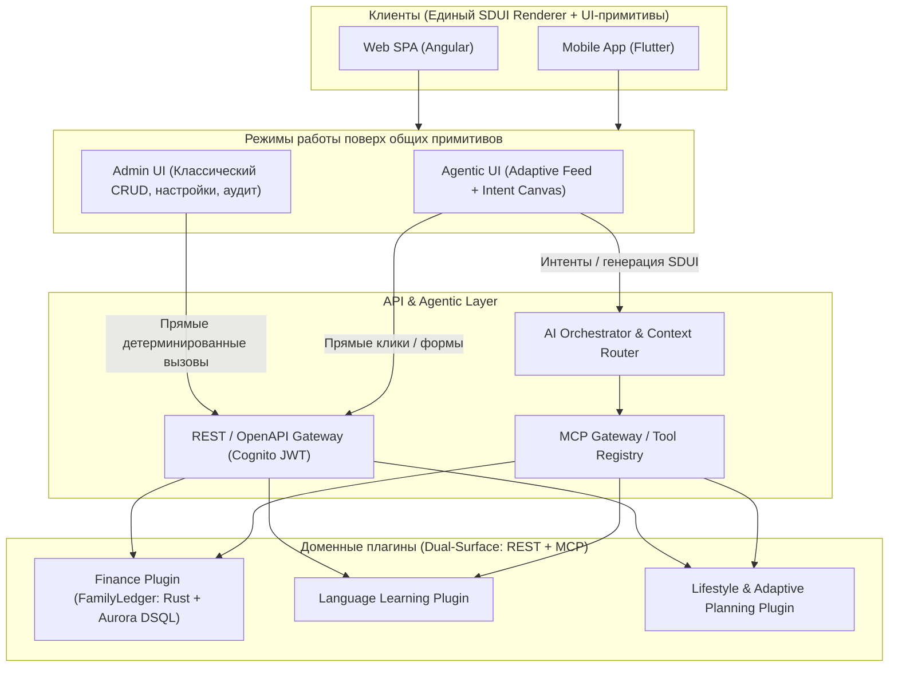

# Переосмысление Home Harmony: AI-Native & AI-First Платформа

> **Статус:** Рабочий документ для архитектурной дискуссии (RFC / Grill Me)  
> **Дата:** 2026-11-14  
> **Контекст:** Эволюция проекта **FamilyLedger** (`home-harmony`) в модульную AI-native платформу для управления жизнью и финансами.

---

## 1. Зафиксированные решения (Baseline)

По итогам первого раунда обсуждения зафиксированы следующие базовые принципы:

1. **Эволюция, а не переписывание с нуля:**
   Платформа развивается как эволюция **FamilyLedger** в модульную «зонтичную» систему (**Umbrella Life OS**), где финансовое ядро (`FamilyLedger`) становится **первым доменным модулем («плагином»)**. Вся существующая строгость финансового домена (`Decimal`, Aurora DSQL, OCC, RBAC, soft-deletes) сохраняется.
2. **Строго типизированный Декларативный UI (SDUI / A2UI):**
   Agentic UI не генерирует произвольный HTML/JS/CSS. Агент формирует **декларативное JSON-описание интерфейса** на базе строго типизированного каталога компонентов (подход SDUI / Adaptive Cards / A2UI). Клиент валидирует схему и рендерит нативные виджеты, с которыми пользователь взаимодействует мышкой или пальцем (кнопки, слайдеры, формы, подтверждения, графики, карточки).
3. **Единые UI-примитивы для Admin UI и Agentic UI на двух платформах:**
   * Оба режима — **Admin UI** (полный детерминированный доступ ко всем возможностям, настройкам и данным) и **Agentic UI** (адаптивный, контекстный интерфейс) — строятся из **одного и того же набора базовых UI-примитивов**.
   * Целевые клиентские платформы: **Web** (Angular) и **Mobile** (Flutter), использующие общий контракт декларативного UI.

---

## 2. Целевая архитектура (концептуальная схема)

### Ключевые архитектурные инварианты

1. **Dual-Surface Backend (REST + MCP):**
   Каждый доменный сервис/Lambda предоставляет два интерфейса поверх общей доменной логики (`domain/`):
   * **REST API (OpenAPI):** для быстрых детерминированных действий (нажатие кнопки в карточке, отправка формы, работа Admin UI).
   * **MCP API (Tools, Resources, Prompts):** для AI-оркестратора. Агент читает состояние через Resources/Read-tools и предлагает мутации через Command-tools.
2. **Безопасность и изоляция контекста (Zero-Trust к LLM):**
   * `family_id`, `user_id` и `role` (например, `Role::Child`) **никогда не передаются агентом как произвольный параметр** — они извлекаются из верифицированного **Cognito JWT** и пробрасываются в каждый REST- и MCP-вызов.
   * Критичные мутации (особенно финансовые) возвращают статус/требование подтверждения (`ApprovalCard` с явным diff «было -> станет»), которое пользователь подтверждает физическим кликом.
3. **Каталог компонентов как контракт (UI-as-Data):**
   * Реестр компонентов версионируется (например, `v1`: `MetricTile`, `ActionGroup`, `StructuredForm`, `ApprovalCard`, `DataTable`, `ChartCard`, `ChecklistCard`, `FlashcardDeck`, `TimelineBlock`).
   * И Angular, и Flutter реализуют рендерер этого каталога. Admin UI использует те же компоненты, но собирает их по статическим маршрутам/экранам, а Agentic UI — по динамическим JSON-декларациям от оркестратора.

---

## 3. Сравнение подходов: где критичные развилки

| Аспект | Вариант A (Детерминированный гибрид) | Вариант B (Чисто агентный цикл) | Рекомендация для обсуждения |
| :--- | :--- | :--- | :--- |
| **Обработка клика в SDUI** | Кнопка вызывает `REST endpoint` напрямую, агенту уходит только фоновое событие | Каждый клик идёт обратно в LLM, которая вызывает MCP-тул и перерисовывает UI | **Вариант A** (или гибрид `action_type: rest \| agent_step`), иначе UX будет тормозить на 2–5 сек на каждый клик |
| **Роль Admin UI** | Полноценный классический интерфейс без необходимости использовать AI + панель отладки агента | Только технический бэк-офис (таблицы, логи, права) | Нужно зафиксировать (см. Вопрос 1 ниже) |
| **Синхронизация Web + Mobile** | Единая JSON Schema каталога SDUI + кодогенерация типов (TypeScript + Dart) | Ручная поддержка схем в Angular и Flutter | **Кодогенерация** схем SDUI и OpenAPI в TS и Dart |

---

## 4. Открытые вопросы для следующих раундов (Grill Me)

Ниже — список вопросов, на которые нужно дать чёткие ответы перед проектированием контрактов и переходом к коду:

### Вопрос 1: Анатомия клика в Agentic UI
Когда агент сгенерировал карточку (например: *«Разнести 5 транзакций по категориям»* или *«Перенести тренировку на завтра 18:00»*) и пользователь нажимает кнопку **`[Применить]`**:
* Должен ли клик идти **напрямую в REST API** (мгновенно, без LLM, предсказуемо), а агент получает уведомление о результате?
* Или клик должен возвращаться в **AI-оркестратор**, чтобы он сразу пересчитал и перерисовал следующий экран/подсказку?
* *Компромисс:* в схеме кнопки явно задавать `action: { kind: "rest_call", ... } | { kind: "agent_intent", ... }`.

### Вопрос 2: Граница Admin UI
Когда мы говорим *«Admin UI for all needed possibilities»*, что именно это для пользователя:
* **(A) Классический режим (Fallback / Power-user):** Пользователь может открыть раздел «Финансы» или «Планировщик» и работать там полностью вручную, как в обычном приложении, не обращаясь к AI.
* **(B) Системный бэк-офис:** Место для управления модулями, ролями (`Role::Child`), просмотра логов MCP-вызовов, отладки и редких ручных правок, а вся ежедневная работа идёт через Agentic UI.

### Вопрос 3: Интерактивность сложных модулей (Языки, Лайфстайл)
Строгий каталог SDUI отлично покрывает формы, списки, графики, карточки подтверждения и расписания. Но в **изучении языков** (интерактивные упражнения, произношение, флеш-карты свайпами) или **трекинге привычек** могут понадобиться насыщенные виджеты.
* Готовы ли мы закладывать специализированные доменные виджеты в общий каталог (например, `FlashcardWidget`, `AudioPromptWidget`, `HabitHeatmapWidget`), которые реализуются нативно и в Angular, и в Flutter?

### Вопрос 4: Кросс-доменная синергия и хранение данных
Где заканчивается изоляция плагинов и начинается «зонтичная» магия?
* Пример синергии: *«Модуль лайфстайла видит покупку авиабилетов из модуля финансов -> предлагает план адаптации сна и мини-курс фраз на языке страны»*.
* Как это должно работать технически: через общую шину событий (**EventBridge** + центральный **User Context / Memory Graph**), или оркестратор сам опрашивает MCP-ресурсы разных плагинов по запросу пользователя?

### Вопрос 5: Где живёт AI Orchestrator и MCP-транспорт?
В `home-harmony` бэкенд построен на **Rust + AWS Lambda + Aurora DSQL**:
* Для детерминированных REST-сервисов и stateless MCP-тулов Lambda подходит идеально.
* Но **AI Orchestrator** (стриминг ответа, генерация SDUI-графа по частям, удержание контекста диалога/сессии, вызов нескольких MCP-тулов в цикле) плохо ложится на короткоживущие Lambda из-за cold starts и таймаутов.
* Допускаем ли мы выделение AI-оркестратора в отдельный stateful/streaming-сервис (например, ECS/Fargate, Bedrock AgentCore или отдельный сервис), оставляя доменные плагины в Rust Lambdas?

### Вопрос 6: Стек для новых плагинов (Languages, Lifestyle)
Обязаны ли все новые доменные плагины следовать всем **16 строгим правилам Aurora DSQL** (которые критичны для денег и ledger), или:
* **Транзакционное ядро (Finance)** остаётся на `Rust + Aurora DSQL`,
* А для **Languages / Lifestyle / AI Memory** (где нужны полнотекстовый поиск, векторные эмбеддинги для памяти, медиа-контент) допускаются специализированные хранилища (например, PostgreSQL + pgvector / DynamoDB / S3)?

---

## 5. Предлагаемый план следующих шагов

1. **Закрыть Вопросы 1–6** в следующем раунде обсуждения.
2. **Спроектировать SDUI Component Catalog v0.1** (JSON Schema + примеры экранов для Finance, Languages, Lifestyle).
3. **Определить контракт Dual-Surface для первого плагина (`Finance / FamilyLedger`)**: какие REST endpoints и какие MCP tools/resources он экспортирует, и как пробрасывается Cognito JWT.
4. **Оформить ADR** в `documentation/decisions/` по итогам согласованной архитектуры.
