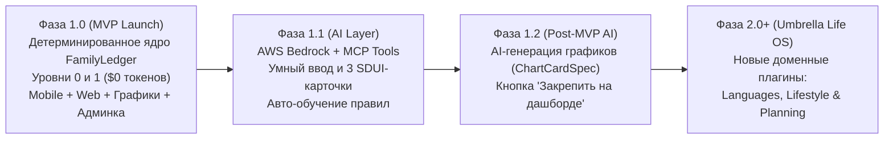

# Переосмысление Home Harmony: AI-Native & AI-First Платформа (Архитектурная спецификация)

> **Статус:** Согласованная архитектурная концепция и детальная спецификация (Раунд 4)  
> **Дата:** 2026-11-14  
> **Контекст:** Поэтапная эволюция **FamilyLedger** (`home-harmony`) — быстрый запуск детерминированного ядра (`AI = OFF`, \$0 токенов) с заложенным фундаментом под **AWS Bedrock**, **MCP** и **Декларативный UI (SDUI)**, а также последующее расширение в зонтичную платформу (**Umbrella Life OS**).

---

## 1. Зафиксированные стратегические решения

1. **Стратегия быстрого запуска (Deterministic First $\rightarrow$ AI Second):**
   * Чтобы запуститься максимально быстро и не распылять ресурсы, **реализация AI-слоя (AWS Bedrock + MCP) откладывается на Фазу 1.1 (сразу после запуска базового MVP)**.
   * Однако **все архитектурные решения под AI фиксируются уже сейчас**: фронтенд (Angular + Flutter) и бэкенд (Rust) сразу строятся вокруг **единых декларативных UI-примитивов** и **движка правил Уровня 1**, чтобы подключение AWS Bedrock на следующем этапе не потребовало переделки экранов или БД.
2. **Трёхступенчатая воронка стоимости (Tiered Cost Funnel):**
   * **Уровень 0 (\$0 — Прямой REST API):** Все клики, формы, фильтры, стандартные графики и подтверждения карточек идут напрямую в Rust REST API.
   * **Уровень 1 (\$0 — Детерминированные правила и математика в Rust):** Авто-категоризация по правилам (мерчант/описание $\rightarrow$ категория), SQL-агрегации бюджетов, расчёт погашения кредитов (*Snowball / Avalanche* на `rust_decimal::Decimal`).
   * **Уровень 2 (Токены AWS Bedrock — Фаза 1.1):** Вызывается **только по явному нажатию кнопки «Умный ввод / Спросить AI»** (или для еженедельного дайджеста). Никогда не триггерится автоматически на события БД.
3. **Самообучение правил (AI $\rightarrow$ Rule Graduation):**
   * Любое новое сопоставление «магазин/описание $\rightarrow$ категория», созданное вручную или (в Фазе 1.1) предложенное через AI, при нажатии `[Сохранить]` записывается в таблицу детерминированных правил БД и дальше работает бесплатно на Уровне 1.
4. **Единые UI-примитивы на двух платформах (Web + Mobile):**
   * **Mobile UI (Flutter):** Фокус на скорости и удобстве одной рукой (ввод расхода за 3 секунды, остатки конвертов бюджета, карточки быстрых действий).
   * **Web UI (Angular):** Весь функционал Mobile UI + **аналитические графики на большом экране** + **Админка (Control Plane)** для управления ролями (`Role::Child` и др.), правилами, модулями и аудитом.
5. **Актуальность документации Aurora DSQL:**
   * За эталон принята актуальная спецификация в `documentation/architecture/aurora-dsql.md` и `database-schema.md` (с поддержкой `FOREIGN KEY ... REFERENCES`, нативного типа `JSONB`, UUID v4/v7 и `CREATE INDEX ASYNC`). Расхождения в `AGENTS.md`, `GEMINI.md` и `backend/migrations/README.md` устранены.

---

## 2. Дорожная карта фаз развития (Phased Rollout)



---

## 3. Детализация: Единый каталог UI-примитивов и SDUI-карточек (v1)

Ключевая идея: **одни и те же карточки используются и в детерминированном MVP (Фаза 1.0), и при подключении AI (Фаза 1.1)**. Разница лишь в том, *кто* заполнил JSON-данные для карточки — обычный Rust-код (например, из шаблона регулярного платежа) или AWS Bedrock (из голосового ввода).

### 3.1. `TransactionDraftCard` (Карточка черновика транзакции / сплита)
* **Где работает в Фазе 1.0 (Без AI):** Подтверждение регулярного платежа по расписанию, повтор частой операции в 1 тап, разбор импортированной строки из банковской выписки.
* **Где работает в Фазе 1.1 (С AI):** Результат разбора фразы *«Заправился на 1800 и купил кофе за 95 с карты Моно»* или фото чека.
* **Интерактивные элементы (мышкой / пальцем):**
  * Выбор/смена иконки категории (выпадающий пикер);
  * Быстрое редактирование суммы (`Decimal` как строка);
  * Галочка `☑ Всегда относить "<merchant>" к категории "<category>"` (создаёт детерминированное правило Уровня 1!);
  * Кнопки `[Сохранить]` (прямой `POST /api/v1/transactions`) и `[Отмена]`.

```json
{
  "card_type": "transaction_draft",
  "version": "1.0",
  "source": "deterministic_rule",
  "title": "Подтверждение операции",
  "items": [
    {
      "kind": "expense",
      "amount_value": "1800.00",
      "amount_currency": "UAH",
      "source_account_id": "acc-uuid-mono",
      "category_id": "cat-uuid-fuel",
      "merchant_raw": "OKKO АЗС",
      "description": "Заправка",
      "occurred_at": "2026-11-14T18:30:00Z",
      "save_as_rule": true
    }
  ],
  "primary_action": {
    "label": "Сохранить",
    "kind": "rest_call",
    "method": "POST",
    "endpoint": "/api/v1/transactions/batch"
  }
}
```

### 3.2. `BudgetRebalanceCard` (Карточка балансировки конвертов бюджета)
* **Где работает в Фазе 1.0 (Без AI):** Детерминированный триггер, когда расход в конверте превысил 100% лимита — система предлагает покрыть минус из конверта с самым большим свободным остатком.
* **Где работает в Фазе 1.1 (С AI):** Умное перераспределение сразу между несколькими конвертами с учётом оставшихся дней месяца и предстоящих обязательных платежей.
* **Интерактивные элементы:**
  * Наглядный индикатор «Было $\rightarrow$ Станет» для каждого конверта;
  * Ползунок (Slider) для корректировки переносимой суммы пальцем/мышкой;
  * Кнопка `[Применить перенос]` (прямой `PATCH /api/v1/budgets/{year}/{month}/rebalance`).

```json
{
  "card_type": "budget_rebalance",
  "version": "1.0",
  "title": "Перерасход в категории «Кафе и рестораны»",
  "transfers": [
    {
      "from_envelope_id": "env-uuid-entertainment",
      "from_name": "Развлечения",
      "to_envelope_id": "env-uuid-restaurants",
      "to_name": "Кафе и рестораны",
      "suggested_amount": "40.00",
      "max_available": "120.00",
      "currency": "USD"
    }
  ],
  "primary_action": {
    "label": "Перенести $40.00",
    "kind": "rest_call",
    "method": "PATCH",
    "endpoint": "/api/v1/budgets/current/rebalance"
  }
}
```

### 3.3. `DebtScenarioCard` (Карточка сравнения стратегий погашения долга)
* **Где работает в Фазе 1.0 (Без AI):** Калькулятор в разделе «Кредиты» — пользователь двигает ползунок «Дополнительный платёж в месяц (+\$100)», а Rust-бэкенд за миллисекунды возвращает сравнение стратегий *Avalanche (Лавина)* и *Snowball (Снежный ком)*.
* **Где работает в Фазе 1.1 (С AI):** Моделирование сложных словесных сценариев (*«В декабре внесу бонус \$1000, а в январе возьму паузу»*).
* **Интерактивные элементы:**
  * Переключатель вкладок `Avalanche (Меньше переплата)` $\leftrightarrow$ `Snowball (Быстрее закрытие первого кредита)`;
  * Показатели экономии на процентах (`interest_saved`) и сокращения срока (в месяцах);
  * Кнопка `[Активировать этот план]` (прямой `POST /api/v1/debt/plans`).

### 3.4. `ApprovalRequestCard` (Семейное согласование / `Role::Child`)
* **Назначение:** Когда ребёнок (`Role::Child`) нажимает у себя в Mobile UI «Попросить на карманные расходы» или когда второй взрослый предлагает изменение месячного бюджета (по `ADR-0013` утверждает `Owner`), владельцу семьи приходит карточка с кнопками `[✓ Одобрить]` и `[✕ Отклонить]`.

---

## 4. Детализация Web UI (Angular): Предустановленные графики (Фаза 1.0 — \$0 токенов)

В Web UI на большом экране реализуются **5 предустановленных аналитических виджетов**, которые работают поверх детерминированных `BEGIN READ ONLY` запросов к Aurora DSQL:

| № | Название графика | Тип визуализации | Какую задачу решает для семьи |
| :--- | :--- | :--- | :--- |
| **1** | **Денежный поток месяца (Cashflow Flow)** | `Sankey Diagram` / `Waterfall` | Показывает на одном экране путь денег: *Все доходы семьи* $\rightarrow$ *Обязательные счета и Кредиты* $\rightarrow$ *Конверты расходов* $\rightarrow$ *Чистый остаток / Цели*. |
| **2** | **Динамика Доходы vs Расходы (6–12 мес.)** | `Grouped Bar + Net Line` | Столбцы доходов и расходов по месяцам + линия чистого сбережения (Net Savings Rate в % и валюте семьи). |
| **3** | **Структура трат (Категории и Участники)** | `Donut Chart` / `Treemap` (с кликом вглубь) | Распределение расходов по категориям. При клике мышкой на сектор «Продукты» показывает разбивку по членам семьи и магазинам. |
| **4** | **Пульс конвертов бюджета (План / Факт)** | `Bullet Chart` / `Progress Bars` | Горизонтальные полосы всех конвертов текущего месяца с вертикальной отметкой «сегодняшний день месяца» (сразу видно, обгоняют ли траты темп месяца). |
| **5** | **Траектория свободы от долгов (Debt Payoff)** | `Stacked Area Timeline` | График уменьшения тела всех кредитов по месяцам до `0.00` с наглядным сравнением текущей траектории и ускоренного плана (*Avalanche / Snowball*). |

> **Задел под Фазу 1.2 (Post-MVP):** Все 5 графиков рендерятся через единый Angular-компонент `<app-chart-card [spec]="chartSpec">`. Когда в Post-MVP мы включим генерацию графиков через AI, агент будет просто возвращать JSON того же формата `ChartCardSpec`, а пользователь сможет закреплять их кнопкой **`[📌 Закрепить на дашборде]`**.

---

## 5. Детализация Web-админки (Control Plane в Angular)

Web-интерфейс включает специальный раздел **Admin / Управление системой** (доступен для `Role::Owner`):

1. **Управление семьёй и правами (Family & RBAC):**
   * Список участников семьи, генерация одноразовых инвайт-ссылок (`InviteToken`), смена ролей (`Owner`, `Member`, `Child`, `Other`).
   * Визуальный редактор матрицы прав (`permissions` JSONB) для роли `Role::Other` (например, бабушка или няня) и жёсткая индикация ограничений `Role::Child` (блокировка кредитов и отчётов семьи по Правилу №16).
2. **Движок правил авто-категоризации (Deterministic Rules Engine — Уровень 1):**
   * Таблица правил: `Условие (содержит текст / точное совпадение мерчанта) -> Категория + Теги`.
   * Возможность создавать правила вручную, тестировать их на прошлых транзакциях и редактировать правила, созданные автоматически при вводе трат.
3. **Журнал аудита и бухгалтерских корректировок (Ledger Inspector):**
   * Полный табличный просмотр `ledger_transactions` с фильтрами и keyset-пагинацией.
   * Инструмент оформления корректировок (`Amendment / Reversal` по `ADR-0012`) с наглядной цепочкой `исходная транзакция -> корректирующая транзакция`.
   * Статус фоновых задач БД (мониторинг `sys.jobs` для асинхронных индексов Aurora DSQL).
4. **Управление модулями и AI Control Center (задел под Фазу 1.1 и Фазу 2.0):**
   * Реестр подключённых плагинов (сейчас активен `FamilyLedger`; будущие слоты: `Language Learning`, `Lifestyle Planner`).
   * Панель управления AI (в Фазе 1.0 отображает статус `AI Mode: Disabled (Deterministic Mode — $0.00)`):
     * Глобальный переключатель `AI Enabled / Disabled`;
     * Разрешение AI по ролям (например, выключить для `Role::Child`);
     * Месячный лимит расходов на AWS Bedrock (в \$) и журнал всех MCP/AI-вызовов с подсчётом токенов.

---

## 6. Схема таблиц, добавляемых для поддержки правил Уровня 1 и Админки

Чтобы заложить этот фундамент в БД с соблюдением всех правил Aurora DSQL (1 DDL на файл, `UUID` PK, `REFERENCES`, `JSONB`), к базовой схеме добавляются 2 легковесные таблицы:

### 6.1. `ledger_categorization_rules` (Для работы Уровня 1 за \$0 токенов)
```sql
CREATE TABLE ledger_categorization_rules (
  id              UUID PRIMARY KEY DEFAULT gen_random_uuid(),
  family_id       UUID          NOT NULL REFERENCES family_families(id),
  match_pattern   VARCHAR(200)  NOT NULL,
  match_kind      VARCHAR(20)   NOT NULL DEFAULT 'contains' CHECK (match_kind IN ('exact','contains','prefix')),
  category_id     UUID          NOT NULL REFERENCES ledger_categories(id),
  default_tags    JSONB         NOT NULL DEFAULT '[]'::jsonb,
  source          VARCHAR(20)   NOT NULL DEFAULT 'manual' CHECK (source IN ('manual','learned_from_input','ai_suggested')),
  priority        SMALLINT      NOT NULL DEFAULT 0,
  created_at      TIMESTAMPTZ   NOT NULL DEFAULT now(),
  deleted_at      TIMESTAMPTZ
);
```

### 6.2. `family_system_settings` (Настройки модулей и AI FinOps для Web-админки)
```sql
CREATE TABLE family_system_settings (
  family_id               UUID PRIMARY KEY REFERENCES family_families(id),
  enabled_modules         JSONB         NOT NULL DEFAULT '["finance"]'::jsonb,
  ai_enabled              BOOLEAN       NOT NULL DEFAULT false,
  ai_allow_for_children   BOOLEAN       NOT NULL DEFAULT false,
  ai_monthly_limit_usd    NUMERIC(10,2) NOT NULL DEFAULT 0.00,
  updated_at              TIMESTAMPTZ   NOT NULL DEFAULT now()
);
```
