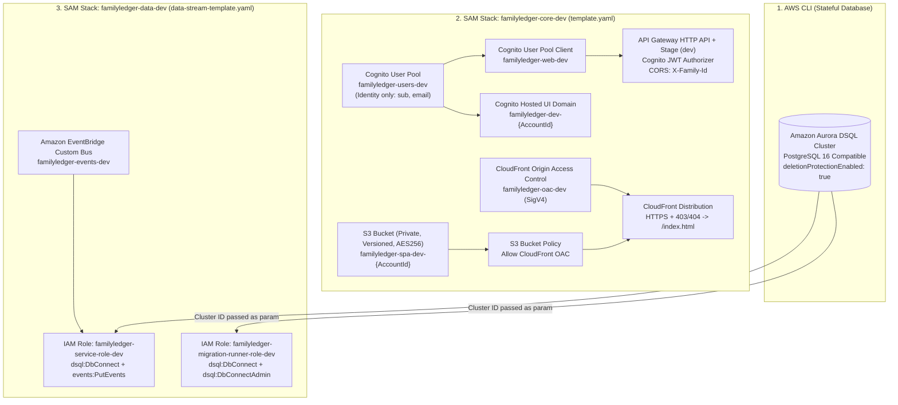

# AWS Bootstrap, Recreation & Teardown Guide — FamilyLedger

> **Scope**: End-to-end operational runbook for bootstrapping, cleanly recreating (after [`ADR-0011`](../decisions/0011-multi-family-membership.md) and [`ADR-0017`](../decisions/0017-cdc-and-event-publishing-strategies.md) refactorings), verifying, and completely removing all AWS infrastructure provisioned during completed [Sprint 1](../roadmap/sprint-1/sprint_1_plan.md) tasks (`Task 1.1` and `Task 1.2`).

---

## 1. Provisioned AWS Objects Inventory (Sprint 1)

All AWS infrastructure created in completed Sprint 1 tasks is split across **one AWS CLI-managed database cluster** and **two AWS SAM / CloudFormation stacks** located in [`backend/infrastructure/sam/`](../../backend/infrastructure/sam/README.md). Every component runs at **`$0.00` idle cost**.



### Summary Table of AWS Objects

| Provisioning Source | Stack / Resource Name | AWS Resource Type | Purpose & ADR Alignment | Idle Cost |
| :--- | :--- | :--- | :--- | :--- |
| **AWS CLI** (`Task 1.2`) | `4bublzlvvtnwjpmgtotwrulv7m` *(or newly generated ID)* | `AWS::DSQL::Cluster` | Serverless active-active PostgreSQL 16 database ([`ADR-0001`](../decisions/0001-aurora-dsql-serverless-db.md)) | **$0.00** |
| **SAM: `familyledger-core-dev`** (`Task 1.1`) | `FamilyLedgerUserPool` (`familyledger-users-dev`) | `AWS::Cognito::UserPool` | Identity-only user pool (`sub`, `email`). No custom `family_id`/`family_role` schema attributes ([`ADR-0011`](../decisions/0011-multi-family-membership.md)) | **$0.00** |
| **SAM: `familyledger-core-dev`** (`Task 1.1`) | `FamilyLedgerWebAppClient` (`familyledger-web-dev`) | `AWS::Cognito::UserPoolClient` | OAuth2 Code Grant / SRP public client for Web & Mobile | **$0.00** |
| **SAM: `familyledger-core-dev`** (`Task 1.1`) | `FamilyLedgerUserPoolDomain` (`familyledger-dev-{AccountId}`) | `AWS::Cognito::UserPoolDomain` | Cognito Hosted UI OAuth2 domain | **$0.00** |
| **SAM: `familyledger-core-dev`** (`Task 1.1`) | `FamilyLedgerApi` + `FamilyLedgerApiStage` (`dev`) | `AWS::Serverless::HttpApi` | HTTPS API front-door with Cognito JWT Authorizer and `X-Family-Id` CORS header ([`ADR-0011`](../decisions/0011-multi-family-membership.md)) | **$0.00** |
| **SAM: `familyledger-core-dev`** (`Task 1.1`) | `FamilyLedgerSpaBucket` (`familyledger-spa-dev-{AccountId}`) | `AWS::S3::Bucket` | Private, AES-256 encrypted, versioned bucket for Angular SPA assets | **$0.00** |
| **SAM: `familyledger-core-dev`** (`Task 1.1`) | `FamilyLedgerSpaBucketPolicy` | `AWS::S3::BucketPolicy` | Grants `s3:GetObject` exclusively to the CloudFront distribution ARN | **$0.00** |
| **SAM: `familyledger-core-dev`** (`Task 1.1`) | `FamilyLedgerCdnOac` (`familyledger-oac-dev`) | `AWS::CloudFront::OriginAccessControl` | SigV4 Origin Access Control bridging CloudFront to private S3 | **$0.00** |
| **SAM: `familyledger-core-dev`** (`Task 1.1`) | `FamilyLedgerCdn` | `AWS::CloudFront::Distribution` | Edge HTTPS CDN with 403/404 SPA routing fallback to `/index.html` | **$0.00** |
| **SAM: `familyledger-data-dev`** (`Task 1.2`) | `FamilyLedgerEventBus` (`familyledger-events-dev`) | `AWS::Events::EventBus` | Custom domain event bus; replaces Kinesis Data Stream ([`ADR-0017`](../decisions/0017-cdc-and-event-publishing-strategies.md)) | **$0.00** |
| **SAM: `familyledger-data-dev`** (`Task 1.2`) | `FamilyLedgerServiceRole` (`familyledger-service-role-dev`) | `AWS::IAM::Role` | Microservice Lambda role: `dsql:DbConnect` + `events:PutEvents` | **$0.00** |
| **SAM: `familyledger-data-dev`** (`Task 1.2`) | `FamilyLedgerMigrationRunnerRole` (`familyledger-migration-runner-role-dev`) | `AWS::IAM::Role` | Migration Runner role: `dsql:DbConnect` + `dsql:DbConnectAdmin` | **$0.00** |
| **SAM CLI Managed** | `aws-sam-cli-managed-default` | CloudFormation Stack + S3 Bucket | Auto-created by SAM (`resolve_s3 = true`) to stage CloudFormation templates | **$0.00** |

---

## 2. Why Clean Recreation Is Required After Refactoring

Recent domain and architectural refactorings introduced two breaking infrastructure changes that require recreating existing Sprint 1 stacks:

1. **Multi-Family Membership & `X-Family-Id` Header ([`ADR-0011`](../decisions/0011-multi-family-membership.md))**:
   - Legacy Cognito User Pools had custom schema attributes (`custom:family_id`, `custom:family_role`).
   - **AWS Cognito Limitation**: CloudFormation cannot delete custom schema attributes from an existing `AWS::Cognito::UserPool` in-place. `familyledger-core-dev` must be deleted and re-deployed so a clean identity-only User Pool (`sub`, `email`) and updated API Gateway CORS (`AllowHeaders` including `X-Family-Id`) are provisioned.
2. **Direct EventBridge Domain Event Publishing ([`ADR-0017`](../decisions/0017-cdc-and-event-publishing-strategies.md))**:
   - Amazon Kinesis Data Stream was removed from `data-stream-template.yaml` to eliminate continuous hourly shard charges (`$10.80–$28.80/month`).
   - Re-deploying (or recreating) `familyledger-data-dev` ensures any legacy Kinesis stream is removed and only `FamilyLedgerEventBus`, `FamilyLedgerServiceRole`, and `FamilyLedgerMigrationRunnerRole` remain active.

---

## 3. Prerequisites & Deployer IAM Permissions

### 3.1 CLI Tools & Authentication
Verify that the AWS CLI v2 and AWS SAM CLI are installed and authenticated against your target account (`us-east-1`):

```powershell
aws --version
sam --version
aws sts get-caller-identity
```

### 3.2 Deployer IAM Inline Policy
Because `familyledger-data-dev` creates named IAM roles (`familyledger-service-role-dev` and `familyledger-migration-runner-role-dev`), your IAM deployer user (e.g., `programmer-user`) must have permissions to manage `familyledger-*` roles. If not already attached, add the inline policy `FamilyLedgerDeployerRoleManagementPolicy` (replace `377161178071` with your AWS `AccountId` if different):

```json
{
    "Version": "2012-10-17",
    "Statement": [
        {
            "Sid": "AllowIamRoleLifecycleManagement",
            "Effect": "Allow",
            "Action": [
                "iam:CreateRole",
                "iam:DeleteRole",
                "iam:GetRole",
                "iam:AttachRolePolicy",
                "iam:DetachRolePolicy",
                "iam:PutRolePolicy",
                "iam:DeleteRolePolicy",
                "iam:GetRolePolicy",
                "iam:TagRole"
            ],
            "Resource": "arn:aws:iam::377161178071:role/familyledger-*"
        },
        {
            "Sid": "AllowPassRoleToLambda",
            "Effect": "Allow",
            "Action": "iam:PassRole",
            "Resource": "arn:aws:iam::377161178071:role/familyledger-*",
            "Condition": {
                "StringEquals": {
                    "iam:PassedToService": "lambda.amazonaws.com"
                }
            }
        }
    ]
}
```

---

## 4. How to Deploy (Bootstrap) the Entire System to AWS

Follow these steps in order when bootstrapping a fresh environment or after running the complete teardown in [Section 6](#6-how-to-remove-teardown-all-aws-objects).

### Step 1: Provision (or Verify) the Amazon Aurora DSQL Cluster

We provision Aurora DSQL first because its 26-character cluster identifier (`DsqlClusterIdentifier`) is required as a parameter by the IAM roles in `familyledger-data-dev`.

```powershell
# Check if an Aurora DSQL cluster already exists in us-east-1
aws dsql list-clusters --region us-east-1
```

If no cluster exists, create a new one:

```powershell
aws dsql create-cluster `
  --region us-east-1 `
  --tags Environment=dev,Project=FamilyLedger
```

Capture the `"identifier"` from the output (e.g., `4bublzlvvtnwjpmgtotwrulv7m`) and wait until `"status"` reaches `"ACTIVE"`:

```powershell
$DSQL_ID = "<YOUR_DSQL_CLUSTER_ID>"
aws dsql get-cluster --identifier $DSQL_ID --region us-east-1
```

> [!TIP]
> Record the new cluster JSON output in `backend/.aws-resources.md` and update `DsqlClusterIdentifier` in `backend/infrastructure/sam/samconfig-data.toml` if the cluster ID changed.

---

### Step 2: Deploy the Core Stack (`familyledger-core-dev`)

Provisions Cognito User Pool, App Client, Hosted UI Domain, API Gateway HTTP API (`dev`), S3 SPA Bucket, CloudFront OAC, and CloudFront Distribution.

```powershell
cd c:\Users\demiu\my-rust-projects\home-harmony\backend\infrastructure\sam

# 1. Validate the CloudFormation/SAM template
sam validate -t template.yaml --lint

# 2. Deploy familyledger-core-dev
sam deploy `
  --template-file template.yaml `
  --config-file samconfig.toml `
  --no-confirm-changeset
```

*(Omit `--no-confirm-changeset` if you want to review and confirm the CloudFormation changeset interactively with `y`.)*

---

### Step 3: Deploy the Data & Event Bus Stack (`familyledger-data-dev`)

Provisions the custom EventBridge bus (`familyledger-events-dev`) and least-privilege IAM roles (`familyledger-service-role-dev`, `familyledger-migration-runner-role-dev`) scoped to your Aurora DSQL cluster ARN.

```powershell
cd c:\Users\demiu\my-rust-projects\home-harmony\backend\infrastructure\sam

# 1. Validate the data & event template
sam validate -t data-stream-template.yaml --lint

# 2. Deploy familyledger-data-dev (passing your active DSQL cluster ID)
sam deploy `
  --template-file data-stream-template.yaml `
  --config-file samconfig-data.toml `
  --capabilities CAPABILITY_NAMED_IAM `
  --parameter-overrides "Environment=dev DsqlClusterIdentifier=$DSQL_ID" `
  --no-confirm-changeset
```

---

### Step 4: Synchronize Outputs to `backend/.env.dev` & Verify

Query the CloudFormation stack outputs and update `backend/.env.dev` (using `backend/.env.example` as template):

```powershell
# Print Core Stack outputs (CognitoUserPoolId, CognitoWebAppClientId, ApiGatewayUrl, CloudFrontUrl)
aws cloudformation describe-stacks `
  --stack-name familyledger-core-dev `
  --region us-east-1 `
  --query "Stacks[0].Outputs" `
  --output table

# Print Data Stack outputs (EventBusArn, EventBusName, ServiceRoleArn, MigrationRunnerRoleArn)
aws cloudformation describe-stacks `
  --stack-name familyledger-data-dev `
  --region us-east-1 `
  --query "Stacks[0].Outputs" `
  --output table

# Verify EventBridge Bus is live
aws events describe-event-bus --name familyledger-events-dev --region us-east-1
```

Populate `backend/.env.dev` (gitignored) with the outputs:

```ini
AWS_REGION=us-east-1
ENVIRONMENT=dev

COGNITO_USER_POOL_ID=<CognitoUserPoolId>
COGNITO_CLIENT_ID=<CognitoWebAppClientId>
COGNITO_ISSUER=https://cognito-idp.us-east-1.amazonaws.com/<CognitoUserPoolId>

API_GATEWAY_URL=<ApiGatewayUrl>
CLOUDFRONT_URL=<CloudFrontUrl>

DSQL_CLUSTER_ID=<YOUR_DSQL_CLUSTER_ID>
DSQL_ENDPOINT=<YOUR_DSQL_CLUSTER_ID>.dsql.us-east-1.on.aws
DATABASE_URL=postgres://admin@<YOUR_DSQL_CLUSTER_ID>.dsql.us-east-1.on.aws:5432/postgres?sslmode=require

EVENT_BUS_NAME=familyledger-events-dev
```

---

## 5. Quick Recreation Workflow (Keeping or Recreating After Refactoring)

If you already have an older deployment in AWS and want to **recreate all Sprint 1 AWS objects cleanly** to match the latest domain model and ADRs:

1. **If you want a 100% fresh start (including a fresh Aurora DSQL cluster)**:
   - Run the complete removal steps in **[Section 6](#6-how-to-remove-teardown-all-aws-objects)** first, then run **[Section 4](#4-how-to-deploy-bootstrap-the-entire-system-to-aws)**.
2. **If your Aurora DSQL cluster (`$DSQL_ID`) is empty/clean and you only want to recreate the SAM stacks (`familyledger-core-dev` and `familyledger-data-dev`)**:
   ```powershell
   cd c:\Users\demiu\my-rust-projects\home-harmony\backend\infrastructure\sam

   # 1. Tear down existing SAM stacks
   sam delete --stack-name familyledger-core-dev --region us-east-1 --no-prompts
   sam delete --stack-name familyledger-data-dev --region us-east-1 --no-prompts

   # 2. Re-deploy both stacks cleanly from current templates
   sam deploy --template-file template.yaml --config-file samconfig.toml --no-confirm-changeset
   sam deploy --template-file data-stream-template.yaml --config-file samconfig-data.toml --capabilities CAPABILITY_NAMED_IAM --no-confirm-changeset
   ```

---

## 6. How to Remove (Teardown) All AWS Objects

To remove the entire system from AWS with **zero leftover resources or hidden charges**, execute the teardown in reverse dependency order.

> [!WARNING]
> **Two AWS Protections Will Block Deletion Unless Handled First**:
> 1. **S3 Bucket Versioning (`FamilyLedgerSpaBucket`)**: CloudFormation cannot delete an S3 bucket that contains objects, historical object versions, or delete markers.
> 2. **Aurora DSQL Deletion Protection**: Aurora DSQL clusters enable `deletionProtectionEnabled: true` by default. You must disable deletion protection before calling `delete-cluster`.

### Step 1: Delete the Data & Event Bus Stack (`familyledger-data-dev`)

Removes `FamilyLedgerEventBus`, `FamilyLedgerServiceRole`, and `FamilyLedgerMigrationRunnerRole`:

```powershell
sam delete --stack-name familyledger-data-dev --region us-east-1 --no-prompts
```

---

### Step 2: Empty the SPA S3 Bucket (If Non-Empty) and Delete the Core Stack (`familyledger-core-dev`)

1. **Empty `familyledger-spa-dev-<AccountId>`** (only required if files were uploaded to the SPA bucket):
   ```powershell
   $ACCOUNT_ID = (aws sts get-caller-identity --query Account --output text)
   $SPA_BUCKET = "familyledger-spa-dev-$ACCOUNT_ID"

   # Remove current objects
   aws s3 rm "s3://$SPA_BUCKET" --recursive --region us-east-1
   ```
   *(If versioned objects or delete markers exist in the bucket, delete them via AWS Console $\rightarrow$ S3 $\rightarrow$ select bucket $\rightarrow$ **Empty** $\rightarrow$ type `permanently delete`, then proceed.)*

2. **Delete `familyledger-core-dev`** (removes CloudFront distribution, OAC, S3 bucket & policy, API Gateway HTTP API, and Cognito User Pool/Client/Domain):
   ```powershell
   sam delete --stack-name familyledger-core-dev --region us-east-1 --no-prompts
   ```
   > [!NOTE]
   > CloudFront distributions typically take **3–8 minutes** to disable and deprovision during CloudFormation stack deletion.

---

### Step 3: Disable Deletion Protection & Delete the Aurora DSQL Cluster

```powershell
# 1. Identify active DSQL cluster ID
aws dsql list-clusters --region us-east-1
$DSQL_ID = "<YOUR_DSQL_CLUSTER_ID>"

# 2. Disable deletion protection (enabled by default on cluster creation)
aws dsql update-cluster `
  --identifier $DSQL_ID `
  --no-deletion-protection-enabled `
  --region us-east-1

# 3. Delete the Aurora DSQL cluster
aws dsql delete-cluster `
  --identifier $DSQL_ID `
  --region us-east-1
```

---

### Step 4 (Optional): Remove the SAM CLI Managed Packaging Stack

When `sam deploy` runs with `resolve_s3 = true`, SAM creates a shared helper stack named `aws-sam-cli-managed-default` containing an S3 staging bucket for CloudFormation templates. Keep it if you plan to redeploy soon, or remove it for a completely clean AWS account:

```powershell
sam delete --stack-name aws-sam-cli-managed-default --region us-east-1 --no-prompts
```

---

### Step 5: Verify Complete Removal

Run the following verification checks to confirm zero FamilyLedger objects remain in AWS:

```powershell
# 1. Verify no active CloudFormation stacks remain
aws cloudformation list-stacks `
  --region us-east-1 `
  --stack-status-filter CREATE_COMPLETE UPDATE_COMPLETE ROLLBACK_COMPLETE DELETE_FAILED `
  --query "StackSummaries[?starts_with(StackName, 'familyledger')].[StackName,StackStatus]" `
  --output table

# 2. Verify no Aurora DSQL clusters remain (or status is DELETING)
aws dsql list-clusters --region us-east-1

# 3. Verify no custom EventBridge buses remain
aws events list-event-buses --region us-east-1 --query "EventBuses[?starts_with(Name, 'familyledger')]"

# 4. Verify no Cognito User Pools remain
aws cognito-idp list-user-pools --max-results 20 --region us-east-1 --query "UserPools[?starts_with(Name, 'familyledger')]"
```
