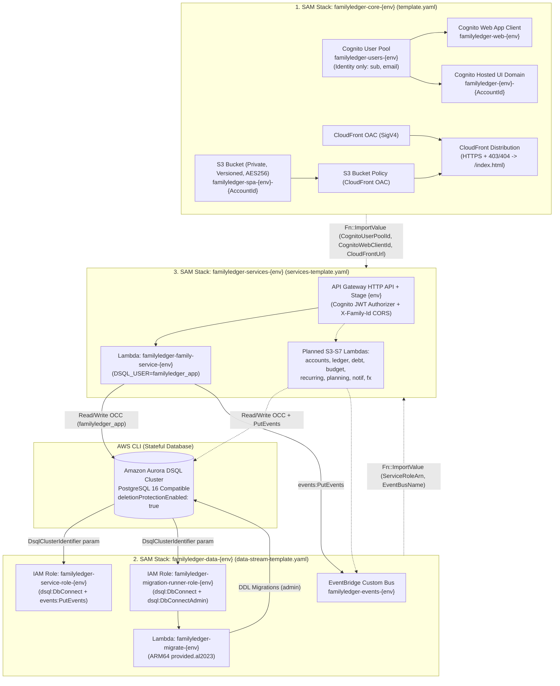

# AWS Deployment, Operations & Teardown Guide — FamilyLedger

> **Scope**: Authoritative product-wide runbook for bootstrapping, operating, scaling across environments (`dev`, `staging`, `prod`), upgrading, recreating, and completely tearing down all FamilyLedger AWS infrastructure under the **Option B2 (3-Stack 1-Way DAG)** architecture (`services` $\rightarrow$ `core` & `data`). Every component operates at **`$0.00` idle cost**.
>
> Upgrading an existing **Sprint 1** environment to **Sprint 2**? Use the focused upgrade guide: [`sprint-2/aws-deployment-guide.md`](../roadmap/sprint-2/aws-deployment-guide.md).

---

## 1. Architecture & Provisioned AWS Objects (Option B2)

FamilyLedger isolates stateful/edge assets, shared IAM/event foundations, and stateless compute across **one AWS CLI-managed Aurora DSQL cluster** and **three AWS SAM stacks** in [`backend/infrastructure/sam/`](../../backend/infrastructure/sam/README.md). This 1-way Directed Acyclic Graph ensures frequent Lambda/API deployments in `services` never touch Cognito User Pools, S3, CloudFront, or database state.



### Complete AWS Resource Inventory

| Provisioning Layer | Logical / Physical Resource | AWS Resource Type | Role & ADR Alignment | Idle Cost |
| :--- | :--- | :--- | :--- | :--- |
| **AWS CLI** | `<DSQL_CLUSTER_ID>` | `AWS::DSQL::Cluster` | Serverless active-active PostgreSQL 16 database ([`ADR-0001`](../decisions/0001-aurora-dsql-serverless-db.md)) | **$0.00** |
| **SAM `core`** (`template.yaml`) | `FamilyLedgerUserPool` (`familyledger-users-{env}`) | `AWS::Cognito::UserPool` | Identity-only Cognito user pool (`sub`, `email`); no tenant schema attributes ([`ADR-0011`](../decisions/0011-multi-family-membership.md)) | **$0.00** |
| **SAM `core`** (`template.yaml`) | `FamilyLedgerWebAppClient` (`familyledger-web-{env}`) | `AWS::Cognito::UserPoolClient` | Public OAuth2 Authorization Code + SRP client (`IdToken`/`AccessToken` 1h, refresh 30d) | **$0.00** |
| **SAM `core`** (`template.yaml`) | `FamilyLedgerUserPoolDomain` (`familyledger-{env}-{AccountId}`) | `AWS::Cognito::UserPoolDomain` | Cognito Hosted UI OAuth2 endpoints | **$0.00** |
| **SAM `core`** (`template.yaml`) | `FamilyLedgerSpaBucket` (`familyledger-spa-{env}-{AccountId}`) | `AWS::S3::Bucket` | Private, AES-256 encrypted, versioned bucket for Angular SPA assets | **$0.00** |
| **SAM `core`** (`template.yaml`) | `FamilyLedgerSpaBucketPolicy` + `FamilyLedgerCdnOac` | `BucketPolicy` + `OriginAccessControl` | SigV4 OAC restricting `s3:GetObject` to CloudFront | **$0.00** |
| **SAM `core`** (`template.yaml`) | `FamilyLedgerCdn` | `AWS::CloudFront::Distribution` | Edge HTTPS CDN with `403`/`404` $\rightarrow$ `/index.html` SPA fallback | **$0.00** |
| **SAM `data`** (`data-stream-template.yaml`) | `FamilyLedgerEventBus` (`familyledger-events-{env}`) | `AWS::Events::EventBus` | Custom domain event bus replacing Kinesis Data Streams ([`ADR-0017`](../decisions/0017-cdc-and-event-publishing-strategies.md)) | **$0.00** |
| **SAM `data`** (`data-stream-template.yaml`) | `FamilyLedgerServiceRole` (`familyledger-service-role-{env}`) | `AWS::IAM::Role` | Least-privilege microservice Lambda role (`dsql:DbConnect` + `events:PutEvents`) | **$0.00** |
| **SAM `data`** (`data-stream-template.yaml`) | `FamilyLedgerMigrationRunnerRole` (`familyledger-migration-runner-role-{env}`) | `AWS::IAM::Role` | Schema migration role (`dsql:DbConnect` + `dsql:DbConnectAdmin`) | **$0.00** |
| **SAM `data`** (`data-stream-template.yaml`) | `FamilyLedgerMigrateRunnerFunction` (`familyledger-migrate-{env}`) | `AWS::Serverless::Function` | ARM64 Rust Lambda (`provided.al2023`) executing embedded DSQL migrations & `CALL sys.wait_for_job` | **$0.00** |
| **SAM `services`** (`services-template.yaml`) | `FamilyLedgerApi` (stage `{env}`) | `AWS::Serverless::HttpApi` | HTTP API front-door with `CognitoJwtAuthorizer` + `X-Family-Id` CORS (`services` owns API Gateway from Sprint 2+) | **$0.00** |
| **SAM `services`** (`services-template.yaml`) | `FamilyLedgerFamilyServiceFunction` (`familyledger-family-service-{env}`) | `AWS::Serverless::Function` | ARM64 Rust Lambda serving 9 Identity/Family endpoints as `DSQL_USER=familyledger_app` | **$0.00** |
| **SAM CLI Managed** | `aws-sam-cli-managed-default` | CloudFormation + S3 | Shared SAM deployment staging bucket (`resolve_s3 = true`) | **$0.00** |

> [!NOTE]
> **Historical Refactoring Context (`ADR-0011` & `ADR-0017`)**: Early Sprint 1 stacks placed `FamilyLedgerApi` in `template.yaml`, custom `family_id`/`family_role` attributes on Cognito, and a Kinesis stream in `data-stream-template.yaml`. Because Cognito cannot delete schema attributes in place and Kinesis incurred fixed hourly charges, `core` was stripped down to identity-only Cognito + static CDN, `data` moved to direct EventBridge publishing, and `services` assumed ownership of `FamilyLedgerApi` and all Rust HTTP Lambdas.

---

## 2. Prerequisites, Toolchain & Multi-Environment Configuration

### 2.1 Local Toolchain (Windows PowerShell)

```powershell
aws --version          # AWS CLI v2
sam --version          # AWS SAM CLI
cargo --version        # Rust toolchain
cargo lambda --version # cargo-lambda >= 1.9.2 (install/update: scoop update cargo-lambda zig)
zig version            # zig >= 0.17.1 (ARM64 Linux musl cross-compiler)
aws sts get-caller-identity
```

Connecting to Aurora DSQL as `admin` during database role bootstrapping also requires **either** native `psql` **or** Docker (`postgres:16-alpine` image).

### 2.2 Deployer IAM Permissions

Attach both of the following permissions to your deployer IAM identity (`programmer-user`, CI role, etc., replacing `<YOUR_ACCOUNT_ID>` and `<REGION>`):

1. **Named IAM Role Lifecycle Management** (required by `familyledger-data-{env}`):
   ```json
   {
       "Version": "2012-10-17",
       "Statement": [
           {
               "Sid": "AllowIamRoleLifecycleManagement",
               "Effect": "Allow",
               "Action": [
                   "iam:CreateRole",
                   "iam:DeleteRole",
                   "iam:GetRole",
                   "iam:AttachRolePolicy",
                   "iam:DetachRolePolicy",
                   "iam:PutRolePolicy",
                   "iam:DeleteRolePolicy",
                   "iam:GetRolePolicy",
                   "iam:TagRole"
               ],
               "Resource": "arn:aws:iam::<YOUR_ACCOUNT_ID>:role/familyledger-*"
           },
           {
               "Sid": "AllowPassRoleToLambda",
               "Effect": "Allow",
               "Action": "iam:PassRole",
               "Resource": "arn:aws:iam::<YOUR_ACCOUNT_ID>:role/familyledger-*",
               "Condition": {
                   "StringEquals": {
                       "iam:PassedToService": "lambda.amazonaws.com"
                   }
               }
           }
       ]
   }
   ```
2. **Aurora DSQL Admin Token Generation** (for bootstrapping the `familyledger_app` database role in fresh environments):
   - Action `dsql:DbConnectAdmin` (plus `dsql:CreateCluster`, `dsql:GetCluster`, `dsql:ListClusters`, `dsql:UpdateCluster`, `dsql:DeleteCluster`) on `arn:aws:dsql:<REGION>:<YOUR_ACCOUNT_ID>:cluster/*`.

### 2.3 Multi-Environment Naming (`dev` / `staging` / `prod`)

All three SAM templates accept `Environment` (`AllowedValues: [dev, staging, prod]`):

| Setting | `dev` | `staging` / `prod` |
| :--- | :--- | :--- |
| **Core / Data / Services Stacks** | `familyledger-{core,data,services}-dev` | `familyledger-{core,data,services}-{env}` |
| **Aurora DSQL Cluster** | Dedicated `dev` cluster | Provision a separate isolated cluster per environment |
| **Cognito Callback / Logout URLs** | `http://localhost:4200/auth/{callback,logout}` | Override `CognitoCallbackUrl` & `CognitoLogoutUrl` with your CloudFront/custom domain URL |

---

## 3. Clean End-to-End Bootstrap (From Zero to Working System)

Execute Steps 1–8 in order when provisioning a brand-new AWS environment (`dev`, `staging`, or `prod`). Commands use PowerShell variables so any environment stays self-contained:

```powershell
# Run from your backend/ directory (e.g. ...\home-harmony\backend)
$BACKEND_DIR = (Get-Location).Path
$SAM_DIR = Join-Path $BACKEND_DIR "infrastructure\sam"
$REGION = "us-east-1"
$ENV = "dev"   # or "staging" / "prod"
$ACCOUNT_ID = (aws sts get-caller-identity --query Account --output text)
```

### Step 1: Provision the Amazon Aurora DSQL Cluster

Provision Aurora DSQL first because IAM policies in `familyledger-data-{env}` scope access to its 26-character cluster identifier (`DsqlClusterIdentifier`).

```powershell
aws dsql list-clusters --region $REGION

# Create a new cluster if none exists for this environment:
aws dsql create-cluster --region $REGION --tags Environment=$ENV,Project=FamilyLedger
```

Assign the returned `"identifier"` to `$DSQL_ID` and wait until `"status"` reaches `"ACTIVE"`:

```powershell
$DSQL_ID = "<YOUR_DSQL_CLUSTER_ID>"
$DSQL_ENDPOINT = "$DSQL_ID.dsql.$REGION.on.aws"
aws dsql get-cluster --identifier $DSQL_ID --region $REGION
```

> [!TIP]
> For `dev`, record the cluster JSON in `backend/.aws-resources.md` (gitignored if kept local) and update `DsqlClusterIdentifier` in `backend/infrastructure/sam/samconfig-data.toml` and `samconfig-services.toml`.

---

### Step 2: Deploy the Core Stack (`familyledger-core-{env}`)

Provisions the identity-only Cognito User Pool (`sub`, `email`), Web App Client, Hosted UI Domain, Private S3 SPA Bucket, CloudFront OAC, and CloudFront Distribution. *(API Gateway is intentionally **not** in `core`.)*

```powershell
Set-Location $SAM_DIR
sam validate -t template.yaml --lint

sam deploy `
  --template-file template.yaml `
  --config-file samconfig.toml `
  --stack-name "familyledger-core-$ENV" `
  --s3-prefix "familyledger-core-$ENV" `
  --parameter-overrides "Environment=$ENV CognitoCallbackUrl=http://localhost:4200/auth/callback CognitoLogoutUrl=http://localhost:4200/auth/logout"
```

---

### Step 3: Build `migrate_runner` (ARM64) & Deploy the Data Stack (`familyledger-data-{env}`)

Builds the ARM64 Rust Migration Runner binary (`target/lambda/migrate_runner/bootstrap`) and deploys EventBridge, least-privilege IAM roles, and `familyledger-migrate-{env}`.

```powershell
Set-Location $BACKEND_DIR
cargo lambda build --release --arm64 --package migrate_runner

Set-Location $SAM_DIR
sam validate -t data-stream-template.yaml --lint

sam deploy `
  --template-file data-stream-template.yaml `
  --config-file samconfig-data.toml `
  --stack-name "familyledger-data-$ENV" `
  --s3-prefix "familyledger-data-$ENV" `
  --capabilities CAPABILITY_NAMED_IAM `
  --parameter-overrides "Environment=$ENV DsqlClusterIdentifier=$DSQL_ID"
```

---

### Step 4: Invoke `migrate_runner` & Verify Schema on Aurora DSQL

Trigger the Migration Runner Lambda to execute all embedded SQL files (`backend/migrations/*.sql`) and wait for every `CREATE INDEX ASYNC` job to complete (`CALL sys.wait_for_job`):

```powershell
Set-Location $BACKEND_DIR
aws lambda invoke `
  --function-name "familyledger-migrate-$ENV" `
  --region $REGION `
  --log-type Tail `
  --cli-binary-format raw-in-base64-out `
  --payload '{}' `
  target\migrate-response.json

Get-Content target\migrate-response.json
# Expected on fresh cluster (Sprint 2):
# {"message":"Schema migrations completed successfully","total_migrations":36,"applied_now":36,"already_applied":0,"active_async_jobs":0}

Remove-Item target\migrate-response.json -Force
```

---

### Step 5: Bootstrap Least-Privilege Aurora DSQL Role (`familyledger_app`)

Service Lambdas assume `FamilyLedgerServiceRole` (`dsql:DbConnect` only, no `dsql:DbConnectAdmin`), so they cannot connect as `"admin"`. Connect once as `admin` after tables exist and create/bind the `familyledger_app` role (`DELETE` is omitted to enforce soft-deletes at the DB layer):

```powershell
$SERVICE_ROLE_ARN = "arn:aws:iam::${ACCOUNT_ID}:role/familyledger-service-role-$ENV"
$env:PGPASSWORD = (aws dsql generate-db-connect-admin-auth-token --region $REGION --hostname $DSQL_ENDPOINT --expires-in 3600)
$env:PGSSLMODE = "require"

$SERVICE_ROLE_ARN

# Connect via native psql (or use Docker: docker run --rm -it -e PGPASSWORD=$env:PGPASSWORD -e PGSSLMODE=require postgres:16-alpine psql --host $DSQL_ENDPOINT --username admin --dbname postgres)
psql --host $DSQL_ENDPOINT --username admin --dbname postgres
```

Execute **each SQL statement individually** (1 DDL/auth statement per transaction in autocommit mode — replace `<SERVICE_ROLE_ARN>` with the ARN printed above):

```sql
CREATE ROLE familyledger_app WITH LOGIN;
```
```sql
AWS IAM GRANT familyledger_app TO '<SERVICE_ROLE_ARN>';
```
```sql
GRANT USAGE ON SCHEMA public TO familyledger_app;
```
```sql
GRANT SELECT, INSERT, UPDATE ON ALL TABLES IN SCHEMA public TO familyledger_app;
```
```sql
ALTER DEFAULT PRIVILEGES IN SCHEMA public GRANT SELECT, INSERT, UPDATE ON TABLES TO familyledger_app;
```

Verify the IAM mapping and clear the ephemeral password:

```sql
SELECT * FROM sys.iam_pg_role_mappings;
\q
```
```powershell
Remove-Item Env:\PGPASSWORD
```

---

### Step 6: Build Service Lambdas (ARM64) & Deploy the Services Stack (`familyledger-services-{env}`)

Compiles every microservice crate configured in `services-template.yaml` and deploys `FamilyLedgerApi` + service functions importing `core` and `data` stack exports:

```powershell
Set-Location $BACKEND_DIR
cargo lambda build --release --arm64 --package family_service
# (Future Sprints 3-7: build additional lambda packages before deploying services-template.yaml)

Set-Location $SAM_DIR
sam validate -t services-template.yaml --lint

sam deploy `
  --template-file services-template.yaml `
  --config-file samconfig-services.toml `
  --stack-name "familyledger-services-$ENV" `
  --s3-prefix "familyledger-services-$ENV" `
  --parameter-overrides "Environment=$ENV DsqlClusterIdentifier=$DSQL_ID CoreStackName=familyledger-core-$ENV DataStackName=familyledger-data-$ENV"
```

---

### Step 7: Synchronize All 3 Stack Outputs to `backend/.env.{env}` & Smoke-Check

```powershell
$USER_POOL_ID  = aws cloudformation describe-stacks --stack-name "familyledger-core-$ENV"     --region $REGION --query "Stacks[0].Outputs[?OutputKey=='CognitoUserPoolId'].OutputValue"     --output text
$CLIENT_ID     = aws cloudformation describe-stacks --stack-name "familyledger-core-$ENV"     --region $REGION --query "Stacks[0].Outputs[?OutputKey=='CognitoWebAppClientId'].OutputValue" --output text
$CLOUDFRONT_URL= aws cloudformation describe-stacks --stack-name "familyledger-core-$ENV"     --region $REGION --query "Stacks[0].Outputs[?OutputKey=='CloudFrontUrl'].OutputValue"         --output text
$API_URL       = aws cloudformation describe-stacks --stack-name "familyledger-services-$ENV" --region $REGION --query "Stacks[0].Outputs[?OutputKey=='ApiGatewayUrl'].OutputValue"         --output text
$EVENT_BUS_NAME= aws cloudformation describe-stacks --stack-name "familyledger-data-$ENV"     --region $REGION --query "Stacks[0].Outputs[?OutputKey=='EventBusName'].OutputValue"          --output text

$ENV_FILE = Join-Path $BACKEND_DIR ".env.$ENV"
@"
AWS_REGION=$REGION
ENVIRONMENT=$ENV

COGNITO_USER_POOL_ID=$USER_POOL_ID
COGNITO_CLIENT_ID=$CLIENT_ID
COGNITO_ISSUER=https://cognito-idp.$REGION.amazonaws.com/$USER_POOL_ID

API_GATEWAY_URL=$API_URL
CLOUDFRONT_URL=$CLOUDFRONT_URL

DSQL_CLUSTER_ID=$DSQL_ID
DSQL_ENDPOINT=$DSQL_ENDPOINT
DATABASE_URL=postgres://admin@${DSQL_ENDPOINT}:5432/postgres?sslmode=require

EVENT_BUS_NAME=$EVENT_BUS_NAME
"@ | Set-Content -Path $ENV_FILE -Encoding utf8

# Verify EventBridge bus & API Gateway JWT authorizer (expect 401 without Authorization header)
aws events describe-event-bus --name $EVENT_BUS_NAME --region $REGION
try { Invoke-WebRequest "$API_URL/profile/families" | Out-Null } catch { [int]$_.Exception.Response.StatusCode }
```

---

### Step 8: Deploy Frontend Angular SPA (When Frontend Assets Are Ready)

Upload built Angular browser assets to the private S3 bucket and invalidate the CloudFront edge cache:

```powershell
$SPA_BUCKET = "familyledger-spa-$ENV-$ACCOUNT_ID"
$DIST_ID = aws cloudformation list-stack-resources --stack-name "familyledger-core-$ENV" --region $REGION --query "StackResourceSummaries[?LogicalResourceId=='FamilyLedgerCdn'].PhysicalResourceId" --output text

aws s3 sync .\frontend\dist\browser "s3://$SPA_BUCKET" --delete --region $REGION
aws cloudfront create-invalidation --distribution-id $DIST_ID --paths "/*"
```

---

## 4. Day-2 Operational Workflows

### 4.1 Routine Backend Service Deployments (`services` Stack Only)

Most application changes only touch Rust Lambda handlers, domain logic, or routes in [`services-template.yaml`](../../backend/infrastructure/sam/services-template.yaml). Deploying only `services` leaves Cognito, S3, CloudFront, EventBridge, and DSQL untouched:

```powershell
# 1. Verify offline compilation & tests locally
Set-Location $BACKEND_DIR
$env:SQLX_OFFLINE = "true"
cargo clippy --workspace --all-targets -- -D warnings
cargo test --workspace

# 2. Rebuild modified ARM64 Lambda binary (or all service Lambdas)
cargo lambda build --release --arm64 --package family_service

# 3. Validate & deploy services stack
Set-Location $SAM_DIR
sam validate -t services-template.yaml --lint
sam deploy --template-file services-template.yaml --config-file samconfig-services.toml --stack-name "familyledger-services-$ENV"
```

### 4.2 Applying New Schema Migrations

Because `ALTER DEFAULT PRIVILEGES IN SCHEMA public GRANT SELECT, INSERT, UPDATE ON TABLES TO familyledger_app;` is configured during bootstrap, newly created `public` tables automatically grant access to runtime services:

1. Create 1-DDL-per-file SQL migrations in `backend/migrations/` (see [`aurora-dsql.md`](./aurora-dsql.md)).
2. Refresh offline SQLx metadata against Docker PG16 (`cargo sqlx prepare --workspace -- --all-targets`).
3. Rebuild `migrate_runner`, deploy `familyledger-data-{env}`, and invoke `familyledger-migrate-{env}` (Steps 3–4 of Section 3).

### 4.3 Adding a New Microservice Lambda (Sprints 3–7)

When adding a new bounded-context Lambda (`accounts`, `ledger`, `debt`, `budget`, `recurring`, `planning`, `notifications`, `fx`):

1. Add the new crate under `backend/lambdas/<service>/` wrapping Axum with `tower::ServiceBuilder::new().map_request(api::auth::strip_apigw_stage_prefix)` for API Gateway stage stripping.
2. Add the `AWS::Serverless::Function` block to `services-template.yaml` reusing `ServiceRoleArn`, `DSQL_ENDPOINT`, `DSQL_USER: familyledger_app`, and `EventBusName`.
3. Build its ARM64 binary (`cargo lambda build --release --arm64 --package <service>`) and deploy `familyledger-services-{env}`.

### 4.4 Upgrading Sprint 1 $\rightarrow$ Sprint 2

Follow the dedicated step-by-step upgrade runbook (handles dropping `FamilyLedgerApi` from `core` first, running `34` $\rightarrow$ `36` migrations, bootstrapping `familyledger_app`, and smoke-testing all 9 endpoints): [`sprint-2/aws-deployment-guide.md`](../roadmap/sprint-2/aws-deployment-guide.md).

### 4.5 Clean 3-Stack Recreation (Preserving Existing Aurora DSQL Cluster)

If your Aurora DSQL cluster (`$DSQL_ID`) already holds valid schema/data and you only want to recreate the SAM stacks cleanly in reverse-then-forward DAG order:

```powershell
# 1. Delete SAM stacks in reverse dependency order (services -> data -> core)
sam delete --stack-name "familyledger-services-$ENV" --region $REGION --no-prompts
sam delete --stack-name "familyledger-data-$ENV"     --region $REGION --no-prompts

# (Empty S3 SPA bucket if non-empty — see Section 5.2)
sam delete --stack-name "familyledger-core-$ENV"     --region $REGION --no-prompts

# 2. Rebuild both ARM64 Lambdas
Set-Location $BACKEND_DIR
cargo lambda build --release --arm64 --package migrate_runner
cargo lambda build --release --arm64 --package family_service

# 3. Redeploy in forward DAG order (core -> data -> migrate -> services)
Set-Location $SAM_DIR
sam deploy --template-file template.yaml             --config-file samconfig.toml          --stack-name "familyledger-core-$ENV"     --no-confirm-changeset
sam deploy --template-file data-stream-template.yaml --config-file samconfig-data.toml     --stack-name "familyledger-data-$ENV"     --capabilities CAPABILITY_NAMED_IAM --parameter-overrides "Environment=$ENV DsqlClusterIdentifier=$DSQL_ID" --no-confirm-changeset
sam deploy --template-file services-template.yaml    --config-file samconfig-services.toml --stack-name "familyledger-services-$ENV" --parameter-overrides "Environment=$ENV DsqlClusterIdentifier=$DSQL_ID CoreStackName=familyledger-core-$ENV DataStackName=familyledger-data-$ENV" --no-confirm-changeset
```

After recreation, re-run Step 7 (`backend/.env.{env}` sync — `COGNITO_USER_POOL_ID`, `COGNITO_CLIENT_ID`, `API_GATEWAY_URL`, and `CLOUDFRONT_URL` will have fresh IDs) and confirm `SELECT * FROM sys.iam_pg_role_mappings;` still maps `arn:aws:iam::<ACCOUNT_ID>:role/familyledger-service-role-<env>` to `familyledger_app`.

### 4.6 Observability & Common Pitfalls

- **Tail Lambda Logs**: `aws logs tail "/aws/lambda/familyledger-family-service-$ENV" --since 30m --follow --region $REGION`
- **Inspect Async Index Jobs on DSQL**: Connect via `psql` and run `SELECT * FROM sys.jobs;`
- **Cognito JWT Validation**: API Gateway's `CognitoJwtAuthorizer` checks `aud = CognitoWebAppClientId`, so HTTP clients must present Cognito **`IdToken`** (not `AccessToken`).
- **API Gateway Stage Prefix**: `lambda_http` passes `/{env}/...` paths to Axum; all HTTP Lambdas strip the leading stage segment via `api::auth::strip_apigw_stage_prefix`.
- **Cross-Stack Exports**: Never delete or rename an exported output in `core` or `data` while `services` imports it; update or delete `services` first.

---

## 5. Complete Teardown (Zero Leftover Resources / `$0.00` Guarantee)

Execute deletion strictly in **reverse DAG order** (`services` $\rightarrow$ `data` $\rightarrow$ `core` $\rightarrow$ `Aurora DSQL`).

> [!WARNING]
> **Two AWS Safeguards Block Deletion Until Cleared**:
> 1. **S3 Versioning (`FamilyLedgerSpaBucket`)**: CloudFormation cannot delete an S3 bucket containing objects, historical versions, or delete markers.
> 2. **Aurora DSQL Deletion Protection**: Enabled (`true`) by default on cluster creation; disable it explicitly before calling `delete-cluster`.

### 5.1 Delete Services & Data Stacks (`services` $\rightarrow$ `data`)

Deleting `familyledger-services-{env}` first releases `Fn::ImportValue` references and removes `FamilyLedgerApi` + microservice Lambdas; deleting `familyledger-data-{env}` removes EventBridge, IAM roles, and `familyledger-migrate-{env}`:

```powershell
sam delete --stack-name "familyledger-services-$ENV" --region $REGION --no-prompts
sam delete --stack-name "familyledger-data-$ENV"     --region $REGION --no-prompts
```

### 5.2 Empty Versioned S3 SPA Bucket & Delete Core Stack (`core`)

1. Empty all current objects, historical object versions, and delete markers from `familyledger-spa-{env}-{AccountId}`:
   ```powershell
   $ACCOUNT_ID = (aws sts get-caller-identity --query Account --output text)
   $SPA_BUCKET = "familyledger-spa-$ENV-$ACCOUNT_ID"

   aws s3 rm "s3://$SPA_BUCKET" --recursive --region $REGION

   # Remove any remaining non-current versions and delete markers
   $VERSIONS = aws s3api list-object-versions --bucket $SPA_BUCKET --region $REGION --output json | ConvertFrom-Json
   foreach ($item in @($VERSIONS.Versions) + @($VERSIONS.DeleteMarkers) | Where-Object { $_ }) {
       aws s3api delete-object --bucket $SPA_BUCKET --key $item.Key --version-id $item.VersionId --region $REGION | Out-Null
   }
   ```
2. Delete `familyledger-core-{env}` (removes CloudFront CDN, OAC, S3 bucket & policy, and Cognito User Pool/Client/Domain; CloudFront deprovisioning typically takes 3–8 minutes):
   ```powershell
   sam delete --stack-name "familyledger-core-$ENV" --region $REGION --no-prompts
   ```

### 5.3 Disable Deletion Protection & Delete Aurora DSQL Cluster

```powershell
aws dsql list-clusters --region $REGION
$DSQL_ID = "<YOUR_DSQL_CLUSTER_ID>"

aws dsql update-cluster --identifier $DSQL_ID --no-deletion-protection-enabled --region $REGION
aws dsql delete-cluster --identifier $DSQL_ID --region $REGION
```

### 5.4 (Optional) Remove SAM CLI Staging Stack

Only delete `aws-sam-cli-managed-default` when decommissioning the entire AWS account (all SAM deployments in the region share it):

```powershell
sam delete --stack-name aws-sam-cli-managed-default --region $REGION --no-prompts
```

### 5.5 Verify Zero Remaining Resources

```powershell
aws cloudformation list-stacks `
  --region $REGION `
  --stack-status-filter CREATE_COMPLETE UPDATE_COMPLETE ROLLBACK_COMPLETE DELETE_FAILED `
  --query "StackSummaries[?starts_with(StackName, 'familyledger')].[StackName,StackStatus]" `
  --output table

aws dsql list-clusters --region $REGION
aws events list-event-buses --region $REGION --query "EventBuses[?starts_with(Name, 'familyledger')]"
aws cognito-idp list-user-pools --max-results 20 --region $REGION --query "UserPools[?starts_with(Name, 'familyledger')]"
```
