# Change Data Capture (CDC) & Event Streaming Strategies for Aurora DSQL

> **Scope**: Exhaustive architectural analysis, capacity modes, pricing models, detailed Pros & Cons, and stack lifecycle management for Amazon Aurora DSQL and Amazon Kinesis Data Streams in **FamilyLedger**.

---

## 1. Context & Aurora DSQL Database Constraints

In event-driven microservice architectures, downstream consumers (such as `budget_service`, `planning_service`, and `notification_service`) must react to state mutations occurring in upstream services (such as `ledger_service` and `cards_service`).

Capturing database changes from **Amazon Aurora DSQL** differs fundamentally from traditional single-instance PostgreSQL:

```
┌───────────────────────────────────────┬────────────────────────────────────────────────────────────────────────┐
│ PostgreSQL Feature                    │ Amazon Aurora DSQL Support & Constraint                                │
├───────────────────────────────────────┼────────────────────────────────────────────────────────────────────────┤
│ Logical Replication Slots             │ ❌ NOT Supported (no pg_create_logical_replication_slot / wal2json)    │
│ Debezium / WAL Streaming              │ ❌ NOT Supported (no direct WAL log access on distributed storage)     │
│ Database Triggers (CREATE TRIGGER)    │ ❌ NOT Supported                                                       │
│ LISTEN / NOTIFY (Pub/Sub)             │ ❌ NOT Supported                                                       │
│ Engine-Level Native CDC Destination   │ ✅ Supported ONLY to Amazon Kinesis Data Streams                       │
│ Application-Level Event Publishing    │ ✅ Supported via Axum / Rust domain events -> EventBridge              │
│ Transactional Outbox Table            │ ✅ Supported (Aurora DSQL supports ACID multi-statement transactions)   │
│ Keyset (Cursor) Query Polling         │ ✅ Supported via (occurred_at, id) < ($cursor) B-tree indexes          │
└───────────────────────────────────────┴────────────────────────────────────────────────────────────────────────┘
```

Because Aurora DSQL cannot emit events to SQS, SNS, or EventBridge directly from its storage layer, we have **four distinct architectural approaches** to achieve Change Data Capture and cross-context event propagation.

---

## 2. The 4 CDC & Event Propagation Approaches

```mermaid
flowchart TD
    subgraph Approach1["1. Native DSQL CDC -> Kinesis"]
        D1[(Aurora DSQL)] -->|Native CDC Engine| K1[Kinesis Data Stream]
        K1 -->|Lambda Trigger| F1[CDC Fanout Lambda]
        F1 -->|Publish| EB1[EventBridge Bus]
    end

    subgraph Approach2["2. Direct Domain Event Publishing"]
        L2[Rust Service Lambda] -->|1. Commit Tx| D2[(Aurora DSQL)]
        L2 -->|2. PutEvents| EB2[EventBridge Bus]
    end

    subgraph Approach3["3. Transactional Outbox Pattern"]
        L3[Rust Service Lambda] -->|Atomic Tx: Data + Outbox| D3[(Aurora DSQL)]
        D3 -.->|Poll Outbox Rows| P3[Outbox Poller Lambda]
        P3 -->|Publish & Delete| EB3[EventBridge Bus]
    end

    subgraph Approach4["4. Keyset Cursor Polling"]
        L4[Periodic Sync Lambda] -->|SELECT ... WHERE occurred_at > cursor| D4[(Aurora DSQL)]
        L4 -->|Batch Process| EXT[Downstream Analytics / S3]
    end
```



---

### Approach 1: Native Aurora DSQL CDC $\rightarrow$ Amazon Kinesis Data Streams

#### How It Works
Aurora DSQL natively captures committed row-level mutations (`INSERT`, `UPDATE`, `DELETE`) across all user tables and streams them as structured JSON records into an Amazon Kinesis Data Stream. A dedicated Rust **CDC Fanout Lambda** processes the stream shards, unpacks row diffs, maps them to semantic domain events, and broadcasts them to the `familyledger-events` EventBridge bus.

```
[DSQL Commit] ---> [DSQL CDC Engine] ---> [Kinesis Data Stream] ---> [Fanout Lambda] ---> [EventBridge]
```

#### Detailed Pros (Advantages)
1. **Decoupled from Application Code**: Changes are captured directly by the database engine at the storage level. Even manual database updates, migrations, or batch administrative tasks generate CDC events automatically.
2. **Zero Dual-Write Hazard**: Avoids the classic distributed transaction problem. If the service Lambda completes the SQL `COMMIT`, the change is guaranteed to be in the CDC pipeline.
3. **Write-Set Compaction**: DSQL consolidates multiple updates to the same row within a single transaction into a single net-change event.
4. **Independent Consumer Scaling**: Multiple independent consumer groups can read the same Kinesis stream with dedicated read throughput without putting query load on the database.
5. **Auditing & Time-Travel Compliance**: Kinesis retains the raw database mutation log for 24 hours (up to 365 days), allowing event replays if downstream event handlers experience bugs.

#### Detailed Cons (Disadvantages & Trade-offs)
1. **Continuous Hourly Base Cost**:
   - In **On-Demand Mode**: **$0.04 / stream-hour** ($0.96 / day, **~$28.80 / month**) even if **0 records** are processed.
   - In **Provisioned Mode (1 Shard)**: **$0.015 / shard-hour** ($0.36 / day, **~$10.80 / month**) minimum.
   - For early development and small personal deployments, this adds an unavoidable fixed monthly cost.
2. **Infrastructure Overhead**: Requires maintaining a Kinesis Data Stream, IAM streaming policies, CloudWatch shard metrics, and a dedicated CDC Fanout Lambda.
3. **Schema Coupling & Low-Level Events**: CDC emits physical database row state (`before` / `after` row images), not semantic business intent. The Fanout Lambda must reconstruct domain events (e.g. converting an `INSERT INTO ledger_transactions` into a `TransactionRecorded` domain event).
4. **Cold Starts & Stream Latency**: End-to-end latency from DSQL commit $\rightarrow$ Kinesis $\rightarrow$ Lambda $\rightarrow$ EventBridge is typically 200 ms – 1.5 seconds.

---

### Approach 2: Direct Domain Event Publishing (Clean Architecture / DDD)

#### How It Works
In FamilyLedger's Domain-Driven Design, aggregate roots already produce immutable domain events during business method execution:
```rust
let (family, events) = Family::create(name, currency, owner_id, owner_name)?;
```
In the Axum handler / application service, the code executes the SQL transaction against Aurora DSQL, and upon successful commit, immediately calls `events:PutEvents` on Amazon EventBridge.

```rust
// 1. Commit state mutation to DSQL
repo.save(&family).await?;

// 2. Publish domain events directly to EventBridge
event_bus.publish_all(&events).await?;
```

#### Detailed Pros (Advantages)
1. **True Pay-Per-Request ($0.00 Base Cost)**: EventBridge custom buses have **zero idle cost**. If no transactions occur, cost is exactly **$0.00 / month**. Pricing is strictly $1.00 per 1,000,000 events published.
2. **Rich Semantic Events**: Events represent business intent (`MemberInvited`, `TransactionRecorded`, `RepaymentPlanGenerated`) with domain-validated types, rather than low-level database column diffs.
3. **Ultra-Low Latency**: Directly publishes in-process. Downstream consumers receive events within **< 25 milliseconds**.
4. **Architectural Simplicity**: No Kinesis stream, no shard management, no Fanout Lambda.

#### Detailed Cons (Disadvantages & Trade-offs)
1. **Dual-Write Vulnerability**: If the Lambda process crashes, times out, or loses network connectivity *after* the DSQL transaction commits but *before* `PutEvents` succeeds, the event is permanently lost.
2. **Bypasses Direct DB Edits**: Any SQL executed outside the service application (e.g. database migration scripts, administrative fixes) will not emit domain events.
3. **Handler Latency**: The HTTP client must wait for both the database write and the EventBridge network call before returning a response (unless dispatched asynchronously via `tokio::spawn` / background worker).

---

### Approach 3: Transactional Outbox Pattern in Aurora DSQL

#### How It Works
To solve the dual-write hazard without paying for a continuous Kinesis stream, write changes and an `outbox_events` record inside the **same atomic database transaction**:

```sql
CREATE TABLE outbox_events (
  id          UUID PRIMARY KEY DEFAULT gen_random_uuid(),
  family_id   UUID NOT NULL,
  event_type  VARCHAR(100) NOT NULL,
  payload     JSONB NOT NULL,
  created_at  TIMESTAMPTZ NOT NULL DEFAULT now()
);
```

```rust
let mut tx = pool.begin().await?;
sqlx::query!("INSERT INTO ledger_transactions ...").execute(&mut *tx).await?;
sqlx::query!("INSERT INTO outbox_events (family_id, event_type, payload) VALUES ($1, $2, $3)", 
    family_id, "transaction_recorded", serde_json::to_value(&event)?
).execute(&mut *tx).await?;
tx.commit().await?; // Guaranteed atomic!
```

A lightweight dispatcher Lambda triggered periodically (every 10–60 seconds via Amazon EventBridge Scheduler or right after write) reads unpublished rows in batches ($\le 500$ rows per DSQL limits), publishes them to EventBridge, and deletes them.

#### Detailed Pros (Advantages)
1. **Guaranteed At-Least-Once Delivery**: Because the business mutation and the outbox entry share the exact same database transaction, dual-write inconsistencies are impossible.
2. **Near-Zero Idle Cost ($0.00 / month)**: EventBridge Scheduler (free for first 14M invocations) + Lambda invocations stay well within the AWS Free Tier. Zero 24/7 stream fees.
3. **Semantic Event Payloads**: Stores rich JSON domain events directly.
4. **Resilient to Network Outages**: If EventBridge is temporarily unreachable, outbox entries accumulate safely in Aurora DSQL and retry automatically.

#### Detailed Cons (Disadvantages & Trade-offs)
1. **Polling Delay**: Downstream consumers receive events with a 5–60 second delay depending on scheduler frequency.
2. **Database Write Amplification**: Every business write incurs an extra insert and an eventual batch delete against Aurora DSQL.
3. **Aurora DSQL 500-Row Delete Constraint**: Must purge outbox rows in small batches using `DELETE FROM outbox_events WHERE id IN (...)` to comply with DSQL transaction limits.
4. **Idempotency Mandate**: Because polling dispatchers may retry upon transient failures, downstream consumers must implement strict deduplication (`idempotency_key`).

---

### Approach 4: Keyset Cursor Polling (Batch / Synchronization)

#### How It Works
Downstream reporting or analytics jobs query Aurora DSQL periodically using keyset pagination:
```sql
SELECT * FROM ledger_transactions
WHERE family_id = $1
  AND (occurred_at, id) > ($last_occurred_at, $last_id)
ORDER BY occurred_at ASC, id ASC
LIMIT 500;
```

#### Detailed Pros (Advantages)
1. **Zero Architecture Overhead**: No streams, no outbox tables, no event buses.
2. **Zero Base Cost**: Only consumes DSQL DPUs when the query executes.
3. **Ideal for Analytical ETL**: Perfect for daily summaries, budget rollovers, or periodic data warehouse sync.

#### Detailed Cons (Disadvantages & Trade-offs)
1. **Not Suitable for Real-Time Event-Driven Systems**: Cannot power immediate reactions (e.g. instant budget limit alerts or push notifications).
2. **High Database Read Load**: Frequent polling wastes DSQL DPUs scanning tables.
3. **Misses Hard Deletes**: Cannot detect deletions unless soft-deletes (`deleted_at TIMESTAMPTZ`) are strictly used.

---

## 3. Comprehensive Comparison Matrix

| Evaluation Criteria | **1. Native DSQL CDC $\rightarrow$ Kinesis** | **2. Direct Domain Event** | **3. Transactional Outbox** | **4. Keyset Cursor Polling** |
| :--- | :--- | :--- | :--- | :--- |
| **Idle Base Cost** | **$10.80 – $28.80 / month** | **$0.00 / month** | **$0.00 / month** | **$0.00 / month** |
| **Consistency Level** | At-least-once (Storage level) | Best-effort (Dual-write risk)| Guaranteed (Atomic Tx) | Eventual |
| **Delivery Latency** | Sub-second (200–500 ms) | Real-time (< 25 ms) | 10–60 seconds | Minutes to Hours |
| **Semantic Richness** | Low (Row diffs: before/after) | High (Typed Domain Events) | High (Typed Domain Events) | Raw table columns |
| **Operational Burden** | High (Kinesis, Shards, Fanout) | Minimal (SDK call) | Moderate (Outbox poller) | Minimal (Cron query) |
| **Captures Non-App DB Edits** | Yes (Engine native) | No (App code only) | No (App code only) | Yes |
| **Event Replay Capability** | Yes (Kinesis 24h–365d log) | No (requires EventBridge Archive)| Yes (if outbox rows kept) | Yes (table scan) |
| **Recommended Environment** | **High-Scale Production** | **Development & Sprints 1–3**| **Cost-Sensitive Production**| **Analytics & Reporting** |

---

## 4. Kinesis Capacity Modes Breakdown

If Approach 1 is selected, configuring the stream capacity mode determines the cost:

| Feature | **Provisioned Mode** | **On-Demand Mode** | **LocalStack (Docker)** |
| :--- | :--- | :--- | :--- |
| **Unit of Scale** | Explicit Shards (e.g. `ShardCount: 1`) | Automatic MB/s scaling | Local Container |
| **Hourly Rate** | **$0.015 / shard-hour** | **$0.040 / stream-hour** | **$0.00** |
| **Monthly Idle Cost** | **~$10.80 / month** | **~$28.80 / month** | **$0.00** |
| **Write Limit** | 1 MB/s (1,000 records/s per shard) | Up to 200 MB/s | System memory |
| **Best Used For** | Predictable dev/staging testing | Unpredictable production bursts | Offline unit/integration tests |

---

## 5. Strategic Recommendations for FamilyLedger

### Phase 1: Sprints 1–3 (Current Stage)
* **Strategy**: **Direct Domain Event Publishing / Zero-Kinesis Deployment**.
* **Action**: Keep `DeployKinesisStream="false"` in [`backend/infrastructure/sam/data-stream-template.yaml`](../../backend/infrastructure/sam/data-stream-template.yaml).
* **Cost**: **$0.00 / month**.
* **Rationale**: Sprints 1–3 focus on domain logic, database migrations (Task 3.1), and basic CRUD APIs. No downstream CDC consumers exist yet. Paying $28.80/month for an idle Kinesis stream is unnecessary.

### Phase 2: Sprint 4 (CDC Fanout Testing in Dev)
* **Strategy**: **Provisioned Mode (1 Shard)** or **LocalStack**.
* **Action**: Deploy with `DeployKinesisStream="true"`, `KinesisCapacityMode="PROVISIONED"`, `KinesisShardCount=1`.
* **Cost**: **$0.36 / day** (~$10.80 / month).
* **Rationale**: Allows testing end-to-end integration with the real AWS Kinesis API while cutting base costs by 63% compared to On-Demand.

### Phase 3: Production Deployment
* **Option A (Low-cost serverless)**: Use the **Transactional Outbox Pattern**. Keeps entire production stack at **$0.00 idle cost** while maintaining 100% atomic consistency for family-scale transaction volumes.
* **Option B (Enterprise scale)**: Use **Native DSQL CDC $\rightarrow$ Kinesis On-Demand**. Provides fully managed, zero-maintenance, active-active multi-region change streaming for high-throughput commercial tiers.

---

## 6. How to Delete and Re-Create the Stack

### Deleting to Stop All Kinesis Charges
```powershell
sam delete --stack-name familyledger-data-dev --region us-east-1 --no-prompts
```

### Re-Creating in Zero-Cost Mode ($0.00 Idle)
```powershell
cd backend/infrastructure/sam
sam deploy --config-file samconfig-data.toml
```

### Re-Creating with 1 Provisioned Shard ($0.36/day)
```powershell
cd backend/infrastructure/sam
sam deploy `
  --config-file samconfig-data.toml `
  --parameter-overrides `
    Environment="dev" `
    DsqlClusterIdentifier="4bublzlvvtnwjpmgtotwrulv7m" `
    DeployKinesisStream="true" `
    KinesisCapacityMode="PROVISIONED" `
    KinesisShardCount=1
```
