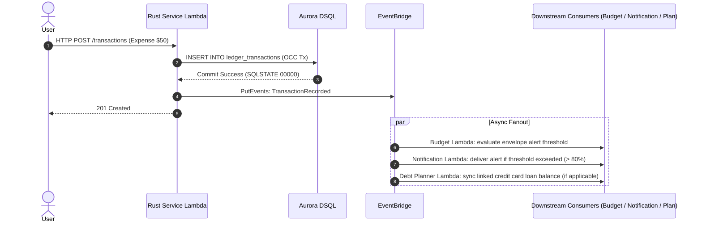
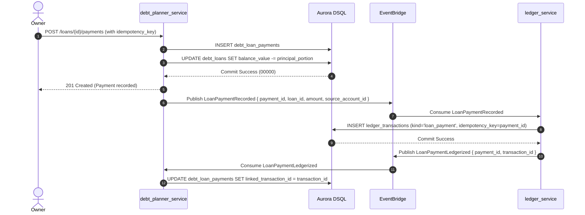

# Event Storming & Domain Events Catalog — FamilyLedger

## 1. Domain Event Flow (Direct EventBridge Publishing — ADR-0017)

---

## 2. Domain Events Catalog

| Domain Event | Originating Context | Trigger Condition | Downstream Consumers & Side-Effects |
| :--- | :--- | :--- | :--- |
| `FamilyCreated` | Identity & Family | User creates workspace | Workspace audit log *(system default `ledger_categories` use shared global `family_id IS NULL` rows seeded idempotently by `migrate_runner`)* |
| `MemberInvited` | Identity & Family | Owner creates invite token | Delivers invite link / audit log |
| `MemberJoined` | Identity & Family | Workspace created (`Owner`) or invite accepted | Refreshes family member cache |
| `MemberRoleChanged` | Identity & Family | Owner modifies role/permissions | Updates active authorization cache |
| `MemberRemoved` | Identity & Family | Member soft-deleted | Revokes active sessions |
| `AccountRegistered` | Payment Cards & Accounts | New account added (`POST /accounts`) | Carries `{ family_id, account_id, owner_member_id, kind, currency, occurred_at }`; initializes account tracking *(account metadata updates/deletes emit 0 events)* |
| `AccountBalanceSnapshotted` | Payment Cards & Accounts | Month-end snapshot computation | Carries `{ family_id, account_id, year_month, closing_balance, occurred_at }` after idempotent upsert in `account_balance_snapshots` *(EventBridge Scheduler wired in Sprint 6)* |
| `TransactionRecorded` | Ledger Core | `Income`/`Expense`/`Transfer`/`CashWithdrawal` recorded or amended (`Corrected` entry) | Carries `{ family_id, transaction_id, recorded_by, kind, amount, destination_amount, source_account_id, destination_account_id, category_id, amendment_of_id, occurred_at }`; triggers budget threshold checks & linked credit card loan sync (`0` events on idempotent replay) |
| `TransactionReversed` | Ledger Core | `POST /transactions/{id}/amend` | Carries `{ family_id, reversal_transaction_id, corrected_transaction_id, amendment_of_id, source_account_id, destination_account_id, amount, destination_amount, reversed_by, occurred_at }` alongside `TransactionRecorded` for the corrected entry |
| `TransactionDeleted` | Ledger Core | `DELETE /transactions/{id}` soft-delete | Carries `{ family_id, transaction_id, source_account_id, destination_account_id, deleted_by, occurred_at }`; reverses downstream budget/loan projections |
| `RecurringPaymentRegistered` | Recurring Payments | New bill/subscription added | Recalculates total committed obligations; pre-seeds draft budget envelopes |
| `RecurringPaymentRecorded` | Recurring Payments | Bill paid | Advances `next_due_date` by frequency; links to ledger transaction |
| `RecurringPaymentMissed` | Recurring Payments | Due date passed +1 day | Triggers push notification reminder |
| `LoanRegistered` | Debt Planner | New loan added | Automatically triggers `RepaymentPlanCalculator` projection |
| `LoanKindCreated` | Debt Planner | Family creates custom kind | Refreshes loan kind selection cache |
| `LoanPaymentRecorded` | Debt Planner | Loan payment made | Reduces loan balance; checks payoff; emits to EventBridge for ledgerization |
| `LoanPaymentLedgerized` | Ledger Core | `LoanPaymentRecorded` consumed | Inserts `loan_payment` ledger transaction; updates `debt_loan_payments.linked_transaction_id` |
| `CreditCardSpendingUpdatedLoanBalance` | Debt Planner | `TransactionRecorded` on linked credit card | Increments `debt_loans.balance_value` for linked credit cards (`kind != 'loan_payment'`) |
| `LoanPaidOff` | Debt Planner | Loan balance reaches 0 | Regenerates plan, rolls freed payment to next debt; notifies Owner to review linked insurance |
| `BudgetDraftCreated` | Budget & Limits | 1st of month Scheduler | Creates `MonthlyBudget` in `Draft` status; delivers push notification to Owner |
| `BudgetApproved` | Budget & Limits | Owner approves draft budget | Transitions status to `Active`; locks envelope limits |
| `BudgetAlertTriggered` | Budget & Limits | Spending exceeds alert threshold (e.g. 80%) | Delivers push notification warning |
| `GoalCreated` | Future Planning | New savings goal registered | Calculates required monthly contribution timeline |
| `GoalContributionRecorded` | Future Planning | Deposit recorded against goal | Recomputes `current_saved` and `OnTrack`/`Behind` status |
| `ExchangeRatesRefreshed` | Infrastructure | Daily Scheduler fetch | Upserts latest rates in `exchange_rates`; triggers recalculation of home-currency totals |

---

## 3. EventBridge Delivery & Idempotency Rules

1. **At-Least-Once Delivery**: EventBridge delivers events with at-least-once semantics.
2. **Idempotent Consumers**: All downstream consumers must handle duplicate event delivery safely using unique entity `idempotency_key` constraints or deterministic deduplication keys (`event_id` / `payment_id` / `transaction_id`).
3. **Soft-Delete Payload Preservation**: Business entities MUST be soft-deleted (`deleted_at TIMESTAMPTZ`) rather than physically erased so downstream consumers and audit trails always retain full historical context.
4. **Loan Payment Filtering**: Event handlers syncing credit card loan balances must ignore `TransactionRecorded` events where `kind IN ('loan_payment', 'reversal')` to prevent double-decrementing or looping balance updates.

---

## 4. Event Flow: Loan Payment → Ledger Choreography

