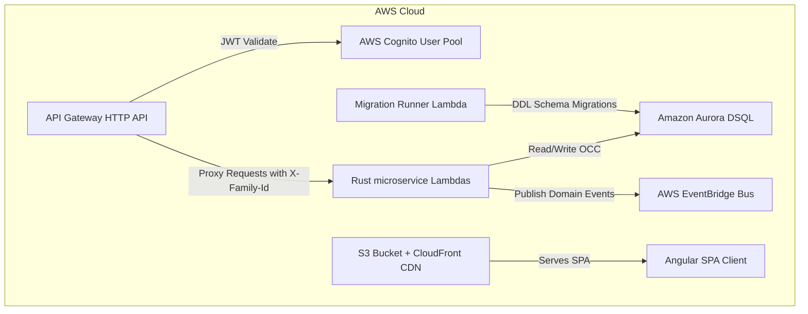

# FamilyLedger — Sprint 1 Execution Plan (Infrastructure & Foundation)

## Sprint 1 Goal
Establish the core serverless cloud infrastructure on AWS, initialize the Rust multi-crate workspace (`backend/`), configure the Amazon Aurora DSQL database cluster, set up the EventBridge domain event bus (`$0.00` idle cost), implement the Database Migration Runner Lambda, and deploy the initial schema migrations (18 tables and 16 asynchronous indexes).

**Duration**: 2 Weeks (10 Working Days)

---

## Technical Overview



---

## Detailed Task Breakdown

> [!TIP]
> **Full AWS Bootstrap, Clean Recreation & Complete Teardown Runbook**: For a unified command-by-command guide covering how to deploy all Sprint 1 AWS objects from scratch, recreate them cleanly after recent `ADR-0011` / `ADR-0017` refactorings, or completely remove them from your AWS account (including Aurora DSQL deletion protection and versioned S3 bucket cleanup), see **[`architecture/aws-deployment-and-teardown.md`](../../architecture/aws-deployment-and-teardown.md)**.

### Phase 1: AWS Serverless Infrastructure Provisioning (Days 1–3)

#### Task 1.1: IAM & CloudFormation/SAM Template Setup — ✅ COMPLETED (Recreate stack cleanly for ADR-0011)
* **Objective**: Create the Infrastructure-as-Code (IaC) templates (AWS SAM / CloudFormation) to model the environment cleanly.
* **Details**:
  * Define AWS Cognito User Pool (identity only; no legacy `family_id`/`family_role` custom schema attributes — tenant context is passed via `X-Family-Id`, ADR-0011), Cognito App Client, and OAuth scopes.
  * Define API Gateway HTTP API with a JWT Authorizer pointing to the Cognito User Pool and CORS `AllowHeaders` including `X-Family-Id`.
  * Define S3 Bucket for Angular static hosting, configured for private access with CloudFront Origin Access Control (OAC).
  * Configure CloudFront Distribution to serve files from the S3 bucket with SPA routing fallbacks (routing 403/404s back to `index.html`).
  * See [Task 1.1 Detailed Guide](task_1_1_detailed_guide.md) for full CloudFormation template and `sam delete` + `sam deploy` steps.
* **Status**: Template updated cleanly for ADR-0011 (Variant 2); recreate `familyledger-core-dev` via `sam delete` + `sam deploy` on next AWS deploy.

#### Task 1.2: Database & Event Bus Provisioning — ✅ COMPLETED
* **Objective**: Set up Aurora DSQL serverless instance, custom EventBridge event bus, and least-privilege IAM execution roles.
* **Details**:
  * Provision an Amazon Aurora DSQL Cluster (`4bublzlvvtnwjpmgtotwrulv7m`). Establish endpoint configurations.
  * Provision custom EventBridge Bus (`familyledger-events-dev`). Amazon Kinesis Data Stream is disabled/removed per ADR-0017 due to fixed idle hourly cost; Rust services publish domain events directly to EventBridge (`$0.00` idle cost).
  * Configure least-privilege IAM Roles allowing microservices (`FamilyLedgerServiceRole`: `dsql:DbConnect` + `events:PutEvents`) and the migration runner (`FamilyLedgerMigrationRunnerRole`: `dsql:DbConnect` + `dsql:DbConnectAdmin`) to authenticate to DSQL via IAM tokens.
  * See [Task 1.2 Detailed Guide](task_1_2_detailed_guide.md) for full deployment steps and IAM configurations.
* **Status**: Stack `familyledger-data-dev` updated cleanly in `data-stream-template.yaml` (re-deploy with `sam deploy --config-file samconfig-data.toml`).

---

### Phase 2: Rust Workspace Initialization (Days 4–5)

#### Task 2.1: Folder & Cargo Workspace Structure — ✅ COMPLETED
* **Objective**: Initialize the multi-crate Rust workspace matching the Clean Architecture/DDD structure in `backend/`.
* **Structure created**:
  ```
  backend/
  ├── Cargo.toml                  # Workspace definition with latest pinned dependencies
  ├── domain/                     # Pure domain logic crate (Zero I/O)
  │   ├── Cargo.toml
  │   └── src/lib.rs
  ├── infrastructure/             # DB & External integration adapters
  │   ├── Cargo.toml
  │   └── src/lib.rs
  ├── api/                        # Shared Axum extractors & responses
  │   ├── Cargo.toml
  │   └── src/lib.rs
  └── lambdas/                    # Binary targets compiled for AWS Lambda
      └── migrate_runner/         # DB Migration runner entry point
          ├── Cargo.toml
          └── src/main.rs
  ```
* See [Task 2.1 Detailed Guide](task_2_1_detailed_guide.md) for step-by-step instructions.
* **Status**: Verified with `cargo check`, `cargo clippy -- -D warnings`, `cargo fmt --check`, 58 unit tests, and 6 doctests passing.

#### Task 2.2: Add Workspace Dependencies — ✅ COMPLETED
* **Objective**: Set up base dependencies in workspace crates to enforce consistent versioning.
* **Core dependencies**:
  * `sqlx` (v0.9.0) with `postgres`, `runtime-tokio`, `tls-rustls-ring`, `macros`, `migrate`, `uuid`, `chrono`, `rust_decimal`, `json`.
  * `aurora-dsql-sqlx-connector` (v0.2.2) for automatic IAM auth refresh and OCC retry logic.
  * `tokio` (v1.54.1) with full features.
  * `rust_decimal` (v1.43.0) with `serde-with-str` for float-free currency calculations.
  * `uuid` (v1.29.3) with `v4`, `v7`, and `serde` features.
  * `axum` (v0.8.9), `lambda_runtime` (v1.5.0), `lambda_http` (v1.3.2), `tower-http` (v0.7.1), `jsonwebtoken` (v12.0.0), `nutype` (v0.8.0).

---

### Phase 3: Database Schema Migrations Setup (Days 6–8)

> [!IMPORTANT]
> **Aurora DSQL Migration Rules**:
> 1. Every migration file starts with `-- no-transaction` so DDL and `_sqlx_migrations` DML execute in separate autocommit transactions.
> 2. DSQL allows **exactly one DDL statement per transaction** (`CREATE TABLE IF NOT EXISTS` / `CREATE INDEX ASYNC IF NOT EXISTS`).
> 3. Mixing DDL (e.g. `CREATE TABLE`) and DML (e.g. `INSERT`) is strictly forbidden.
> 4. Indices must be built asynchronously using `CREATE INDEX ASYNC` in separate migration files.
> 5. Use `FOREIGN KEY (...) REFERENCES ...` for database-level referential integrity and native `JSONB` for semi-structured data.

#### Task 3.1: Create Migration Files — ✅ COMPLETED
* **Detailed Implementation Guide**: [Task 3.1 Detailed Guide](task_3_1_detailed_guide.md)
* **Objective**: Author all 34 database migration files conforming to Aurora DSQL constraints (1 DDL per file, `CREATE INDEX ASYNC`, UUID v4/v7 PKs, explicit foreign keys, native `JSONB`).

We maintain 34 individual migration files under `backend/migrations/` to conform to the single DDL statement per file constraint:

```
backend/migrations/
├── 20260616000001_create_family_families.sql
├── 20260616000002_create_family_members.sql
├── 20260616000003_create_family_invite_tokens.sql
├── 20260616000004_create_payment_accounts.sql
├── 20260616000005_create_account_balance_snapshots.sql
├── 20260616000006_create_ledger_categories.sql
├── 20260616000007_create_ledger_transactions.sql
├── 20260616000008_create_debt_loan_kinds.sql
├── 20260616000009_create_debt_loans.sql
├── 20260616000010_create_debt_loan_payments.sql
├── 20260616000011_create_debt_repayment_plans.sql
├── 20260616000012_create_recurring_payments.sql
├── 20260616000013_create_recurring_payment_records.sql
├── 20260616000014_create_budget_monthly_budgets.sql
├── 20260616000015_create_budget_envelopes.sql
├── 20260616000016_create_planning_savings_goals.sql
├── 20260616000017_create_goal_contributions.sql
├── 20260616000018_create_exchange_rates.sql
├── 20260616000019_idx_members_family.sql
├── 20260616000020_idx_accounts_family.sql
├── 20260616000021_idx_balance_snapshots_account.sql
├── 20260616000022_idx_tx_family_time.sql
├── 20260616000023_idx_tx_account_src.sql
├── 20260616000024_idx_tx_account_dst.sql
├── 20260616000025_idx_loan_kinds_family.sql
├── 20260616000026_idx_loans_family.sql
├── 20260616000027_idx_loan_payments.sql
├── 20260616000028_idx_recurring_family.sql
├── 20260616000029_idx_recurring_due.sql
├── 20260616000030_idx_recurring_linked_loan.sql
├── 20260616000031_idx_recurring_records.sql
├── 20260616000032_idx_goals_family.sql
├── 20260616000033_idx_goal_contributions.sql
└── 20260616000034_idx_exchange_rates.sql
```

---

### Phase 4: Migration Runner Lambda Implementation (Days 8–9)

#### Task 4.1: Write the Rust Migration Runner Lambda — ✅ COMPLETED
* **Objective**: Write a Lambda binary using `lambda_runtime` that connects to Aurora DSQL via `infrastructure::db::pool::create_pool_with_max_connections(1)` and runs `infrastructure::db::migrations::run_dsql_migrations` (`locking = false`, OCC retries, `sys.wait_for_job`). Wired in `backend/infrastructure/sam/data-stream-template.yaml` as `FamilyLedgerMigrateRunnerFunction` (`familyledger-migrate-${Environment}`).
* **Code Implementation (`backend/lambdas/migrate_runner/src/main.rs`)**:
```rust
use anyhow::Context;
use infrastructure::db::{
    migrations::{DsqlMigrationOptions, MigrationReport, run_dsql_migrations},
    pool::create_pool_with_max_connections,
};
use lambda_runtime::{Error, LambdaEvent, run, service_fn};
use serde::{Deserialize, Serialize};
use tracing::info;

#[derive(Debug, Deserialize)]
struct Request {
    #[serde(default = "default_wait_for_indexes")]
    wait_for_indexes: bool,
}

#[derive(Debug, Serialize, PartialEq, Eq)]
struct Response {
    message: String,
    total_migrations: usize,
    applied_now: usize,
    already_applied: usize,
    active_async_jobs: usize,
}

async fn handler(event: LambdaEvent<Request>) -> Result<Response, Error> {
    let pg_pool = create_pool_with_max_connections(1).await?;
    let options = DsqlMigrationOptions {
        wait_for_indexes: event.payload.wait_for_indexes,
        ..DsqlMigrationOptions::default()
    };

    let report = run_dsql_migrations(&pg_pool, options)
        .await
        .context("Migration run failed")?;

    info!(
        total_migrations = report.total_migrations,
        applied_now = report.applied_now,
        already_applied = report.already_applied,
        active_async_jobs = report.active_async_jobs,
        "Schema migrations completed"
    );

    Ok(Response::from_report(report))
}
```

---

### Phase 5: Testing, Local Validation & Deployment (Day 10)

#### Task 5.1: Local Integration Testing Setup — ✅ IMPLEMENTED (Run with Docker)
* **Objective**: Validate all 34 migrations offline (`infrastructure/tests/migration_invariants.rs`) and against PostgreSQL 16 via Testcontainers (`infrastructure/tests/migrations_pg.rs`).
* **Details**:
  * `infrastructure::db::migrations::run_postgres_migrations` strips `ASYNC` from `CREATE INDEX ASYNC` in memory so PG 16 executes all 34 files cleanly from the same source of truth.
  * Run with Docker active: `cargo test -p infrastructure -- --ignored`.

#### Task 5.2: Compilation & Deploy
* **Objective**: Compile the Rust binary and deploy the CloudFormation/SAM stack.
* **Details**:
  * Execute `cargo lambda build --release --arm64 --package migrate_runner` to compile the migration runner.
  * Validate and deploy `familyledger-data-dev` (`cd backend/infrastructure/sam && sam validate -t data-stream-template.yaml --lint && sam deploy --config-file samconfig-data.toml`).
  * Trigger the `familyledger-migrate-dev` Lambda function (`aws lambda invoke --function-name familyledger-migrate-dev --payload '{}' response.json`).
  * Check AWS CloudWatch logs to verify database connectivity, `applied_now`/`already_applied` counts, and `active_async_jobs == 0`.
  * Verify background index creation status via SQL Client if `wait_for_indexes` was `false`:
    ```sql
    SELECT * FROM sys.jobs WHERE LOWER(status) IN ('submitted', 'processing', 'failed');
    ```

---

## Sprint 1 Definition of Done (DoD)
- [x] AWS infrastructure templates (Cognito, API Gateway, S3, CloudFront, Aurora DSQL, EventBridge, IAM, `FamilyLedgerMigrateRunnerFunction`) are defined and wired.
- [x] EventBridge bus and least-privilege IAM roles are configured (`$0.00` idle cost; Kinesis disabled/removed per ADR-0017).
- [x] Rust Cargo workspace, all 34 SQL migrations, `infrastructure::db::migrations`, and `migrate_runner` Lambda compile cleanly with zero warnings/errors.
- [ ] Local database migration checks run successfully against PostgreSQL 16 (`cargo test -p infrastructure -- --ignored` with Docker active).
- [ ] The Migration Runner Lambda compiles with `cargo-lambda`, deploys via SAM, and executes successfully on AWS.
- [ ] Live Aurora DSQL cluster contains all **18 schema tables** and **16 asynchronous indexes** (34 migrations total) verified via active schema checks.
