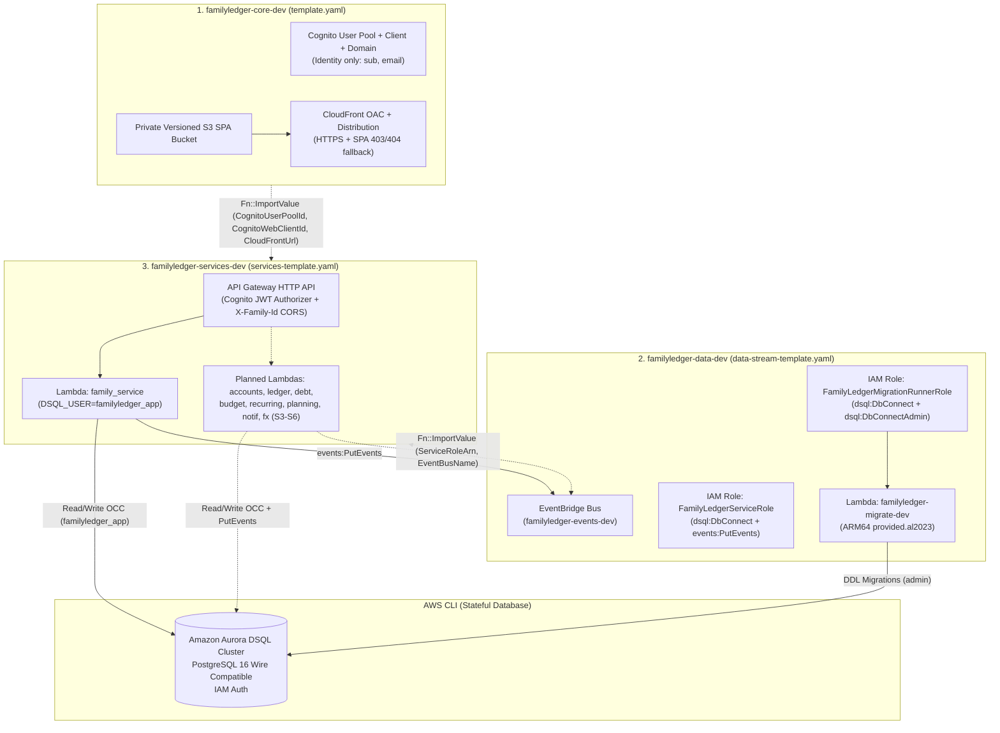

# FamilyLedger — Sprint 2 Execution Plan (Identity, Multi-Family Auth & `family_service`)

- **Status**: 🚧 **In Progress**
- **Branch**: `feat/sprint-2-identity-family` (in both `documentation/` and `backend/`)
- **Target Scope**: `documentation/` and `backend/` only *(Angular Web SPA and Flutter Mobile UI login/workspace switchers live in separate client repositories)*

---

## 1. Sprint 2 Goal

Deliver the complete **Identity & Family Bounded Context** backend: `lambdas/family_service`, multi-family `X-Family-Id` authorization middleware ([`ADR-0011`](../../decisions/0011-multi-family-membership.md)), Aurora DSQL repositories (`retry_on_occ`, `BEGIN READ ONLY`), direct EventBridge event publishing ([`ADR-0017`](../../decisions/0017-cdc-and-event-publishing-strategies.md)), and deployment under the **Option B2 (3-Stack 1-Way DAG)** AWS SAM architecture.

---

## 2. Settled Design Decisions

| Decision | Choice | Rationale |
| :--- | :--- | :--- |
| **Branching** | `feat/sprint-2-identity-family` in `documentation/` + `backend/` | Isolates Sprint 2 specs, schema index, Rust code, and SAM refactoring from `main`. |
| **Repo Scope** | `documentation/` + `backend/` | Client UI belongs in separate Angular/Flutter repos. |
| **JWT Verification** | Trust API Gateway `CognitoJwtAuthorizer` claims in Lambda (`UserIdentity`) + local/test extractor | API Gateway already validates Cognito JWT signatures (`sub`, optional `email`), avoiding duplicate JWKS cold-start calls. |
| **Read Visibility** | Any active member (`Owner`, `Member`, `Child`, `Other`) of `X-Family-Id` on `GET /families/{id}` and `GET /families/{id}/members` | Every active workspace member needs workspace currency/name and member display names. |
| **SAM Topology** | **Option B2 — 3-Stack 1-Way DAG** | Separates slow/stateful `core` (Cognito, S3, CloudFront) and `data` (EventBridge, IAM, `migrate_runner`) from stateless `services` (`FamilyLedgerApi` + Rust HTTP Lambdas). |

---

## 3. Visual Dependency Graph (Option B2 — 3-Stack 1-Way DAG)



---

## 4. Vertical Slice Plan (`Slice 0` – `Slice 5`)

```text
Slice 0 ✅ (Prefactoring: Approved AU/FM Specs + Ports + Auth Split + User/Invite Indexes)
   │
   ▼
Slice 1 ✅ (POST /families & GET /profile/families + Lambda Authorizer Extractor)
   │
   ▼
Slice 2 ✅ (GET /families/{id} & PUT /families/{id} + X-Family-Id Guard)
   │
   ▼
Slice 3 ✅ (POST /families/{id}/invites, POST /families/{id}/members, GET /families/{id}/members)
   │
   ▼
Slice 4 ✅ (PATCH /families/{id}/members/{mid}/role & DELETE /families/{id}/members/{mid})
   │
   ▼
Slice 5 ✅ (Local Option B2 3-Stack SAM Wiring & ARM64 Builds; Live AWS Deploy Deferred)
```

> **Spec vs. TDD Seam Strategy**: Declarative specs `AU-01`–`AU-08` ([`multi-family-auth.md`](../../../backend/specs/api/multi-family-auth.md)) and `FM-01`–`FM-27` ([`family-rbac.md`](../../../backend/specs/domain/family-rbac.md)) govern multi-family auth isolation and pure aggregate invariants. Endpoint wire contracts, database persistence, and `SpyPublisher` event assertions in `Slice 1`–`Slice 4` are verified via Red-Green-Refactor TDD integration tests in `lambdas/family_service/tests/` (Layer 2b) and `infrastructure/tests/` (Layer 2a), matching [`api-design.md`](../../architecture/api-design.md).

| Slice | Deliverables & Vertical Behavior | Test Seams | Blocked By |
| :--- | :--- | :--- | :--- |
| **Slice 0** *(✅ Completed)* | Approved [`multi-family-auth.md`](../../../backend/specs/api/multi-family-auth.md) (`AU-01`–`AU-08`) and `FM-23`–`FM-27` in [`family-rbac.md`](../../../backend/specs/domain/family-rbac.md) with 1:1 blind tests; added RPITIT ports (`FamilyRepository`, `MembershipReader`, `EventPublisher`), `DomainError::FamilyNotFound` (`404 FAMILY_NOT_FOUND`), `DomainAction::ViewFamilyWorkspace`, and `Family::update_profile` in `domain/`; split `api/src/auth.rs` into `UserIdentity` + `AuthClaims` + `FAMILY_ROUTE_POLICIES` + `family_auth_middleware`; added 1-DDL async index migrations `idx_members_user` and `idx_invite_tokens_family` (total **36** migrations / **18** indexes). | Layer 1 (`domain/tests/`), Layer 2b (`api/tests/`), `migration_invariants`, Layer 2a PG (`--ignored`) | — |
| **Slice 1** *(✅ Completed)* | Added `lambda_http` authorizer-claims-to-`UserIdentity` middleware (`sub` → `UserId`, optional `email` → `Option<Email>`, mapping missing/malformed claims to `401 MISSING_CLAIMS` / `401 INVALID_CLAIMS`); implemented `POST /families` (`201 Created`, creator becomes `Owner`, emits `FamilyCreated` + `MemberJoined`) and `GET /profile/families` (`200 OK`, caller's active workspaces). Implemented `DsqlFamilyRepository` (`find_by_id` loads `deleted_at` + soft-deleted members so `None` → `404 FAMILY_NOT_FOUND` and deleted → `410 FAMILY_DELETED`; `save` uses idempotent `INSERT ... ON CONFLICT DO UPDATE` without `DELETE` inside `retry_on_occ`; reads use `BEGIN READ ONLY`), `EventBridgePublisher` + `SpyPublisher`, `create_service_pool()` non-admin `DSQL_USER` guard, and `lambdas/family_service` Axum router. | Layer 2a (Testcontainers PG) + Layer 2b (Axum `oneshot` + fakes/`SpyPublisher`) | Slice 0 |
| **Slice 2** *(✅ Completed)* | Wired `family_auth_middleware` (`X-Family-Id` + path `{id} == claims.family_id` guard + non-UUID path validation) into `family_service`; implemented `GET /families/{id}` (`200 OK`, any active member) and `PUT /families/{id}` (`200 OK`, `Owner` only — updates `name` / `home_currency`; intentionally emits `0` EventBridge events). | Layer 1 (`Family::update_profile`) + Layer 2a + Layer 2b (`AU` specs) | Slice 1 |
| **Slice 3** *(✅ Completed)* | Invite & join flow: `POST /families/{id}/invites` (`201 Created`, `Owner` only, `ttl_hours` defaulting to `168`h / 7 days up to 30 days, `Role::Other` JSONB permissions), `POST /families/{id}/members` (`201 Created`, identity-only auth + `{ token, display_name }`; handles new join & soft-deleted reactivation preserving `MemberId` per `FM-16`), and `GET /families/{id}/members` (`200 OK`, any active member). Emits `MemberInvited` / `MemberJoined`. | Layer 2a (OCC + JSONB + reactivation) + Layer 2b (`404`/`409`/`410` RFC 9457 codes) | Slice 2 |
| **Slice 4** *(✅ Completed)* | Member governance: `PATCH /families/{id}/members/{mid}/role` (`200 OK`, `Owner` only, deduplicates `Other` permissions, no-op skips save & emits `0` events) and `DELETE /families/{id}/members/{mid}` (`204 No Content`, `Owner` only, soft-delete `deleted_at`, blocks Owner removal). Emits `MemberRoleChanged` / `MemberRemoved`. | Layer 2a + Layer 2b (`MemberRoleChanged`, `MemberRemoved`) | Slice 3 |
| **Slice 5** *(✅ Local IaC Complete; Live AWS Deferred)* | Added `services-template.yaml` + `samconfig-services.toml`, removed `FamilyLedgerApi` from `template.yaml`, added `strip_apigw_stage_prefix` for `/{stage}` API Gateway routing, synced SAM/deployment runbooks, built ARM64 `migrate_runner` + `family_service` binaries, and generated `.sqlx/` offline cache. Live AWS deployment (`migrate_runner` 36 migrations, `familyledger_app` DSQL role bootstrap, 3-stack `sam deploy`, and live Cognito JWT + `X-Family-Id` smoke test) deferred for manual execution per user. | `sam validate --lint` + ARM64 `cargo lambda build` + `cargo clippy` / `cargo test --workspace` | Slice 4 |

---

## 5. Sprint 2 Definition of Done (DoD)

- [x] `AU-01`–`AU-08` and `FM-23`–`FM-27` reviewed, `Approved` by human, and covered 1:1 by blind integration tests (`spec_traceability` passes).
- [x] All 9 endpoints (`GET /profile/families` + 8 `/families*` routes) implemented across `domain`, `infrastructure`, `api`, and `lambdas/family_service` matching [`api-design.md`](../../architecture/api-design.md).
- [x] Layer 1, Layer 2a (`cargo test -p infrastructure -- --ignored` with Docker), and Layer 2b (`oneshot`) tests pass alongside `cargo clippy --workspace --all-targets -- -D warnings`.
- [ ] `cargo sqlx prepare --workspace -- --all-targets` offline cache committed *(generated locally in `backend/.sqlx/`; ready to commit)*.
- [ ] `idx_members_user` and `idx_invite_tokens_family` applied on live Aurora DSQL (`36` migrations), `familyledger_app` IAM role + default privileges configured, Option B2 3-stack SAM templates deployed, and live Cognito JWT + `X-Family-Id` tenant isolation verified *(deferred for manual AWS deploy per user)*.

---

## 6. Execution Progress & Notes

### Slice 1 (`POST /families`, `GET /profile/families`, Persistence & EventBridge)
- **Delivered**:
  - `domain/`: `DomainError::Internal` (`errors.rs`) and `DomainEvent::detail_type()` (`events/mod.rs`).
  - `api/`: `ApiJson<T>` (`400 INVALID_JSON`) + sanitized `500 INTERNAL_ERROR` mapping (`errors.rs`), and `extract_user_identity_from_context` / `lambda_identity_middleware` (`auth.rs`).
  - `infrastructure/`: `DsqlFamilyRepository` (`repositories/family_repository.rs`) implementing `FamilyRepository` and `MembershipReader` with compile-time `sqlx::query!` / `sqlx::query_as!`, `BEGIN READ ONLY` reads, `retry_on_occ` idempotent upserts (`MAX_BATCH_ROWS = 500`), `EventBridgePublisher` + `SpyPublisher` (`events/`), `create_service_pool()` enforcing non-admin `DSQL_USER` (`db/pool.rs`), and `backend/.sqlx/` offline query cache (8 files).
  - `lambdas/family_service/`: `AppState`, wire DTOs, `post_families` / `get_profile_families` handlers, Axum router, and Lambda `main.rs` entrypoint.
- **Settled Decisions**:
  - Port/I/O failures map through `DomainError::Internal` to `500 INTERNAL_ERROR` with sanitized `"An internal server error occurred"` (`real` diagnostics logged via `tracing::error!`).
  - EventBridge publishing runs best-effort after Aurora DSQL commit (`tracing::error!` on failure; HTTP `201` still returned to prevent duplicate-write client retries under `ADR-0017` Option 2).
  - Compile-time `sqlx::query!` / `sqlx::query_as!` queries backed by `backend/.sqlx/` prepared against PostgreSQL 16.
- **Review Findings Resolved**:
  - *Axis A (`pro`)*: Split oversized tests into `<= 33`-line functions/helpers across `family_repository_pg.rs` and `slice_1_families.rs`; added `create_service_pool()` rejecting `"admin"` / unset `DSQL_USER`; removed unused `uuid` dependency in `family_service/Cargo.toml`; simplified `mark_family_soft_deleted`; inlined trivial `chunk_events` wrapper. Re-verified `APPROVE` by `pro`.
  - *Axis B (`pro`)*: Synced `documentation/architecture/api-design.md` (`400 INVALID_JSON`, `500 INTERNAL_ERROR`, `422 INVALID_EMAIL`) and `documentation/domain/event-storming.md` (`MemberJoined` trigger wording).
- **Operational Notes for Slices 2–5**:
  - `sqlx-macros-core` scans ancestor `.env` files up to `C:\Users\demiu\.env` on this host, so Cargo commands compiling `infrastructure` require running outside the sandbox (`BypassSandbox: true`) even with `SQLX_OFFLINE=true`.
  - Run Cargo verification commands sequentially (not concurrently) to avoid target-directory file lock contention.
- **Verification Evidence**:
  - `cargo clippy --workspace --all-targets -- -D warnings` (`SQLX_OFFLINE=true`): **0 warnings**.
  - `cargo test --workspace` (`SQLX_OFFLINE=true`): **all passed** (`api`: 10 unit + 2 `au_multi_family_auth`; `domain`: 87 unit + 2 `fm_family_rbac` + 9 `spec_traceability` + 10 `vo_value_objects` + 7 doctests; `family_service`: 10 `slice_1_families`; `infrastructure`: 18 unit + 4 `migration_invariants` + 1 doctest; `migrate_runner`: 3 unit).
  - `cargo test -p infrastructure -- --ignored` (Docker PG16): **4 passed** (`family_repository_pg`: 3, `migrations_pg`: 1).

### Slice 2 (`GET /families/{id}`, `PUT /families/{id}` & `X-Family-Id` Guard)
- **Delivered**:
  - `lambdas/family_service/`: added `UpdateFamilyRequest` and `FamilyResponse` DTOs (`dto.rs`), `get_family` / `put_family` handlers with defense-in-depth `parse_and_verify_path_family_id` guard (`handlers.rs`), and per-method `family_auth_middleware` wiring (`ViewFamilyWorkspace` on `GET /families/{id}`, `ManageFamily` on `PUT /families/{id}`) inside outer `lambda_identity_middleware` (`router.rs`).
  - `lambdas/family_service/tests/`: implemented `MembershipReader` on `InMemoryFamilyRepo` (`slice_1_families.rs`) and added 11 Layer 2b tests in `slice_2_family_profile.rs` covering all 4 roles, multi-family isolation, `400`/`401`/`403`/`404`/`410`/`422`/`500` contracts, and `0` EventBridge events on `PUT`.
  - `infrastructure/tests/family_repository_pg.rs`: added Layer 2a PG16 test `update_profile_persists_name_and_currency_while_preserving_created_at_and_members`.
- **Review Findings Resolved**:
  - *Axis A (`pro`)*: 0 Blockers, 0 Majors, 3 Minor test-file cleanups (Newspaper helper order in `slice_2_family_profile.rs`, removed 7 unnecessary `family.clone()` calls, changed `post_json_with_context` in `slice_1_families.rs` to borrow `&Value`).
  - *Axis B (`pro`)*: `APPROVE` (0 findings; noted informational observation that `ApiJson` runs before path UUID check on `PUT` when JSON is malformed).
- **Subagent Model Note**: Switched implementation subagents from `flash` (hit 429 quota) to `inherit` per user approval, keeping independent `pro` two-axis reviewers.
- **Verification Evidence**:
  - `cargo clippy --workspace --all-targets -- -D warnings` (`SQLX_OFFLINE=true`): **0 warnings**.
  - `cargo test --workspace` (`SQLX_OFFLINE=true`): **all passed** (`slice_1_families`: 10, `slice_2_family_profile`: 11, `spec_traceability`: 9, plus all `api`, `domain`, `infrastructure`, `migrate_runner`, and doctest suites).
  - `cargo test -p infrastructure -- --ignored` (Docker PG16): **5 passed** (`family_repository_pg`: 4, `migrations_pg`: 1).

### Slice 3 (`POST /families/{id}/invites`, `POST /families/{id}/members`, `GET /families/{id}/members`)
- **Delivered**:
  - `lambdas/family_service/`: added `CreateInviteRequest`, `InviteResponse`, `AcceptInviteRequest`, `MemberResponse`, `ListMembersResponse` (`dto.rs`); split handlers cleanly into `handlers/{mod.rs, families.rs, members.rs}` implementing `post_family_invite` (`168`h default TTL, `MemberInvited`), identity-only `post_family_member` (`MemberJoined`, soft-deleted reactivation preserving `MemberId`), and `get_family_members` (active `deleted_at IS NULL` only); wired routes in `router.rs`.
  - `lambdas/family_service/tests/slice_3_invites_members.rs`: added 22 Layer 2b tests covering invite defaults/bounds/deduplication, enum/JSON rejections (`400 INVALID_JSON`), `X-Family-Id` + path guards, identity-only join & reactivation, token lifecycle errors (`404`/`409`/`410`), best-effort EventBridge tolerance, and active-only member listing across all 4 roles.
  - `infrastructure/tests/family_repository_pg.rs`: added Layer 2a PG16 test `reactivated_member_round_trips_preserving_id_and_updating_role_and_permissions`.
- **Review Findings Resolved**:
  - *Axis A (`pro`)*: `APPROVE` (0 Blockers, 0 Majors, 0 Minors).
  - *Axis B (`pro`)*: 0 Blockers, 0 Majors, 2 Minors — documented lowercase `role` / `snake_case` `permissions` wire values and `400 INVALID_JSON` enum/UUID handling in `documentation/architecture/api-design.md`, and added 5 boundary/negative Layer 2b tests in `slice_3_invites_members.rs`.
- **Verification Evidence**:
  - `cargo clippy --workspace --all-targets -- -D warnings` (`SQLX_OFFLINE=true`): **0 warnings**.
  - `cargo test --workspace` (`SQLX_OFFLINE=true`): **all passed** (`slice_3_invites_members`: 22, `slice_1_families`: 10, `slice_2_family_profile`: 11, `spec_traceability`: 9, plus all `api`, `domain`, `infrastructure`, `migrate_runner`, and doctest suites).
  - `cargo test -p infrastructure -- --ignored` (Docker PG16): **6 passed** (`family_repository_pg`: 5, `migrations_pg`: 1).

### Slice 4 (`PATCH /families/{id}/members/{mid}/role`, `DELETE /families/{id}/members/{mid}`)
- **Delivered**:
  - `lambdas/family_service/`: added `ChangeMemberRoleRequest` (`dto.rs`), `parse_family_and_member_paths` + `parse_path_member_id` (`400 INVALID_MEMBER_ID` with `Box<Response>` avoiding `clippy::result_large_err`) (`handlers/mod.rs`), `patch_member_role` (skips `save` & `publish` on no-op; emits `MemberRoleChanged` best-effort) and `delete_member` (`204 No Content`, soft-delete `deleted_at`, emits `MemberRemoved` best-effort) (`handlers/members.rs`), and `add_member_governance_routes` (`router.rs`).
  - `lambdas/family_service/tests/slice_4_member_governance.rs`: added 19 Layer 2b tests covering deduplicated `Other` permissions, `Other -> Member` permission clearing, no-op zero-event skip, Owner protection (`409 CANNOT_REMOVE_OWNER` / `DUPLICATE_OWNER`), custom-permission guards (`422 INVARIANT_VIOLATION`), unknown/soft-deleted/malformed `{mid}` (`404`/`400`), auth/header/`{id}` guards (`401`/`400`/`403`), soft-deleted family (`410`), EventBridge failure tolerance, and post-delete roster exclusion + `403 USER_NOT_IN_FAMILY` access revocation.
  - `infrastructure/tests/family_repository_pg.rs`: added Layer 2a PG16 test `role_change_and_member_removal_persist_across_reload_and_auth_queries`.
  - `documentation/architecture/api-design.md`: documented `400 INVALID_MEMBER_ID`.
- **Review Findings Resolved**:
  - *Axis A (`pro`)*: `APPROVE` (0 Blockers, 0 Majors, 0 Minors); fixed `clippy::result_large_err` in `handlers/mod.rs` by boxing error `Response`.
  - *Axis B (`pro`)*: 0 Blockers, 0 Majors, 3 Minors — updated `MemberResponse` doc comment in `dto.rs`, added auth/header/non-UUID `{id}`/outsider/removed-member tests on `PATCH` & `DELETE`, added `Other -> Member` permission-clearing test, and strengthened `MemberResponse` + `MemberRoleChanged`/`MemberRemoved` event assertions.
- **Verification Evidence**:
  - `cargo clippy --workspace --all-targets -- -D warnings` (`SQLX_OFFLINE=true`): **0 warnings**.
  - `cargo test --workspace` (`SQLX_OFFLINE=true`): **all passed** (`slice_4_member_governance`: 19, `slice_3_invites_members`: 22, `slice_2_family_profile`: 11, `slice_1_families`: 10, `spec_traceability`: 9, `au_multi_family_auth`: 2, `fm_family_rbac`: 2, `vo_value_objects`: 10, `api` unit: 10, `domain` unit: 87 + 7 doctests, `infrastructure` unit: 18 + 4 `migration_invariants` + 1 doctest, `migrate_runner` unit: 3).
  - `cargo test -p infrastructure -- --ignored` (Docker PG16): **7 passed** (`family_repository_pg`: 6, `migrations_pg`: 1).

### Slice 5 (Local Option B2 3-Stack SAM Wiring & ARM64 Builds)
- **Delivered**:
  - Removed legacy `FamilyLedgerApi`, `ApiGatewayUrl` output, and unused `Globals` from [`template.yaml`](../../../backend/infrastructure/sam/template.yaml).
  - Added [`services-template.yaml`](../../../backend/infrastructure/sam/services-template.yaml) (`FamilyLedgerApi` HTTP API with Cognito JWT Authorizer + `X-Family-Id` CORS, `FamilyLedgerFamilyServiceFunction` with `DSQL_USER=familyledger_app`, `ServiceRoleArn`, `EVENT_BUS_NAME`, and all 9 routes) and [`samconfig-services.toml`](../../../backend/infrastructure/sam/samconfig-services.toml) (`DsqlClusterIdentifier="4bublzlvvtnwjpmgtotwrulv7m"`).
  - Added `strip_apigw_stage_prefix` in [`api/src/auth.rs`](../../../backend/api/src/auth.rs) (+ unit tests), wrapped the Axum router in [`lambdas/family_service/src/main.rs`](../../../backend/lambdas/family_service/src/main.rs) via `tower::ServiceBuilder::new().map_request(strip_apigw_stage_prefix)`, moved `serde_json`/`anyhow`/`tower` `"util"` to `[dev-dependencies]` in [`lambdas/family_service/Cargo.toml`](../../../backend/lambdas/family_service/Cargo.toml), and added Layer 2b stage-prefix routing coverage in `slice_2_family_profile.rs`.
  - Synchronized [`infrastructure/sam/README.md`](../../../backend/infrastructure/sam/README.md) and [`aws-deployment-and-teardown.md`](../../architecture/aws-deployment-and-teardown.md) with the Option B2 upgrade order (`core` re-deployed before `services` deploy).
  - Built release ARM64 Lambda bootstrap binaries via `cargo lambda build --release --arm64`: `migrate_runner` (`13,303,552` bytes) and `family_service` (`14,395,784` bytes).
- **Review Findings Resolved**:
  - *Axis B (`pro`)*: `APPROVE`.
  - *Axis A (`pro`)*: 0 Blockers, 3 Majors, 4 Minors — fixed Majors 1–3 & Minors 1–3 (`api/src/auth.rs` `mod tests` helpers returning `Result`, <= 32 lines, Newspaper ordering; moved test-only deps to `[dev-dependencies]` in `lambdas/family_service/Cargo.toml`); intentionally retained `${AWS::StackName}-ApiUrl` export name in `services-template.yaml` for backwards compatibility with `template.yaml`. Re-verified `APPROVE` by `pro`.
- **Verification Evidence**:
  - `cargo clippy --workspace --all-targets -- -D warnings` (`SQLX_OFFLINE=true`): **0 warnings**.
  - `cargo test --workspace` (`SQLX_OFFLINE=true`): **all passed** (`slice_1_families`: 10, `slice_2_family_profile`: 12, `slice_3_invites_members`: 22, `slice_4_member_governance`: 19, `api` unit: 13, `au_multi_family_auth`: 2, `domain` unit: 87 + 7 doctests, `fm_family_rbac`: 2, `spec_traceability`: 9, `vo_value_objects`: 10, `infrastructure` unit: 18 + 4 `migration_invariants` + 1 doctest, `migrate_runner` unit: 3).
  - `sam validate --lint` on `template.yaml`, `data-stream-template.yaml`, and `services-template.yaml`: all **3 passed**.
  - `cargo lambda build --release --arm64` for `migrate_runner` and `family_service`: **both succeeded**.
  - *(Note: Layer 2a Docker PG16 `cargo test -p infrastructure -- --ignored` passed 7/7 in Slice 4; `infrastructure/` was unchanged in Slice 5.)*
- **Deferred Manual AWS Steps** *(per user request not to mutate live AWS/DSQL; follow [`aws-deployment-guide.md`](./aws-deployment-guide.md))*:
  1. Deploy updated `data-stream-template.yaml` if needed and invoke `familyledger-migrate-dev` to apply all `36` migrations (`idx_members_user`, `idx_invite_tokens_family`).
  2. Execute the 5-statement `familyledger_app` DSQL IAM role bootstrap against cluster `4bublzlvvtnwjpmgtotwrulv7m` with `arn:aws:iam::377161178071:role/familyledger-service-role-dev`.
  3. Re-deploy `familyledger-core-dev` (`template.yaml`) first to remove legacy `FamilyLedgerApi`, then deploy `familyledger-services-dev` (`services-template.yaml` + `samconfig-services.toml`).
  4. Sync `.env.dev` (`API_URL` from `familyledger-services-dev`) and smoke-test live Cognito JWT + `X-Family-Id` tenant isolation.
