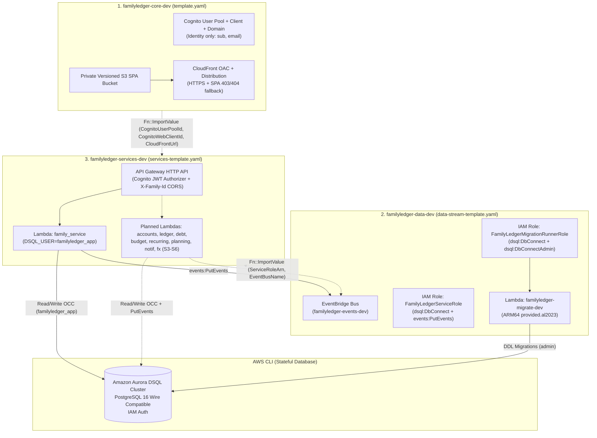

# FamilyLedger — Sprint 2 Execution Plan (Identity, Multi-Family Auth & `family_service`)

- **Status**: 🚧 **In Progress**
- **Branch**: `feat/sprint-2-identity-family` (in both `documentation/` and `backend/`)
- **Target Scope**: `documentation/` and `backend/` only *(Angular Web SPA and Flutter Mobile UI login/workspace switchers live in separate client repositories)*

---

## 1. Sprint 2 Goal

Deliver the complete **Identity & Family Bounded Context** backend: `lambdas/family_service`, multi-family `X-Family-Id` authorization middleware ([`ADR-0011`](../../decisions/0011-multi-family-membership.md)), Aurora DSQL repositories (`retry_on_occ`, `BEGIN READ ONLY`), direct EventBridge event publishing ([`ADR-0017`](../../decisions/0017-cdc-and-event-publishing-strategies.md)), and deployment under the **Option B2 (3-Stack 1-Way DAG)** AWS SAM architecture.

---

## 2. Settled Design Decisions

| Decision | Choice | Rationale |
| :--- | :--- | :--- |
| **Branching** | `feat/sprint-2-identity-family` in `documentation/` + `backend/` | Isolates Sprint 2 specs, schema index, Rust code, and SAM refactoring from `main`. |
| **Repo Scope** | `documentation/` + `backend/` | Client UI belongs in separate Angular/Flutter repos. |
| **JWT Verification** | Trust API Gateway `CognitoJwtAuthorizer` claims in Lambda (`UserIdentity`) + local/test extractor | API Gateway already validates Cognito JWT signatures (`sub`, optional `email`), avoiding duplicate JWKS cold-start calls. |
| **Read Visibility** | Any active member (`Owner`, `Member`, `Child`, `Other`) of `X-Family-Id` on `GET /families/{id}` and `GET /families/{id}/members` | Every active workspace member needs workspace currency/name and member display names. |
| **SAM Topology** | **Option B2 — 3-Stack 1-Way DAG** | Separates slow/stateful `core` (Cognito, S3, CloudFront) and `data` (EventBridge, IAM, `migrate_runner`) from stateless `services` (`FamilyLedgerApi` + Rust HTTP Lambdas). |

---

## 3. Visual Dependency Graph (Option B2 — 3-Stack 1-Way DAG)



---

## 4. Vertical Slice Plan (`Slice 0` – `Slice 5`)

```text
Slice 0 ✅ (Prefactoring: Approved AU/FM Specs + Ports + Auth Split + User/Invite Indexes)
   │
   ▼
Slice 1 (POST /families & GET /profile/families + Lambda Authorizer Extractor)
   │
   ▼
Slice 2 (GET /families/{id} & PUT /families/{id} + X-Family-Id Guard)
   │
   ▼
Slice 3 (POST /families/{id}/invites, POST /families/{id}/members, GET /families/{id}/members)
   │
   ▼
Slice 4 (PATCH /families/{id}/members/{mid}/role & DELETE /families/{id}/members/{mid})
   │
   ▼
Slice 5 (Option B2 3-Stack SAM Wiring, DSQL_USER Bootstrap & Live Verification)
```

> **Spec vs. TDD Seam Strategy**: Declarative specs `AU-01`–`AU-08` ([`multi-family-auth.md`](../../../backend/specs/api/multi-family-auth.md)) and `FM-01`–`FM-27` ([`family-rbac.md`](../../../backend/specs/domain/family-rbac.md)) govern multi-family auth isolation and pure aggregate invariants. Endpoint wire contracts, database persistence, and `SpyPublisher` event assertions in `Slice 1`–`Slice 4` are verified via Red-Green-Refactor TDD integration tests in `lambdas/family_service/tests/` (Layer 2b) and `infrastructure/tests/` (Layer 2a), matching [`api-design.md`](../../architecture/api-design.md).

| Slice | Deliverables & Vertical Behavior | Test Seams | Blocked By |
| :--- | :--- | :--- | :--- |
| **Slice 0** *(✅ Completed)* | Approved [`multi-family-auth.md`](../../../backend/specs/api/multi-family-auth.md) (`AU-01`–`AU-08`) and `FM-23`–`FM-27` in [`family-rbac.md`](../../../backend/specs/domain/family-rbac.md) with 1:1 blind tests; added RPITIT ports (`FamilyRepository`, `MembershipReader`, `EventPublisher`), `DomainError::FamilyNotFound` (`404 FAMILY_NOT_FOUND`), `DomainAction::ViewFamilyWorkspace`, and `Family::update_profile` in `domain/`; split `api/src/auth.rs` into `UserIdentity` + `AuthClaims` + `FAMILY_ROUTE_POLICIES` + `family_auth_middleware`; added 1-DDL async index migrations `idx_members_user` and `idx_invite_tokens_family` (total **36** migrations / **18** indexes). | Layer 1 (`domain/tests/`), Layer 2b (`api/tests/`), `migration_invariants`, Layer 2a PG (`--ignored`) | — |
| **Slice 1** | Add `lambda_http` authorizer-claims-to-`UserIdentity` middleware (`sub` → `UserId`, optional `email` → `Option<Email>`, mapping missing/malformed claims to `401 MISSING_CLAIMS` / `401 INVALID_CLAIMS`); implement `POST /families` (`201 Created`, creator becomes `Owner`, emits `FamilyCreated` + `MemberJoined`) and `GET /profile/families` (`200 OK`, caller's active workspaces). Implement `DsqlFamilyRepository` (`find_by_id` loads `deleted_at` + soft-deleted members so `None` → `404 FAMILY_NOT_FOUND` and deleted → `410 FAMILY_DELETED`; `save` uses idempotent `INSERT ... ON CONFLICT DO UPDATE` without `DELETE` inside `retry_on_occ`; reads use `BEGIN READ ONLY`), `EventBridgePublisher` + `SpyPublisher`, and `lambdas/family_service` Axum router. | Layer 2a (Testcontainers PG) + Layer 2b (Axum `oneshot` + fakes/`SpyPublisher`) | Slice 0 |
| **Slice 2** | Wire `family_auth_middleware` (`X-Family-Id` + path `{id} == claims.family_id` guard) into `family_service`; implement `GET /families/{id}` (`200 OK`, any active member) and `PUT /families/{id}` (`200 OK`, `Owner` only — updates `name` / `home_currency`; intentionally emits `0` EventBridge events). | Layer 1 (`Family::update_profile`) + Layer 2a + Layer 2b (`AU` specs) | Slice 1 |
| **Slice 3** | Invite & join flow: `POST /families/{id}/invites` (`201 Created`, `Owner` only, `ttl_hours` defaulting to `168`h / 7 days up to 30 days, `Role::Other` JSONB permissions), `POST /families/{id}/members` (`201 Created`, identity-only auth + `{ token, display_name }`; handles new join & soft-deleted reactivation preserving `MemberId` per `FM-16`), and `GET /families/{id}/members` (`200 OK`, any active member). Emits `MemberInvited` / `MemberJoined`. | Layer 2a (OCC + JSONB + reactivation) + Layer 2b (`404`/`409`/`410` RFC 9457 codes) | Slice 2 |
| **Slice 4** | Member governance: `PATCH /families/{id}/members/{mid}/role` (`200 OK`, `Owner` only, deduplicates `Other` permissions, no-op emits `0` events) and `DELETE /families/{id}/members/{mid}` (`204 No Content`, `Owner` only, soft-delete `deleted_at`, blocks Owner removal). Emits `MemberRoleChanged` / `MemberRemoved`. | Layer 2a + Layer 2b (`MemberRoleChanged`, `MemberRemoved`) | Slice 3 |
| **Slice 5** | Invoke `migrate_runner` for `idx_members_user` + `idx_invite_tokens_family` (`total_migrations: 36`); execute per-statement `familyledger_app` DSQL role bootstrap (`CREATE ROLE`, `AWS IAM GRANT`, `GRANT SELECT, INSERT, UPDATE`, and `ALTER DEFAULT PRIVILEGES`); add `services-template.yaml` + `samconfig-services.toml` moving `FamilyLedgerApi` from `template.yaml` and wiring `FamilyLedgerFamilyServiceFunction` (`DSQL_USER=familyledger_app`); deploy ARM64 binary; run `cargo sqlx prepare --workspace -- --all-targets`; smoke-test live Cognito JWT + `X-Family-Id` isolation. | Live AWS smoke test + `cargo clippy` / `cargo test --workspace` | Slice 4 |

---

## 5. Sprint 2 Definition of Done (DoD)

- [x] `AU-01`–`AU-08` and `FM-23`–`FM-27` reviewed, `Approved` by human, and covered 1:1 by blind integration tests (`spec_traceability` passes).
- [ ] All 9 endpoints (`GET /profile/families` + 8 `/families*` routes) implemented across `domain`, `infrastructure`, `api`, and `lambdas/family_service` matching [`api-design.md`](../../architecture/api-design.md).
- [ ] Layer 1, Layer 2a (`cargo test -p infrastructure -- --ignored` with Docker), and Layer 2b (`oneshot`) tests pass alongside `cargo clippy --workspace --all-targets -- -D warnings`.
- [ ] `cargo sqlx prepare --workspace -- --all-targets` offline cache committed.
- [ ] `idx_members_user` and `idx_invite_tokens_family` applied on live Aurora DSQL (`36` migrations), `familyledger_app` IAM role + default privileges configured, Option B2 3-stack SAM templates deployed, and live Cognito JWT + `X-Family-Id` tenant isolation verified.
