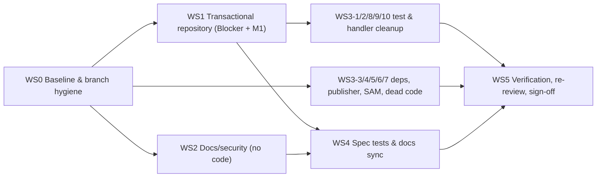

# Sprint 2 Review — Remediation Plan

- **Status**: ✅ Completed *(code, tests, and docs verified; live AWS deploy deferred)*
- **Branch**: `feat/sprint-2-identity-family` (`backend/` and `documentation/`)
- **Source**: Two-axis code review of `main...HEAD` (Axis A: Standards & Architecture, Axis B: Spec, Domain, Security & Docs)
- **Baseline (green before any fix)**: `SQLX_OFFLINE=true cargo clippy --workspace --all-targets -- -D warnings` and `cargo test --workspace` pass (219 tests, 7 Docker-gated tests ignored). `sam validate --lint` passes for all 3 templates.
- **Goal**: Close every finding below without regressing any approved spec rule (`AU-01`–`AU-08`, `FM-01`–`FM-27`), the API wire contract, or the SAM export/import graph. Live AWS deploy stays blocked until **WS1** and **WS2** are done.

> [!IMPORTANT]
> Governance reminders (`common.md`): agents write specs only as `Draft` and ADRs only as `Proposed`. Spec-backed tests must never be weakened. If a faithful spec test fails against code, stop and report `SPEC–CODE MISMATCH DETECTED`. Tests must not cite a `Draft` rule ID (`spec_traceability` fails CI), so the new concurrency tests in WS1 carry no rule ID until a human approves the proposed rules.

---

## 1. Finding Index → Work Item Traceability

| Finding | Sev | Summary | Work item |
| :--- | :--- | :--- | :--- |
| A-B1 | Blocker | Split read–modify–write; OCC retry replays stale snapshot; token double-spend; `23505` → 500 | **WS1** |
| A-M1 | Major | Unbounded token load + full-aggregate upsert bricks family at 500 rows; N+1 writes | **WS1** |
| B-M1 | Major | Real AWS Account ID + DSQL cluster ID in `sprint_2_plan.md` | **WS2-1** |
| B-M2 | Major | Smoke-test step #5 wrong; 4 wrong `AU-*` labels | **WS2-2** |
| A-M2 | Major | Test/helper functions > 40 lines; silent `_ => Ok(())` | **WS3-1** |
| A-m1 | Minor | Wildcard in `domain_error_status_and_code` | **WS3-2** |
| A-m2 | Minor | Unused / dev-only deps in `[dependencies]` | **WS3-3** |
| A-m3 | Minor | `publish_batch` drops per-entry failure diagnostics | **WS3-4** |
| A-m4 | Minor | `localhost:4200` CORS in every environment | **WS3-5** |
| A-m5 / B-nit | Minor | Dead `AuthError::Forbidden` variant | **WS3-6** |
| A-m6 | Minor | `SpyPublisher` compiled into production crate | **WS3-7** |
| A-m7 | Minor | Newspaper-order deviations | **WS3-8** |
| A-n1 | Nit | Over-wide `P: EventPublisher` bound on read handlers | **WS3-9** |
| A-n2 | Nit | Test harness duplicated across 4 `slice_*` files | **WS3-10** (folded into WS1-6) |
| A-n3 | Nit | No `family_id` guard on upsert conflict clauses | **WS1-4** |
| A-n4 | Nit | Hardcoded `DSQL_USER` in SAM | **WS3-5** |
| B-m1 | Minor | `FM-24`–`FM-27` sub-case gaps | **WS4-1** |
| B-m2 | Minor | No cross-family invite token regression test | **WS4-2** |
| B-m3 | Minor | `api-design.md` IdToken vs AccessToken | **WS4-3** |
| B-m4 | Minor | `backend/README.md` drift | **WS4-4** |
| B-m5 | Minor | DoD `.sqlx` checkbox stale | **WS4-5** |
| B-nit | Nit | Wrong CloudFormation export-collision explanation | **WS2-3** |
| B-nit | Nit | Dev cluster ID in `samconfig-services.toml` | **WS2-4** (decision) |
| B-nit | Nit | `decisions.md` lacks Option B2 note | **WS4-6** |

---

## 1.1 Progress Tracker (updated as each item lands)

Legend: ⬜ pending · 🚧 in progress · ✅ done

| Item | Status | Item | Status |
| :--- | :---: | :--- | :---: |
| WS1 (A-B1, A-M1, A-n3, 3-9, 3-10) | ✅ | WS3-5 (CORS cond + DsqlUser param) | ✅ |
| WS2-1 scrub IDs (B-M1) | ✅ | WS3-6 remove `AuthError::Forbidden` | ✅ |
| WS2-2 smoke test + AU labels (B-M2) | ✅ | WS3-7 gate `SpyPublisher` | ✅ |
| WS2-3 export wording | ✅ | WS3-8 newspaper ordering | ✅ |
| WS2-4 cluster-ID decision | ✅ | WS4-1 FM-24..27 coverage | ✅ |
| WS3-1 oversize functions (A-M2) | ✅ | WS4-2 cross-family token test | ✅ |
| WS3-2 exhaustive error mapping | ✅ | WS4-3 IdToken note | ✅ |
| WS3-3 deps cleanup | ✅ | WS4-4 README drift | ✅ |
| WS3-4 publisher diagnostics | ✅ | WS4-5 DoD checkbox | ✅ |
| WS4-6 decisions.md | ✅ | WS4-7 contract docs | ✅ |
| WS5 final gates + re-review | ✅ | | |

---

## 2. Execution Order & Dependencies



Recommended commit grouping (one logical commit each, conventional-commit messages):
1. `docs(sprint-2): scrub account ids and fix smoke-test guide` (WS2)
2. `refactor(family): transactional update port with targeted writes` (WS1; may split into 2–3 commits by phase)
3. `chore(api,infra): dependency, dead-code and SAM hygiene` (WS3-3..7)
4. `test: split oversized tests, shared harness, FM-24..27 coverage, cross-family token` (WS3-1/8/10, WS4-1/2)
5. `docs(sprint-2): sync README, api-design, DoD, decisions` (WS4)

Rough effort: WS0 0.25 d · WS1 1.5–2 d · WS2 0.25 d · WS3 1 d · WS4 0.5 d · WS5 0.5 d.

---

## WS0 — Baseline & Hygiene (0.25 d)

| # | Task | Done when |
| :--- | :--- | :--- |
| 0.1 | Re-run both Rust gates with `SQLX_OFFLINE=true` (outside sandbox on this host: `sqlx-macros-core` reads `C:\Users\demiu\.env`). Run Cargo commands sequentially. | Baseline numbers recorded in §7 |
| 0.2 | Run `cargo test -p infrastructure -- --ignored` (Docker) to confirm the 7 PG16 tests are green *before* changing the repository. | 7/7 pass |
| 0.3 | Confirm `git status` clean in both repos; create no new branch (stay on `feat/sprint-2-identity-family`). | Clean tree |

---

## WS1 — Transactional Family Repository (A-B1 + A-M1 + A-n3)

### 1.1 Problem recap

Every mutating handler does `find_by_id` (own `BEGIN READ ONLY` tx) → mutate in memory → `save` (separate tx, `retry_on_occ`, unconditional upsert of **every** member and token row). Consequences:

1. An OCC retry replays the stale snapshot, overwriting rows committed by a concurrent request (member resurrection: `deleted_at` reset to `NULL`; reverted role/profile).
2. Two concurrent `POST /families/{id}/members` with one token both see `used = false` and both succeed.
3. Two concurrent joins by the same user mint different `MemberId`s → `UNIQUE (family_id, user_id)` violation `23505` → `500` instead of `409 MEMBER_ALREADY_EXISTS`.
4. `find_by_id` loads all historical tokens; `prepare_family_save` rejects `1 + members + tokens > 500`, permanently blocking mutations on long-lived families; writes are an N+1 loop.

### 1.2 Target design

**Principle**: read, domain mutation, and write happen inside one `retry_on_occ` transaction; on every OCC retry the aggregate is re-read and the domain rules re-run; only rows that actually changed are written.

**New domain port** (`domain/src/ports.rs`, RPITIT, static dispatch, no `'static`):

```rust
/// Which invite tokens the aggregate should be loaded with.
pub enum TokenScope { None, One(InviteTokenId) }

pub trait FamilyRepository: Send + Sync {
    /// Read-only load (family + all members, NO invite tokens).
    fn find_by_id(&self, family_id: FamilyId)
        -> impl Future<Output = Result<Option<Family>, DomainError>> + Send;

    fn list_for_user(&self, user_id: UserId) -> impl Future<...> + Send;

    /// Inserts a brand-new aggregate (POST /families). Insert-only, no upsert.
    fn insert_new(&self, family: &Family) -> impl Future<Output = Result<(), DomainError>> + Send;

    /// Atomic read → mutate → write. `op` may run more than once (OCC retry) and must be
    /// pure with respect to anything outside `&mut Family`. Returns `op`'s value plus its events.
    fn update<T, F>(&self, family_id: FamilyId, scope: TokenScope, op: F)
        -> impl Future<Output = Result<Updated<T>, DomainError>> + Send
    where
        T: Send,
        F: Fn(&mut Family) -> Result<(T, Vec<DomainEvent>), DomainError> + Send + Sync;
}

pub struct Updated<T> { pub value: T, pub events: Vec<DomainEvent> }
```

Why this shape: it keeps `Family` unchanged (no dirty-flag plumbing in the domain), keeps ports in `domain/`, and makes "re-run domain rules on retry" structural rather than a convention. `save` is removed (rename `insert_new` makes the create-only intent explicit).

**Infrastructure algorithm** (`DsqlFamilyRepository::update`), executed inside `retry_on_occ(|| async { ... })`:

1. `pool.begin()`.
2. Lock the family row to serialize per-family mutations and eliminate write skew: `SELECT id FROM family_families WHERE id = $1 FOR UPDATE`. No row → `DomainError::FamilyNotFound`.
   - **Verify first (task 1.3-A)**: confirm in the Aurora DSQL docs that `SELECT … FOR UPDATE` is supported and creates a write-conflict intent. **Fallback** if not: `UPDATE family_families SET name = name WHERE id = $1` (forces a write–write conflict on the family row). Record the outcome in `documentation/architecture/aurora-dsql.md`.
3. Load family row, all member rows, and tokens per `TokenScope` (`One(t)` → `WHERE family_id = $1 AND token = $2`; `None` → no query). Reconstitute `Family`.
4. Build a **snapshot** `HashMap<Uuid, PreparedMember>` and `HashMap<Uuid, PreparedInviteToken>` from the loaded rows (`#[derive(PartialEq)]` on the `Prepared*` structs).
5. Run `op(&mut family)`; on `Err`, roll back and return it (domain errors such as `TokenAlreadyUsed` are never retried).
6. `prepare_*` every member/token in the mutated aggregate; **write only rows that are new or differ from the snapshot** (`family row` only if `name/home_currency/deleted_at` changed). Changed rows ≤ ~3 per request, so the 500-row guard now applies to *changed rows* (keep `MAX_BATCH_ROWS` as a safety check there).
7. Token transitions to `used = true` use a conditional statement: `UPDATE family_invite_tokens SET used = true WHERE token = $1 AND family_id = $2 AND used = false`; `rows_affected() == 0` → `DomainError::TokenAlreadyUsed` (belt and braces behind the row lock).
8. Member/family upserts add tenant guards: `ON CONFLICT (id) DO UPDATE SET … WHERE family_members.family_id = EXCLUDED.family_id` (A-n3).
9. Commit. Return `Updated { value, events }` from the **successful** attempt only.
10. Error mapping: `sqlx::Error::Database` with SQLSTATE `23505` on the `(family_id, user_id)` unique constraint → `DomainError::MemberAlreadyExists { user_id }` (fallback; the row lock should make it unreachable). Everything else → sanitized `DomainError::Internal`.

`insert_new`: single `retry_on_occ` tx, plain `INSERT` for family, owner member (and any tokens), no `ON CONFLICT`.
`find_by_id`/`list_for_user`/`find_active_membership`: unchanged `BEGIN READ ONLY` paths; `find_by_id` stops loading tokens (remove `fetch_invite_token_rows` from this path).

### 1.3 Task list (TDD: red tests first, then implement)

| # | Task | Files | Done when |
| :--- | :--- | :--- | :--- |
| 1.3-A | **Research spike** — verify `FOR UPDATE` support/semantics on DSQL (primary AWS docs); decide lock vs. touch-write; note result in `architecture/aurora-dsql.md`. | `documentation/architecture/aurora-dsql.md` | Decision recorded |
| 1.3-B | **Propose ADR-0020** (`Status: Proposed`): "Atomic aggregate update port & targeted writes on Aurora DSQL" (context: OCC + snapshot isolation write-skew, rejected alternatives: version column + migration, full-aggregate upsert). Add to ADR index. | `documentation/decisions/0020-*.md`, `decisions/README.md` | Human acceptance pending; code may proceed under explicit instruction |
| 1.3-C | **Red tests (Layer 2a, Docker PG16)** in `infrastructure/tests/family_repository_pg.rs` (no spec IDs): (1) two concurrent `update` calls accepting the same token via `tokio::join!` → exactly one `Ok`, the other `TokenAlreadyUsed`; (2) concurrent join of same `user_id` → one `Ok`, other `MemberAlreadyExists` (never `Internal`); (3) update profile concurrent with remove member → removed member stays removed (`deleted_at` set) and profile updated; (4) `update` with a closure returning `Err` writes nothing; (5) no-op `change_member_role` performs zero row writes; (6) family with ≥ 600 historical used tokens still accepts `PUT`/invite/remove (regression for A-M1). Keep each test fn ≤ 40 lines using helpers. | `infrastructure/tests/family_repository_pg.rs` | Tests compile and fail against current `save` |
| 1.3-D | Port change: add `TokenScope`, `Updated<T>`, `update`, `insert_new`; remove `save`; update rustdoc on `find_by_id` (no tokens). | `domain/src/ports.rs`, `domain/src/lib.rs` | `cargo check -p domain` |
| 1.3-E | Implement `DsqlFamilyRepository::update` / `insert_new` per §1.2; derive `PartialEq` on `Prepared*`; snapshot diff helper (`changed_members`, `changed_tokens`, `family_changed`); conditional token update; `23505` mapping helper; drop `fetch_invite_token_rows` from `find_by_id`; keep every function ≤ 40 lines (split `execute_update` into `lock_family`, `load_snapshot`, `apply_diff`). | `infrastructure/src/repositories/family_repository.rs` | 1.3-C tests green on Docker PG16 |
| 1.3-F | Regenerate the offline cache: new/changed `sqlx::query!` statements → `cargo sqlx prepare --workspace -- --all-targets` against the PG16 container (migrations applied); delete stale `.sqlx/query-*.json`; commit. | `backend/.sqlx/` | `SQLX_OFFLINE=true cargo check --workspace` passes; no stale files |
| 1.3-G | Convert handlers to `repo.update(...)`: `put_family`, `post_family_invite` (`TokenScope::None`), `post_family_member` (`TokenScope::One(req.token)`), `patch_member_role`, `delete_member`; `post_families` → `insert_new`. Closures clone captured inputs per attempt (`permissions`, `DisplayName`, `Relationship`) — add a one-line comment justifying the clone (OCC re-execution). Publish `updated.events` best-effort after commit (unchanged ADR-0017 behavior). `PATCH` no-op returns `200` with current member and `0` events (response built from the closure's value). | `lambdas/family_service/src/handlers/{families,members}.rs` | Handler fns ≤ 40 lines; existing Layer 2b tests pass |
| 1.3-H | Update `InMemoryFamilyRepo` fakes to the new port (see WS3-10 shared `tests/common/mod.rs`): `update` = lock mutex, clone aggregate, apply `op`, store on `Ok`. | `lambdas/family_service/tests/` | Layer 2b suites green unchanged in assertions |
| 1.3-I | Update/extend Layer 2a tests that relied on `save` + tokens from `find_by_id` (`family_repository_round_trips_*`, reactivation, role-change tests) to use `insert_new`/`update` with `TokenScope::One`. Do not weaken assertions. | `infrastructure/tests/family_repository_pg.rs` | 7 original tests + new tests green |
| 1.3-J | **Draft** spec proposal (`Status: Draft`, `Origin: human` left for the reviewer): e.g. `FM-28` "Invite token is single-use under concurrent acceptance", `FM-29` "Concurrent mutation never resurrects a removed member". Human approves; only then add citing tests. | `backend/specs/domain/family-rbac.md` (or new `PR` repository spec + prefix registry row) | Draft rows present, `spec_traceability` still green |
| 1.3-K | Live DSQL validation (manual, deferred to the AWS deploy step): fire 2–3 parallel `POST /families/{id}/members` with one token via the guide's PowerShell helper; expect one `201`, others `409 TOKEN_ALREADY_USED`; check CloudWatch for no `500`. Add as step 15 in `aws-deployment-guide.md`. | `documentation/roadmap/sprint-2/aws-deployment-guide.md` | Step documented |

### 1.4 Acceptance criteria
- No code path reads outside the transaction that writes (grep: no `find_by_id` → `save` pairs remain).
- OCC retry re-runs `op` against freshly read state (covered by a unit test using a counting closure and an injected retryable error where feasible; otherwise by the manual DSQL step 1.3-K).
- A family with arbitrarily many historical tokens/members remains mutable; per-request writes are O(changed rows).
- `23505` never surfaces as `500`.
- All existing spec-backed tests (`AU-*`, `FM-*`) unchanged and green.

### 1.5 Risks & mitigations
| Risk | Mitigation |
| :--- | :--- |
| `FOR UPDATE` unsupported / different semantics on DSQL | Spike 1.3-A first; fallback to touch-write on the family row |
| Closure re-execution surprises (side effects inside `op`) | Documented contract on the port; handlers keep `op` pure; publish events only after `update` returns |
| PG16 container cannot reproduce DSQL OCC errors | Tests prove serialization semantics (lock, conditional update); OCC replay validated manually on dev DSQL (1.3-K) |
| `.sqlx` cache churn / host `.env` ancestor issue | Regenerate in one step; run Cargo outside the sandbox on this host (see `sprint_2_plan.md` §6 notes) |
| Larger diff in the public port | ADR-0020 `Proposed`; fakes updated in the same commit series |

---

## WS2 — Documentation Security & Runbook Correctness

| # | Task | Details | Done when |
| :--- | :--- | :--- | :--- |
| 2-1 (B-M1) | Scrub identifiers in `sprint_2_plan.md` | Replace the real 12-digit AWS account ID with `<YOUR_ACCOUNT_ID>` and the real DSQL cluster ID with `<YOUR_DSQL_CLUSTER_ID>` (lines ~180, 195). A recursive `Select-String` over `documentation/` for both real values (taken from `backend/.aws-resources.md`) returns nothing. Note: values remain in earlier git history (branch already pushed); an account ID is an identifier, not a credential, so **do not rewrite history** unless the user asks. | grep clean in `documentation/` |
| 2-2 (B-M2) | Fix `aws-deployment-guide.md` §6.2 | Step 5 becomes `Invoke-FlApi GET "/families/$([guid]::NewGuid().Guid)" -Token $ALICE_TOKEN -FamilyId $FAMILY_ID` → expect `403 FAMILY_ID_MISMATCH`. Relabel: missing header `AU-01`→**`AU-03`**, mismatch `AU-04`→**`AU-05`**, non-member Bob `AU-03`→**`AU-04`**, Member Bob on `PUT` `AU-06`→**`AU-08`**. Optionally add `AU-01` (no token → API Gateway `401`) wording and a "random `X-Family-Id`" sub-step expecting `USER_NOT_IN_FAMILY`. | Every cited `AU-*` matches `multi-family-auth.md` |
| 2-3 (nit) | Correct export-collision explanation | Lines ~217 and ~543: reason for deploying `core` first is avoiding two API Gateways/URL churn (export names are distinct: `familyledger-core-dev-ApiUrl` vs `familyledger-services-dev-ApiUrl`). | Text accurate |
| 2-4 (nit, **decision**) | Dev DSQL cluster ID in `samconfig-*.toml` | Matches existing Sprint 1 convention (`samconfig-data.toml`). Default: leave as is (private repo) and add a one-line note in `infrastructure/sam/README.md` to scrub before publishing. Alternative: move to a gitignored override. | Decision recorded |

---

## WS3 — Standards & Architecture Cleanup

| # | Finding | Fix | Files | Done when |
| :--- | :--- | :--- | :--- | :--- |
| 3-1 | A-M2 oversize functions | Split to ≤ 40 lines (target ≤ 30) with small case-table builders/helpers and replace `_ => Ok(())` with an **exhaustive** `match` over `FamilyRuleAction` (group into `invite_action`, `role_or_member_action`, `profile_or_deleted_action`). Targets: `fm_family_rbac.rs::execute_error_action` (112), `build_fixture` (49), `assert_role_policy_case` (44); `events/mod.rs::detail_type_returns_pascal_case_variant_names` (64 → `sample_events()` helper + loop); `au_multi_family_auth.rs::au_06_…` (51), `route_method_and_uri` (42); `errors.rs` tests (80 and 41; also pre-existing 55-line test). Pre-existing `family.rs` debt (`create_invite_at` 43 lines + 7 inline tests) is **in scope** because the file was touched: extract `build_invite` helper and split tests. | listed files | A line-count script reports 0 functions > 40 in changed files; assertions unchanged |
| 3-2 | A-m1 wildcard | Make `domain_error_status_and_code` exhaustive (no `_`); give `validation_error_code` an `unreachable`-free split: `non_validation(err) -> Option<(StatusCode,&'static str)>` + validation arms with every variant listed. Adding a `DomainError` variant must fail compilation. | `api/src/errors.rs` | Removing an arm breaks the build (verified once locally) |
| 3-3 | A-m2 deps | `api/Cargo.toml`: remove `chrono`; move `tower`, `tokio`, `serde_json` to `[dev-dependencies]` (keep `tower` once). `infrastructure/Cargo.toml`: drop duplicate dev `tokio`; remove unused `rust_decimal`/`thiserror` **only if** `cargo machete`/compile confirms unused. | `api/Cargo.toml`, `infrastructure/Cargo.toml` | `cargo build/clippy/test --workspace` green; `Cargo.lock` updated |
| 3-4 | A-m3 publisher diagnostics | In `publish_batch`, when `failed_entry_count() > 0`, collect `entries()` where `error_code().is_some()` into `"{code}: {message}"` list inside the `DomainError::Internal` text (stays server-side; `publish_best_effort` logs it). Add a unit test with a constructed `PutEventsOutput`. | `infrastructure/src/events/eventbridge_publisher.rs` | Test asserts codes appear in the error |
| 3-5 | A-m4 / A-n4 SAM | `services-template.yaml`: add `Conditions: IsDev: !Equals [!Ref Environment, dev]`; `AllowOrigins: !If [IsDev, [localhost, CloudFront], [CloudFront]]` (use `Fn::ImportValue` inside the list correctly); add `Parameters.DsqlUser` (`Default: familyledger_app`, `AllowedPattern` role chars, rejecting `admin` via `AllowedPattern`) and use `!Ref DsqlUser`. Re-lint all 3 templates; update `infrastructure/sam/README.md`. Note: Sprint 1 `template.yaml` (core) has the same localhost callback by design — leave. | `services-template.yaml`, `samconfig-services.toml`, `sam/README.md` | `sam validate --lint` ×3 valid |
| 3-6 | A-m5 dead variant | Remove `AuthError::Forbidden` + its `into_response` arm + test row (array `[...; 8]` → `7`). | `api/src/auth.rs` | Tests green; `api-design.md` unchanged (code was never documented) |
| 3-7 | A-m6 SpyPublisher | Add `[features] test-utils = []` to `infrastructure/Cargo.toml`; `#[cfg(any(test, feature = "test-utils"))] pub mod spy_publisher;`; `lambdas/family_service/Cargo.toml` dev-dep: `infrastructure = { path = "../../infrastructure", features = ["test-utils"] }`. Verify release `cargo lambda build` does not include the module (`cargo tree -e features`). | infra + lambda manifests, `events/mod.rs` | Production build free of spy; tests green |
| 3-8 | A-m7 ordering | Move `const ALL_EIGHT_PERMS` / `AUTH_RULE_TABLE` above the `impl` in `au_multi_family_auth.rs`; inside `mod tests`, put external imports before `use super::*;` and place helpers **below** the `#[test]` fns (`errors.rs`, `eventbridge_publisher.rs`). | listed files | Review checklist item clean |
| 3-9 | A-n1 bounds | Handlers that never use the publisher (`get_profile_families`, `get_family`, `put_family`, `get_family_members`) → `P: Send + Sync + 'static`. | `handlers/*.rs` | Compiles, clippy clean |
| 3-10 | A-n2 shared harness | Create `lambdas/family_service/tests/common/mod.rs` (`InMemoryFamilyRepo` incl. new `update`, `RoleUsers`, `build_family_with_all_roles`, `mark_family_soft_deleted`, `v2_jwt_context`, `request_with_auth`, `assert_problem`, `send`); remove the 4 duplicates; each slice file `mod common;`. Do this together with WS1-1.3-H to touch the fakes once. | `tests/` | ~500 duplicate lines removed; same tests, same assertions |

---

## WS4 — Spec, Test & Documentation Sync

| # | Finding | Fix | Done when |
| :--- | :--- | :--- | :--- |
| 4-1 | B-m1 `FM-24`–`FM-27` gaps | In `domain/tests/fm_family_rbac.rs` add table rows (not new rules): `FM-24` absent **and soft-deleted** caller × {`create_invite_at`, `change_member_role_at`, `remove_member_at`, `update_profile`}; `FM-25` absent/soft-deleted target × {`change_member_role_at`, `remove_member_at`}; `FM-26` custom perms on `Role::Member` **and** `Role::Child`; `FM-27` `UpdateProfileOnDeletedFamily` uses `fx.owner_user_id`. Add enum arms only (exhaustive match from 3-1). | All sub-cases from the spec text exercised; `spec_traceability` green; no assertion weakened |
| 4-2 | B-m2 cross-family token | In `slice_3_invites_members.rs` add `post_member_rejects_valid_token_from_another_family`: two families; Family A invite token posted to `/families/{B}/members` → `404 INVITE_TOKEN_NOT_FOUND`; reload A → token still unused; zero events. Uses shared harness; also add the same case at Layer 2a (`TokenScope::One` on wrong family returns not found). | Test green |
| 4-3 | B-m3 IdToken | `api-design.md` §1.2: add note — API Gateway `JwtConfiguration.Audience` is bound to the web client, so clients must send the Cognito **ID token**; access tokens are rejected at the gateway with `401` (before Lambda); the Lambda extractor still treats `email` as optional. Also document `X-Family-Id` CORS allow-list. | Doc consistent with `services-template.yaml` and the guide |
| 4-4 | B-m4 README drift | `backend/README.md`: add `lambdas/family_service/` (`app_state`, `dto`, `handlers/`, `router`), `infrastructure/src/{repositories,events}`, `infrastructure/tests/family_repository_pg.rs`, `infrastructure/sam/{template,data-stream-template,services-template}.yaml`, `.sqlx/`, `lambda_http`; update the new port (`update`/`insert_new`) and `test-utils` feature mention. Also refresh the root docs index in `documentation/README.md` with this plan file. | Tree matches `git ls-files` |
| 4-5 | B-m5 DoD | `sprint_2_plan.md` §5: mark `.sqlx` item `[x]` (after WS1-1.3-F regenerates and commits it); add a §6 "Review Remediation" subsection pointing to this plan with results. | Plan reflects reality |
| 4-6 | B-nit decisions | Add one line to `documentation/.ai/context/decisions.md`: Option B2 3-stack SAM (`core` + `data` + `services`) and ADR-0020 (once proposed). | Entry present |
| 4-7 | Contract docs for WS1 | `api-design.md`: confirm no wire change (document that concurrent token redemption yields exactly one `201` + `409 TOKEN_ALREADY_USED`; concurrent duplicate join yields `409 MEMBER_ALREADY_EXISTS`). `testing-strategy.md`: add Layer 2a concurrency tests. `ubiquitous-language.md`: no new terms expected (use existing). | Docs synced in the same change set as code |

---

## WS5 — Verification, Re-Review & Sign-Off

1. **Automated gates** (sequential, outside sandbox on this host, `SQLX_OFFLINE=true`):
   - `cargo clippy --workspace --all-targets -- -D warnings`
   - `cargo test --workspace` (expect test count ≥ 219 + new tests)
   - `cargo test -p infrastructure -- --ignored` (Docker PG16; all original + new concurrency tests)
   - `cargo test -p domain --test spec_traceability`
2. **Static checks**: function-length scan (0 > 40 lines in changed Rust files), `rg "\.unwrap\(|\.expect\(" --glob '!**/tests/**'` on production code, `rg "OFFSET"`, `rg "save\("` (no stale callers), identifier scrub grep for the account/cluster IDs in `documentation/`.
3. **SAM**: `sam validate -t … --lint` for all 3 templates (run from an unrestricted shell; the sandbox blocks the SAM telemetry file but validation itself passes).
4. **ARM64 builds**: `cargo lambda build --release --arm64 --package family_service` and `--package migrate_runner`; confirm no `spy_publisher` symbols are expected (3-7).
5. **Re-review**: run the `code-review` skill again with two isolated reviewers (Axis A blind to the feature prompt, Axis B on spec/docs); required outcome: **0 Blockers, 0 Majors**.
6. **Docs close-out**: update `sprint_2_plan.md` (§5 DoD, §6 Remediation notes with evidence), keep the two live-AWS DoD items open until the manual deploy (`aws-deployment-guide.md`, including the new concurrency smoke step).
7. **One-way-door sign-off list for the human**: ADR-0020 acceptance, any approved `FM-28/29` rules, migrations 35–36 (unchanged by this plan — **no new migrations are introduced**), SAM parameter additions (3-5), `.sqlx` regeneration.

### Definition of Done for this plan
- [x] Every finding in §1 is closed or has an explicit recorded decision (2-4).
- [x] Both Rust gates, `spec_traceability`, and Docker PG16 tests pass.
- [x] No unconditional full-aggregate upsert remains; mutation workflows are single-transaction.
- [x] `documentation/` contains no real AWS account ID; runbook assertions match actual behavior.
- [x] ADR-0020 is `Proposed`; any new spec rules are `Draft`.
- [x] Re-review reports 0 Blockers / 0 Majors.

---

## 7. Evidence Log (fill during execution)

| Step | Command | Result |
| :--- | :--- | :--- |
| WS0 baseline | `cargo clippy --workspace --all-targets -- -D warnings` / `cargo test --workspace` | 0 warnings; 219 tests passed prior to WS1–WS4 edits |
| WS1 green PG16 | `cargo test -p infrastructure -- --ignored --test-threads=1` | 14 passed, 0 failed (`family_repository_pg`: 13 including concurrency/race/cross-family tests; `migrations_pg`: 1) *(refactored `ports.rs` + `family_repository.rs` directly, then verified green against PG16)* |
| WS5 Rust gates | `SQLX_OFFLINE=true CARGO_TARGET_DIR="$PWD\target\verify" cargo clippy --workspace --all-targets -- -D warnings` + `cargo test --workspace` | 0 warnings; 225 passed, 0 failed (14 Docker-gated `#[ignore]` skipped here; `15 api + 119 domain + 64 family_service + 24 infrastructure + 3 migrate_runner = 225` total, incl. 9 `spec_traceability` & 8 doctests) |
| WS5 PG16 + feature gate + builds + SAM | `cargo test -p infrastructure -- --ignored --test-threads=1`; `cargo tree -p family_service -e features -e no-dev`; `cargo lambda build --release --arm64` (2 crates); `sam validate -t ... --lint` (3 templates) | PG16: 14 passed, 0 failed (`family_repository_pg`: 13 incl. deterministic `owner_uid` rollback test, `migrations_pg`: 1); `test-utils` absent from prod `family_service` tree (`0 matches`); both ARM64 builds exited 0; all 3 SAM templates valid (`Exit 0`) |
| WS5 final re-review | Two-axis isolated review (`code-review` skill) | **Axis A**: 0 Blockers, 0 Majors, 1 Minor (fixed in `family_writes.rs` Newspaper ordering), 3 Nits; **Axis B**: 0 Blockers, 0 Majors, 2 Minors (fixed in `documentation/README.md` and `sprint_2_plan.md`), 4 Nits |
