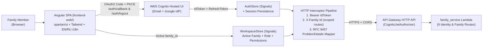

# FamilyLedger — Sprint 2 UI Execution Plan (Angular Web SPA: Auth, Multi-Family Workspace & Governance)

- **Status**: 📋 **Approved (Ready for Execution)**
- **Target Repository**: `home-harmony/frontend-web/` *(independent Git repository per [ADR-0004](../../decisions/0004-multi-repo-organization.md))*
- **Branch**: `feat/sprint-2-identity-family-ui` (in `frontend-web/`)
- **Governing ADR**: [`ADR-0021`](../../decisions/0021-angular-spa-architecture-and-ui-library.md) *(Accepted)*
- **UI Library Research**: [`Angular UI Libraries for FamilyLedger: Five Newer Candidates`](../../research/Angular%20UI%20Libraries%20for%20FamilyLedger%20Five%20Newer%20Candidates.md)

---

## 1. Sprint 2 UI Goal

Deliver the foundational **Angular Web SPA** (`frontend-web/`) and the complete **Identity & Family Workspace** user interface covering all **9 `family_service` REST endpoints** ([`api-design.md`](../../architecture/api-design.md)): Cognito Hosted UI (OAuth 2.0 PKCE) login/logout, multi-family `X-Family-Id` workspace switching ([`ADR-0011`](../../decisions/0011-multi-family-membership.md)), family creation and profile settings, Owner invite generation & deep-link invite acceptance, active member roster and role/permission governance, and **EN + RU localization** with typed RFC 9457 `error.code` mapping.

---

## 2. Settled Design Decisions

| Decision | Choice | Rationale |
| :--- | :--- | :--- |
| **UI Component Library** | **`spartan/ui` 1.0 + Tailwind CSS** | Classical low-noise shadcn aesthetic, small copy-only-what-you-use bundle, signals/standalone/zoneless-ready, covers Select/Combobox/Table/Date Picker/Dialog/Sidebar/Chart (`ADR-0021`, Accepted). Slice 0 verifies `Chart` internals & `Data Table` scaling. |
| **Spartan AI Tooling** | **Official `@spartan-ng/mcp` server** | Configured via `npx -y @spartan-ng/mcp` so AI agents read live `Brn*`/`Hlm*` APIs, blocks, and theming docs directly from `spartan.ng` rather than relying on stale training weights. |
| **Theming & UI Review Gate** | **Interactive Theme Picker (Slice 0) + UI Mock Approval Gate (Slices 2–5)** | Because `spartan/ui` themes are pure OKLCH CSS variables (`:root` / `.dark`) without visual gallery previews in docs, Slice 0 presents interactive theme candidates to choose from. Before implementing any UI view, form, dialog, or workspace (Slices 2–5), an interactive UI mock is presented for human approval or changes. |
| **Cognito Auth Flow** | **Cognito Hosted UI (OAuth 2.0 Authorization Code + PKCE)** | Matches `template.yaml` (`AllowedOAuthFlows: [code]`, `/auth/callback`, `/auth/logout`), supports both Email/Password and Google OIDC federation out of the box with zero password handling in the SPA. |
| **API Auth Token** | **Cognito `IdToken`** (`Authorization: Bearer <id_token>`) | API Gateway `CognitoJwtAuthorizer` validates `aud == CognitoWebClientId` (present only on `IdToken`); backend requires `email_verified == "true"`. |
| **Multi-Family Context** | **Active `family_id` signal + `X-Family-Id` HTTP interceptor** | Automatically attaches `X-Family-Id` on family-scoped requests and omits it on identity-only onboarding/profile routes (`GET /profile/families`, `POST /families`, `POST /families/{id}/members`). |
| **Localization & Errors** | **EN + RU i18n + typed RFC 9457 `error.code` dictionary** | Aligns with bilingual docs (`README.md` / `README.ru.md`) and enforces `api-design.md` rule: never display raw backend `detail` strings as primary user-facing copy. |
| **CSP & Hosting** | **Self-hosted assets + S3/CloudFront SPA** | Complies with `FamilyLedgerSecurityHeadersPolicy` (`script-src 'self'`, `style-src 'self' 'unsafe-inline'`, `frame-ancestors 'none'`). |

---

## 3. Frontend Architecture & Request Flow



### Target Module Layout (`frontend-web/`)

```text
frontend-web/
├── libs/ui/               # Owned spartan/ui helm components (@spartan-ng/helm/* via components.json)
└── src/app/
    ├── core/
    │   ├── api/           # Pure backend wire DTOs (family.dto.ts)
    │   ├── auth/          # PKCE OAuth2 service, AuthStore (signals), authGuard, callback/logout routes
    │   ├── config/        # Typed AppConfig + APP_CONFIG InjectionToken
    │   ├── context/       # WorkspaceStore (active family_id, role, permissions, switcher state), familyContextGuard
    │   ├── errors/        # RFC 9457 ProblemDetails model + typed error.code -> i18n key map
    │   ├── http/          # authInterceptor, familyHeaderInterceptor, problemDetailsInterceptor, typed API client
    │   └── i18n/          # EN/RU translation dictionaries, I18nService (signal), TranslatePipe
    ├── shared/
    │   └── components/    # AppShellComponent, WorkspaceSwitcherComponent, RoleBadgeComponent, PermissionChecklistComponent
    └── features/
        ├── onboarding/    # First-run Create Family / Join by Invite landing view
        ├── family/        # Workspace overview, Family Settings (PUT /families/{id})
        ├── members/       # Members roster (GET), Invite dialog (POST /invites), Role/Permissions edit (PATCH), Remove (DELETE)
        └── invite-accept/ # Deep-link /join?familyId=...&token=... acceptance view (POST /families/{id}/members)
```

---

## 4. Vertical Slice Plan (`Slice 0` – `Slice 5`)

```text
Slice 0 ✅ (Repo, spartan/ui lyra + Chart/Table Spike, 4 Live OKLCH Themes, DTOs, Errors, EN/RU i18n)
   │
   ▼
Slice 1 📋 (Cognito Hosted UI PKCE Auth, IdToken & X-Family-Id Interceptors, Route Guards)
   │
   ▼
Slice 2 📋 (App Shell, Workspace Switcher & Onboarding: GET /profile/families, POST /families)
   │
   ▼
Slice 3 📋 (Family Workspace Overview & Settings: GET /families/{id}, PUT /families/{id})
   │
   ▼
Slice 4 📋 (Invite Creation & Deep-Link Join: POST /families/{id}/invites, POST /families/{id}/members)
   │
   ▼
Slice 5 📋 (Member Roster & Governance: GET/PATCH/DELETE members + Prod Build, CSP & S3/CloudFront Deploy)
```

> **Mandatory UI Mock Approval Gate (Slices 2–5)**: Before writing Angular templates/components for any new screen, form, dialog, or workspace view, present an interactive UI mockup (using the approved OKLCH theme) for human review. Proceed to implementation only after the mock is approved or requested adjustments are applied.

| Slice | Deliverables & Vertical Behavior | Backend Endpoints & Verification Seams | Blocked By |
| :--- | :--- | :--- | :--- |
| **Slice 0** *(✅ Completed)* | Scaffold `home-harmony/frontend-web/` (Angular standalone + signals + zoneless-ready, strict TypeScript, ESLint/Prettier, `frontend-web/AGENTS.md` documenting `@spartan-ng/mcp` and the **UI Mock Approval Gate**); configure Tailwind CSS + `@spartan-ng/brain` + initial `helm` primitives (`lyra`, `--radius: 0rem`) + self-hosted font/CSS tokens matching strict CSP. **Theme Selection (`0.8`)**: interactive OKLCH theme picker approved **4 live-switchable themes** (`heritage-forest` default + `private-navy`, `slate`, `zinc`) × `system`/`light`/`dark` via `ThemeService` (`data-theme` + `.dark`) in `styles.css`. **Spike**: inspect `spartan/ui` `Chart` underlying library and `Data Table` large-dataset behavior, and record baseline `ng build` gzipped bundle stats. Wire **EN + RU i18n** + typed RFC 9457 `ProblemDetails` and `error.code` dictionary covering all Sprint 2 error codes. Add environment config (`dev` localhost:4200 vs `prod` CloudFront) with zero committed secrets. | No backend calls yet. Human approved 4 live OKLCH themes (`0.8`); unit tests for `ThemeService`, `ProblemDetails` mapper (100% of `api-design.md` §2.2.1 codes), and EN/RU key parity test; `pnpm lint`, `pnpm test`, `pnpm build` green. | — |
| **Slice 1** *(Cognito PKCE & HTTP Pipeline)* | Implement OAuth 2.0 Authorization Code + PKCE client against Cognito Hosted UI (`CognitoUserPoolDomain`, scopes `openid email profile`), `/auth/callback` code-to-token exchange, token refresh (`RefreshToken`), and `/auth/logout` teardown. Persist pending deep-link URL (e.g. invite link) across Hosted UI redirect. Enforce `IdToken` attachment (`Authorization: Bearer <id_token>`) and `email_verified` check. Implement `authInterceptor`, `familyHeaderInterceptor` (injects `X-Family-Id` on scoped routes; omits on `/profile/families`, `POST /families`, `POST /families/{id}/members`), `problemDetailsInterceptor`, and `authGuard`. | Cognito Hosted UI (`dev`) + mocked HTTP interceptor unit tests verifying `IdToken` header, `X-Family-Id` inclusion/omission rules, `401` re-auth redirect, and `application/problem+json` localization. | Slice 0 |
| **Slice 2** *(Shell, Switcher & Onboarding)* | Build classical `spartan/ui` App Shell (responsive Sidebar + Topbar with **Workspace Switcher**, active role badge, EN/RU switcher, Sign Out). On login, call `GET /profile/families`: route `0`-family users to Onboarding (`Create Family` or `Enter Invite Code`), auto-select single family, or restore last active `family_id` for multi-family users. Implement **Create Family Workspace** form (`POST /families`: `name`, searchable ISO `home_currency` combobox, `owner_display_name`) with client-side validation (`VO`/`FM` bounds) and instant workspace activation. Switching families updates `WorkspaceStore` (`X-Family-Id`) and reloads scoped views cleanly without stale cross-family data. | `GET /profile/families`, `POST /families`. Component + store tests for `0`/`1`/`2+` family routing, switcher isolation (no stale state on switch), and `422 INVALID_FAMILY_NAME` / `INVALID_CURRENCY_CODE` / `INVALID_DISPLAY_NAME` feedback. | Slice 1 |
| **Slice 3** *(Workspace Overview & Settings)* | Implement Workspace Dashboard shell (summary card + role-gated navigation placeholders for S3–S5 Accounts, Ledger, Debt Planner, Budget) and **Family Settings** view (`GET /families/{id}`). Render `PUT /families/{id}` edit form (`name`, `home_currency`) strictly for `Role::Owner` (read-only view for `Member`, `Child`, `Other`). Handle `403 INSUFFICIENT_ROLE`, `403 USER_NOT_IN_FAMILY`, `410 FAMILY_DELETED` (evicting deleted workspace from switcher and redirecting cleanly), and `422` errors. | `GET /families/{id}`, `PUT /families/{id}`. Component tests across all 4 roles (`Owner`, `Member`, `Child`, `Other`) and `410 FAMILY_DELETED` recovery flow. | Slice 2 |
| **Slice 4** *(Invites & Join Flow)* | **Owner Invite Dialog** (`POST /families/{id}/invites`): target `role` selector (`member`, `child`, `other` — `owner` excluded), conditional **8-permission checklist** rendered and enabled **only when `role === 'other'`** (Domain Invariant #10), optional `relationship`, and `ttl_hours` preset/input (`168`h default, max `720`h). Display copyable invite link (`/join?familyId={id}&token={token}`) + expiry timestamp. **Accept Invite View** (`/join`): if unauthenticated, redirects through Cognito Hosted UI and returns to `/join`; prompts for `display_name`; calls identity-only `POST /families/{id}/members`; maps `404 INVITE_TOKEN_NOT_FOUND`, `409 TOKEN_ALREADY_USED`, `409 MEMBER_ALREADY_EXISTS`, `410 TOKEN_EXPIRED`, `410 FAMILY_DELETED`; on `201 Created`, refreshes `/profile/families` and switches into the joined workspace. | `POST /families/{id}/invites`, `POST /families/{id}/members`. Component & integration tests verifying `Role::Other` permission visibility, invite link round-trip across login redirect, and all `404`/`409`/`410`/`422` error states. | Slice 3 |
| **Slice 5** *(Member Roster, Governance & Deploy)* | **Members Directory** (`GET /families/{id}/members`): `spartan/ui` Table showing active members (`display_name`, localized `role` badge, `relationship`, `permissions` pills for `Other`, `joined_at`) for all active roles. **Owner Governance**: (1) **Edit Role & Permissions Dialog** (`PATCH /families/{id}/members/{mid}/role`) with conditional `Other` permissions, no-op submit guard, and Owner protection; (2) **Remove Member Confirmation Dialog** (`DELETE /families/{id}/members/{mid}`) hidden on Owner row, refreshing roster on `204 No Content`. **Production Readiness**: verify `ng build --configuration production` bundle budgets, run live smoke test against `dev` API Gateway (`http://localhost:4200`), and add S3 sync + CloudFront invalidation deploy script verifying zero CSP violations. | `GET /families/{id}/members`, `PATCH /families/{id}/members/{mid}/role`, `DELETE /families/{id}/members/{mid}`. Component tests for Owner vs non-Owner controls, `409 CANNOT_REMOVE_OWNER` / `DUPLICATE_OWNER`, plus end-to-end smoke checklist against `dev` stack. | Slice 4 |

---

## 5. Testing & Quality Strategy

1. **Unit Tests (Vitest / Jest or Angular Runner)**:
   - PKCE verifier/challenge generation, token expiry & refresh logic, `email_verified` enforcement.
   - `familyHeaderInterceptor` matrix: guarantees `X-Family-Id` is sent on all 6 family-scoped endpoints and omitted on the 3 identity-only endpoints.
   - `ProblemDetails` RFC 9457 error-code dictionary: 100% coverage of every code in [`api-design.md`](../../architecture/api-design.md) §2.2.1 with EN/RU key parity check (CI fails if any EN key is missing in RU or vice versa).
2. **Component & Store Integration Tests**:
   - Mocked `HttpClient` tests per slice verifying role-based UI visibility (`Owner`, `Member`, `Child`, `Other`), `Role::Other`-only permission controls, multi-family workspace switching isolation, and `404`/`409`/`410`/`422` error banners.
3. **E2E Smoke Verification (Manual or Playwright against `dev`)**:
   - Two test users (`User A` Owner, `User B` Member/Other): Sign in via Cognito Hosted UI → Create Family → Update Settings → Generate `Role::Other` Invite → `User B` opens invite link, signs in, accepts invite → `User A` changes `User B`'s role & permissions → `User A` removes `User B` → Verify `User B` loses access cleanly (`403 USER_NOT_IN_FAMILY`).
   - Verify browser console reports **zero CSP violations** on CloudFront HTTPS origin.

---

## 6. Sprint 2 UI Definition of Done (DoD)

- [x] [`ADR-0021`](../../decisions/0021-angular-spa-architecture-and-ui-library.md) reviewed and marked `Accepted` by human.
- [x] `home-harmony/frontend-web/` initialized with `frontend-web/AGENTS.md` (including `@spartan-ng/mcp` setup & UI Mock Approval Gate), `spartan/ui` + Tailwind CSS, human-approved OKLCH theme in `styles.css`, and Slice 0 `Chart` / `Data Table` / bundle-size findings documented.
- [ ] Every new UI view/form/dialog in Slices 2–5 reviewed and approved via UI mocks prior to Angular implementation.
- [ ] Cognito Hosted UI (OAuth 2.0 PKCE) login, `/auth/callback`, token refresh, and `/auth/logout` working with `IdToken` (`email_verified == true`).
- [ ] All **9 `family_service` endpoints** wired through typed Angular services and `X-Family-Id` / RFC 9457 interceptors.
- [ ] Multi-family workspace switcher cleanly isolates state across `2+` families without stale data.
- [ ] Full **EN + RU** translations and typed RFC 9457 `error.code` mapping (zero raw backend `detail` strings shown as primary copy).
- [ ] `ng lint`, unit/component tests (including EN/RU key parity), and `ng build --configuration production` pass within bundle budgets.
- [ ] Live `dev` smoke test (`http://localhost:4200` and/or CloudFront S3 deploy) passes with zero CORS or CSP console errors.

---

## 7. Execution Progress & Notes

### Slice 0 — Bootstrap, `spartan/ui` Spike & Core Foundations

| Sub-Step | Status | What Was Implemented & Important Notes |
| :--- | :--- | :--- |
| **0.1 Git & Angular Scaffold** | ✅ Completed | Created sibling repo `home-harmony/frontend-web/` on branch `feat/sprint-2-identity-family-ui`. Scaffolded Angular `22.3.0` (`family-ledger-web`, standalone, routing, zoneless, Tailwind CSS `4.1.12`, Vitest `5.0.0`, TypeScript `~6.0.2`), added `@angular-eslint/schematics` `22.8.0`, enabled `strict: true` + `strictTemplates: true` in `tsconfig.json`, and configured non-interactive `pnpm test` (`ng test --watch=false`). |
| **0.2 Tailwind & `spartan/ui`** | ✅ Completed | Installed `@spartan-ng/cli` `1.10.1` (`nx: false` in `pnpm-workspace.yaml`), initialized `@spartan-ng/brain` `1.10.1` + `@angular/cdk` `22.0.0` + `cn` `0.5.2` + `tw-animate-css` `1.4.0`. Configured `components.json` (`componentsPath: "libs/ui"`, `importAlias: "@spartan-ng/helm"`, `style: "lyra"`) and generated baseline `button`, `card`, `input`, `badge`, `table`, and `select` primitives (`@ng-icons/core` + `@ng-icons/lucide` `33.4.0`). Marked `src/styles.css` neutral OKLCH tokens clearly as **temporary** until Step 0.8. Confirmed zero external script/font CDNs (system-font stack in `--font-sans`) for CloudFront CSP compliance. |
| **0.3 `Chart`, `Data Table` & Bundle Spike** | ✅ Completed | **Chart**: Inspected `@spartan-ng/cli` `1.10.1` `libs/chart/` — `HlmChart`, `HlmChartTooltip`, and `HLM_CHART_THEME` wrap **`@tanstack/charts` + `@tanstack/angular-charts` (`0.16.0`)** and bind `--ts-chart-*` directly to Spartan's `--chart-1..5` OKLCH tokens. **Data Table**: `libs/table/` provides `HlmTable*` directives (`HlmTableContainer`, `HlmTable`, `HlmTHead`, `HlmTBody`, `HlmTFoot`, `HlmTr`, `HlmTh`, `HlmTd`, `HlmCaption`), designed to pair with headless `@tanstack/angular-table` — fits FamilyLedger's server-side keyset pagination (`limit <= 50` per `ADR-0002`) without heavy client virtualization. **Baseline Prod Bundle (`pnpm build`, `lyra`)**: `main` `218.50 kB` raw (`60.03 kB` est. transfer), `styles` `37.12 kB` raw (`6.39 kB` est. transfer) = **`255.62 kB` raw (`66.42 kB` est. transfer)**. |
| **0.4 `AGENTS.md` & Env Config** | ✅ Completed | Authored `frontend-web/AGENTS.md` (reading order, Angular 22 rules, `@spartan-ng/mcp` setup, mandatory UI Mock Approval Gate, verification gates). Added typed `AppConfig` + `APP_CONFIG` `InjectionToken` (`src/app/core/config/app-config.ts`), placeholder-only `environment.ts` / `environment.prod.ts` (zero secrets), and `fileReplacements` in `angular.json` production build. |
| **0.5 Wire DTOs & RFC 9457 Mapper** | ✅ Completed | Added `src/app/core/api/family.dto.ts` matching `backend/lambdas/family_service/src/dto.rs` 1:1 (`Role`, `Permission`, `ALL_PERMISSIONS`, and all 13 request/response DTOs). Added `src/app/core/errors/problem-details.ts` covering all **31** backend `API_ERROR_CODES` (8 auth, 3 request/infra, 20 domain/lifecycle) plus `NETWORK_ERROR` (`status === 0`) and `UNKNOWN_ERROR` fallback — never leaking raw backend `detail` strings. |
| **0.6 EN + RU i18n Foundation** | ✅ Completed | Added `messages.en.ts` (`EN_MESSAGES`, `TranslationKey`), `messages.ru.ts` (`RU_MESSAGES: Record<TranslationKey, string>`), signal-based `I18nService` (`locale` signal, `fl_locale` persistence, `navigator.language` fallback, `<html lang>` sync, `{{param}}` interpolation, `translateError`), and standalone `TranslatePipe` (`t`). |
| **0.7 Unit Tests & Gates** | ✅ Completed | Added `problem-details.spec.ts` (4 tests: type guard, all 31 codes, network/unknown fallbacks, explicit no-`detail`-leak assertion across EN/RU) and `i18n.service.spec.ts` (3 tests: strict EN/RU key parity & non-empty copy, locale persistence & `<html lang>`, `{{param}}` interpolation). Verified `pnpm lint` (0 warnings/errors), `pnpm test` (3 files / 9 tests passed), and `pnpm build` (green). |
| **0.8 Interactive OKLCH Theme Picker & Live Switcher** | ✅ Completed | Built interactive OKLCH Theme Picker artifact; user selected **Lyra sharp (`--radius: 0rem`)** with **4 live-switchable themes** (`heritage-forest` default + `private-navy`, `slate`, `zinc`) across `system` (default) / `light` / `dark`. Locked `:root[data-theme=...]` & `:root.dark[data-theme=...]` tokens in `src/styles.css`, added signal-based `ThemeService` (`src/app/core/theme/theme.service.ts` + `fl_theme`/`fl_color_mode` persistence + `prefers-color-scheme` listener) wired via `provideAppInitializer` in `app.config.ts`, added EN/RU theme labels, and added 5 tests in `theme.service.spec.ts`. Final Slice 0 gates: `pnpm lint` (0 errors), `pnpm test` (`4` files / `14` tests passed), `pnpm build` (`main` `221.02 kB` / `60.64 kB` transfer + `styles` `45.89 kB` / `7.45 kB` transfer = **`266.91 kB` raw / `68.08 kB` transfer**). |
