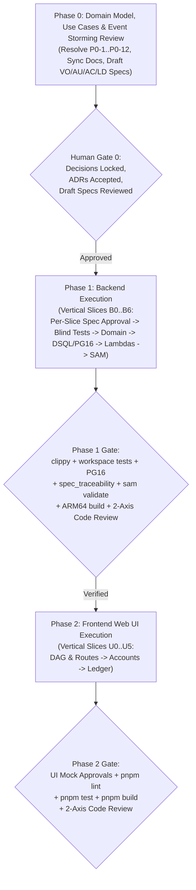
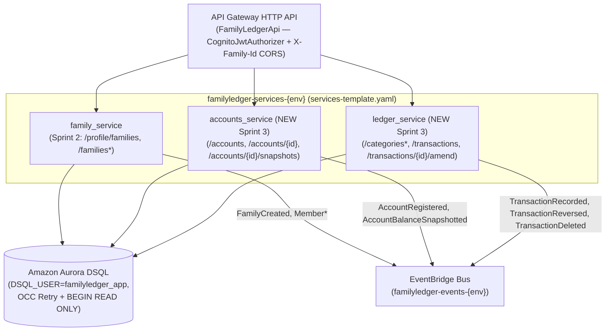

# FamilyLedger — Sprint 3 Execution Plan (Payment Accounts, Balance Snapshots & Immutable Ledger Core)

- **Status**: 🚧 **In Progress (Phase 0 Complete — Ready for Phase 1 Backend)**
- **Branch**: `feat/sprint-3` (across `documentation/`, `backend/`, and `frontend-web/`)
- **Target Duration**: 3 Weeks (per [`sprint-roadmap.md`](../sprint-roadmap.md))
- **Governing ADRs**:
  - [`ADR-0002`](../../decisions/0002-keyset-pagination.md) — Keyset Cursor Pagination (`UUID v7`, `limit <= 50`)
  - [`ADR-0003`](../../decisions/0003-rust-ddd-clean-architecture.md) — Clean Architecture / DDD Hexagonal Boundaries in Rust
  - [`ADR-0005`](../../decisions/0005-decimal-precision-money.md) — Float-Free `rust_decimal::Decimal` Money
  - [`ADR-0006`](../../decisions/0006-account-balance-snapshot.md) — Separate `AccountBalanceSnapshot` Table & Balance Derivation
  - [`ADR-0011`](../../decisions/0011-multi-family-membership.md) — Multi-Family Workspace Isolation (`X-Family-Id`) & RBAC
  - [`ADR-0012`](../../decisions/0012-immutable-ledger-transactions.md) — Immutable Ledger & `TransactionAmendment` Reversals
  - [`ADR-0015`](../../decisions/0015-multi-currency-live-exchange-rates.md) — Multi-Currency Display & Dual-Amount Cross-Currency Transfers
  - [`ADR-0017`](../../decisions/0017-cdc-and-event-publishing-strategies.md) — Direct EventBridge Domain Event Publishing (`$0.00` idle cost)
  - [`ADR-0019`](../../decisions/0019-declarative-test-specifications.md) — Declarative Behavior Specifications & Blind Spec Tests
  - [`ADR-0020`](../../decisions/0020-atomic-aggregate-update-port.md) — Atomic Aggregate Update Port & Snapshot-Diff Persistence
  - [`ADR-0021`](../../decisions/0021-angular-spa-architecture-and-ui-library.md) — Angular Web SPA, `spartan/ui` & Cognito PKCE
  - [`ADR-0022`](../../decisions/0022-frontend-web-structure-and-styling.md) — Frontend Bounded-Context Slices, Suffixless Role Folders & 3-Layer CSS

---

## 1. Sprint 3 Goal & 3-Phase Execution Structure

Deliver the end-to-end **Payment Cards & Accounts** (`accounts_service`) and **Ledger Core** (`ledger_service`) bounded contexts across backend and web UI:

- **Payment Accounts & Monthly Balance Snapshots**: `PaymentAccount` registry (`CreditCard`, `DebitCard`, `Cash`, `BankAccount`), `AccountBalanceSnapshot` entity, derived `current_balance` (`SignedMoney`) computed from latest snapshot + bounded ledger delta ([`ADR-0006`](../../decisions/0006-account-balance-snapshot.md)), and month-end snapshot computation service (wired to EventBridge Scheduler in Sprint 6).
- **Immutable Ledger Core & Categories**: Global system + per-family `Category` taxonomy, append-only `Transaction` recording (`Income`, `Expense`, `Transfer`, `CashWithdrawal`) with `TransactionId` (`UUID v7`), strictly positive `PositiveMoney` amounts, and per-family `idempotency_key`, accounting amendment flow (`POST /transactions/{id}/amend` creating linked `Reversal` + corrected entry, [`ADR-0012`](../../decisions/0012-immutable-ledger-transactions.md)), and soft-delete (`DELETE /transactions/{id}`).
- **Cross-Currency Transfers & Keyset Pagination**: Dual-amount `CrossCurrencyTransfer` (and cross-currency `CashWithdrawal`) recording with implied conversion rate and optional `FXSpread` calculation ([`ADR-0015`](../../decisions/0015-multi-currency-live-exchange-rates.md)), plus keyset cursor pagination (`(occurred_at, id) < ($cursor_time, $cursor_id)`, `limit <= 50`, [`ADR-0002`](../../decisions/0002-keyset-pagination.md)).
- **Direct EventBridge Publishing**: `accounts_service` and `ledger_service` emit typed `DomainEvent`s directly to `familyledger-events-{env}` after DSQL commit ([`ADR-0017`](../../decisions/0017-cdc-and-event-publishing-strategies.md)).
- **Angular Web SPA (`frontend-web/`)**: Lazy bounded-context slices `features/accounts/` and `features/ledger/` following [`ADR-0022`](../../decisions/0022-frontend-web-structure-and-styling.md) with ESLint-enforced sibling isolation, strict 4-role / `Role::Other` permission gating, float-free decimal display (`MoneyDisplay`), snapshot trend charts, keyset-paginated transaction feed, dual-amount FX transfer UX, and immutable amendment workflows.

### Strict 3-Phase Execution Flow



---

## 2. Phase 0: Domain Model, Use Cases & Event Storming Review (Pre-Coding Alignment Gate)

Phase 0 runs **before** any Rust or Angular implementation. Its goal is to resolve all **12 cross-context gaps, accounting edge cases, CI constraints, and contract mismatches (`P0-1` – `P0-12`)** uncovered across [`ubiquitous-language.md`](../../domain/ubiquitous-language.md), [`bounded-contexts.md`](../../domain/bounded-contexts.md), [`event-storming.md`](../../domain/event-storming.md), [`api-design.md`](../../architecture/api-design.md), [`database-schema.md`](../../architecture/database-schema.md), [`migration_invariants.rs`](../../../backend/infrastructure/tests/migration_invariants.rs), [`spec_traceability.rs`](../../../backend/domain/tests/spec_traceability.rs), and the Sprint 2 codebases.

### Phase 0 Decision & Audit Table (`P0-1` – `P0-12`)

| ID | Topic & Current Gap / Contradiction | Options & Trade-offs | Recommended Default (`➡️`) |
| :--- | :--- | :--- | :--- |
| **`P0-1`** | **Caller `MemberId`, `HomeDisplayCurrency` & `Permissions` Propagation**: `MemberAccess` (`domain/src/ports.rs`) and `AuthClaims` (`api/src/auth.rs`) carry `role` and `permissions`, but lack `member_id: MemberId` (needed for `payment_accounts.owner_member_id`, `ledger_transactions.recorded_by`, and ownership checks) and `home_currency: CurrencyCode` (needed by `ledger_service` to compute `FXSpread` in `HomeDisplayCurrency` per `ADR-0015`). Likewise, `GET /profile/families` (`UserFamilySummary`) returns only `{ role, display_name }`, leaving `WorkspaceStore` in `frontend-web/` without `member_id` or `permissions` for `Role::Other` UI gating. | **A.** Add `member_id: MemberId` (and `home_currency: CurrencyCode` via `family_members JOIN family_families` in `MembershipReader`, or a separate `FamilyCurrencyReader` port) to `MemberAccess` / `AuthClaims`, AND add `member_id` + `permissions` to `GET /profile/families` (`membership: { member_id, role, permissions, display_name }`).<br>**B.** Keep `GET /profile/families` unchanged and force extra `GET /families/{id}/members` + `GET /families/{id}` calls per request/switch. | ➡️ **Option A**: Extend `MemberAccess` & `AuthClaims` with `member_id` (plus `FamilyCurrencyReader` or `home_currency` on `MemberAccess`) and enrich `GET /profile/families` with `member_id` + `permissions` for zero-extra-roundtrip authorization in both backend and SPA. |
| **`P0-2`** | **Ledger Amendment (`ADR-0012`), Cross-Currency `Reversal` Math & Balance Derivation (`ADR-0006`)**:<br>1. **Double-Negation Hazard**: `ADR-0012` marks an amended original `deleted_at = now()` *and* inserts a `Reversal` row (`deleted_at IS NULL`), while `ADR-0006` sums `WHERE deleted_at IS NULL` — which would drop the original *and* apply the `Reversal`, double-negating the amount!<br>2. **Cross-Currency `Reversal` Currency Mismatch**: For a cross-currency transfer (`Account A` in `MDL` → `Account B` in `EUR`: `amount = 1950 MDL`, `destination_amount = 100 EUR`), swapping `source_account_id` ↔ `destination_account_id` without swapping `amount` ↔ `destination_amount` debits `B` in `MDL` and credits `A` in `EUR`, violating Domain Invariant #2 (`Currency Consistency`). | **A (Keep original non-deleted; invert direction & dual amounts on `Reversal`)**:<br>1. Keep `original.deleted_at = NULL` when amended (reserve `deleted_at` strictly for `DELETE /transactions/{id}`). Because `original + Reversal == 0`, same-month sums cancel out exactly **and** post-snapshot amendments in later months naturally adjust balances after a closed `AccountBalanceSnapshot` without rewriting historical snapshots.<br>2. For single-currency / single-leg transactions (`Income`, `Expense`, same-currency `Transfer`/`CashWithdrawal`, `LoanPayment`), `Reversal` swaps `source_account_id` ↔ `destination_account_id` and keeps `amount` (`destination_amount = None`).<br>3. For cross-currency transactions (`destination_amount.is_some()`), `Reversal` swaps `source_account_id` ↔ `destination_account_id` **AND** swaps `amount` ↔ `destination_amount` so `amount.currency == source.currency` and `destination_amount.currency == destination.currency`.<br>4. Reject amending a `Reversal` (`422 CANNOT_AMEND_REVERSAL`), an already-amended row (`409 TRANSACTION_ALREADY_AMENDED`), or a soft-deleted row (`410 TRANSACTION_DELETED`). Default `GET /transactions` hides superseded originals and `Reversal` rows unless `?include_audit=true`.<br>**B.** Soft-delete original and exclude `Reversal` from balance sums (breaks post-snapshot prior-month amendments). | ➡️ **Option A** (adding an explicit clarification note to `ADR-0012` and `ADR-0006` during Phase 0). |
| **`P0-3`** | **`SignedMoney`, Positive Transaction Amounts & Account `opening_balance` Strategy**:<br>1. `Money` allows `0` (`>= 0`), which is valid for `$0.00` credit limits, **but** allowing `0` on `Transaction` permits zero-value ledger noise and causes **division-by-zero** in `implied_rate = destination_amount / source_amount`.<br>2. `AccountBalanceSnapshot.closing_balance` and `PaymentAccount` current balances can be negative (`SignedMoney`).<br>3. Seeding an initial account balance via `account_balance_snapshots` (`YYYY-MM`) breaks `ADR-0006`'s `occurred_at > snapshot_end_of_month` cutoff for mid-month or backdated transactions, while writing directly to `ledger_transactions` from `POST /accounts` couples `accounts_service` to `ledger_service`'s write table. | **Amounts**: Add `SignedMoney` (`< 0`, `0`, `> 0`) for account balances, snapshots, and `FXSpread`, and `PositiveMoney` (strictly `> 0`) for `Transaction` amounts (`amount` and `destination_amount`).<br>**Opening Balance**:<br>**Option A1 (Immutable column on `payment_accounts`)**: Add `opening_balance NUMERIC(19,4) NOT NULL DEFAULT 0` via 1-DDL `ALTER TABLE` migration (set once at creation, never mutated on transactions — zero OCC contention; pre-snapshot balance = `opening_balance + ledger_sum`, first month-end snapshot folds `opening_balance` into `closing_balance`, post-snapshot balance = `latest_snapshot.closing_balance + delta_after_month_end`).<br>**Option A2 (No schema column; optional `POST /transactions` entry)**: Start all accounts at `0`; when a user enters a non-zero initial balance in the UI, the SPA submits an initial `Income` (`> 0`) or `Expense` (`< 0`) via `POST /transactions`. | ➡️ **`SignedMoney` + `PositiveMoney` (`> 0`)**, paired with **Option A1** (immutable `opening_balance` column on `payment_accounts`) so existing bank/card balances onboard atomically in `accounts_service` without distorting income/expense analytics or mid-month cutoffs. |
| **`P0-4`** | **`ledger_categories` System Seeding (Zero DML in `.sql` Migrations) & Category/Kind Rules**:<br>1. [`migration_invariants.rs`](../../../backend/infrastructure/tests/migration_invariants.rs) explicitly bans `INSERT INTO`, `UPDATE `, and `DELETE FROM` in `backend/migrations/*.sql`, so system categories (`family_id IS NULL`) **cannot** be seeded via `.sql` migrations.<br>2. `api-design.md` has zero `/categories` endpoints.<br>3. `ledger_categories` defines `CHECK (kind IN ('income','expense','transfer'))` and `bounded-contexts.md` marks `category_id` *nullable* for `Transfer`, so `Transfer` must **not** forbid `'transfer'` categories. | **A.**<br>1. Seed global system categories (`family_id IS NULL`, deterministic UUIDs) via an **idempotent Rust seeder** run by `migrate_runner` after DDL migrations (matching `debt_loan_kinds` in `ADR-0007`), and update `event-storming.md` (`FamilyCreated` does not copy categories per family).<br>2. Expose `GET /categories`, `POST /categories`, `PUT /categories/{id}`, `DELETE /categories/{id}` on `ledger_service` (system rows are read-only; `403`/`409` on edit/delete).<br>3. Category rules on `Transaction`: `Income` **requires** active category (`kind == 'income'`); `Expense` **requires** active category (`kind == 'expense'`); `Transfer` & `CashWithdrawal` accept **optional** `Option<CategoryId>` (if `Some`, must have `kind == 'transfer'`); `LoanPayment` & `Reversal` require `category_id == None`. | ➡️ **Option A**: Idempotent Rust system-category seed in `migrate_runner` + `/categories*` endpoints + aligned `'income' \| 'expense' \| 'transfer'` category validation. |
| **`P0-5`** | **`CashWithdrawal` Domain Invariants & Cross-Currency Transfers (`ADR-0015`)**:<br>1. `ubiquitous-language.md` Invariant #3 requires `Transfer` and `CashWithdrawal` to have distinct `source_account_id` and `destination_account_id`, but account-kind and FX rules for `CashWithdrawal` are unspecified.<br>2. Daily `exchange_rate_fetcher` (BNM/ECB) lands in **Sprint 5**, so `exchange_rates` will normally be empty in Sprint 3. | **A.**<br>1. `CashWithdrawal` requires `destination_account.kind == AccountKind::Cash` and `source_account.kind != AccountKind::Cash` (`CreditCard`, `DebitCard`, `BankAccount`), and supports **both** same-currency and cross-currency ATM withdrawals using the exact same dual-amount invariant as `Transfer` (`destination_amount` required & matching `destination_account.currency` iff `source.currency != destination.currency`; forbidden when equal).<br>2. Because `PositiveMoney` guarantees `source_amount > 0`, `implied_rate = destination_amount / source_amount` is always defined on cross-currency `Transfer`/`CashWithdrawal`; `fx_spread` in `HomeDisplayCurrency` is returned as `Option<SignedMoney>` (`Some` when `exchange_rates` rows exist, `None` until Sprint 5). | ➡️ **Option A**: Lock `CashWithdrawal` (`Non-Cash -> Cash`, optional cross-currency) + safe `implied_rate` + `Option<SignedMoney>` `fx_spread`. |
| **`P0-6`** | **`PaymentAccount`, `Category` & `Transaction` Field Bounds & Lifecycle Invariants**: Reconcile `bounded-contexts.md` with SQL column limits in `database-schema.md` (`payment_accounts`, `ledger_categories`, `ledger_transactions`) and lock update/soft-delete behavior. | **A.**<br>- `PaymentAccount`: `name` (`1..=200`), `kind`, `currency`, `credit_limit` (`Option<Money>`, allowed **only** for `CreditCard`, `422` otherwise), `last_four` (`Option<LastFour>`, 4 ASCII digits), `bank_name` (`Option<BankName>`, `1..=100`), `color` (`Option<HexColor>`, `#RRGGBB`), `included_in_budget: bool`, `opening_balance: SignedMoney` (if `P0-3` A1). `currency`, `kind`, `owner_member_id`, and `opening_balance` are **immutable** after creation.<br>- `Category`: `name` (`1..=100`), `kind` (`income \| expense \| transfer`), `icon` (`Option<CategoryIcon>`, `1..=50`), `color` (`Option<HexColor>`).<br>- `Transaction`: `tags` (`<= 20` unique trimmed tags, each `1..=40` chars), `description` (`Option<TransactionDescription>`, `1..=500` chars).<br>- Soft-deleted accounts (`410 ACCOUNT_DELETED`) and soft-deleted categories (`410 CATEGORY_DELETED`) reject new transactions/amendments while remaining readable in historical views. | ➡️ **Option A**: Codify all schema bounds in `nutype` / domain VOs (`Slice B0`). |
| **`P0-7`** | **Idempotency Contract, Dual-Row Amendment Keys & UUID v7 Ordering**:<br>1. `ledger_transactions` has `UNIQUE (family_id, idempotency_key)`, yet `POST /transactions/{id}/amend` inserts **2 rows** (`Reversal` + `Corrected`) from 1 client `idempotency_key` — reusing the raw key on both rows crashes with `SQLSTATE 23505`.<br>2. Duplicate `idempotency_key` replay vs. conflict behavior is unspecified.<br>3. `ledger_transactions` / `account_balance_snapshots` have SQL `DEFAULT gen_random_uuid()` (UUID v4), whereas `ADR-0002` mandates `UUID v7`. | **A.**<br>1. **Replay vs. Conflict**: Repeating `POST /transactions` or `POST /transactions/{id}/amend` with an existing `(family_id, idempotency_key)` returns idempotent `200 OK` / `201 Created` (emitting `0` duplicate EventBridge events) if the normalized request matches the recorded entry, or `409 IDEMPOTENCY_CONFLICT` if the payload differs.<br>2. **Dual-Row Key Derivation**: Store the client's `idempotency_key` on `Corrected`, and deterministically derive `Reversal`'s key via SHA-256 domain separation (`derive_reversal_idempotency_key(family_id, idempotency_key)` -> RFC 9562 UUID v8).<br>3. **Explicit UUID v7 Ordering**: Always bind Rust-generated `Uuid::now_v7()` on `INSERT` (never rely on SQL `DEFAULT`), and mint `Reversal`'s UUID v7 strictly `<` `Corrected`'s UUID v7 so `ORDER BY occurred_at DESC, id DESC` deterministically places `Corrected` above `Reversal` when `include_audit=true`. | ➡️ **Option A**: Deterministic idempotent replay + `409` payload-mismatch guard + derived reversal UUID + ordered `Uuid::now_v7()`. |
| **`P0-8`** | **4-Role RBAC, Ownership & Zero-Permission `Role::Other` Edge Cases**: Clarify exact access rules across `Owner`, `Member`, `Child`, and `Other` (`ViewAllAccounts`, `ManageOwnAccounts`, `ViewAllTransactions`, `RecordOwnTransactions`, `RecordAnyTransaction`), including inbound transfers to `Child` accounts and `Role::Other` with `permissions = []`. | **A.**<br>1. **Zero-Permission `Role::Other`**: Calling `/accounts*` without `ViewAllAccounts \| ManageOwnAccounts` or `/transactions*` without `ViewAllTransactions \| RecordOwnTransactions \| RecordAnyTransaction` returns **`403 INSUFFICIENT_ROLE`** (and `AppShell` hides those nav items).<br>2. **Account Read**: `ViewAllAccounts` -> all active family accounts; `ManageOwnAccounts` only -> accounts where `owner_member_id == claims.member_id`.<br>3. **Account Write**: `POST /accounts` requires `ManageOwnAccounts` (`owner_member_id` defaults to `claims.member_id`; `Owner` may specify another active `member_id`); `PUT`/`DELETE /accounts/{id}` allowed for account owner (with `ManageOwnAccounts`) or `Role::Owner`.<br>4. **Transaction Read**: `ViewAllTransactions` -> all family transactions; `RecordOwnTransactions` only -> rows where `recorded_by == claims.member_id` **OR** `source_account_id`/`destination_account_id` belongs to `claims.member_id` (so a child sees inbound allowance transfers).<br>5. **Transaction Write / Amend / Delete**: `RecordAnyTransaction` allows any active family account; `RecordOwnTransactions` requires all referenced accounts to belong to `claims.member_id` (and on amend/delete, `recorded_by == claims.member_id`).<br>6. **Categories**: `GET /categories` requires any ledger view/record permission; `POST`/`PUT`/`DELETE /categories*` requires `RecordAnyTransaction` (i.e. `Owner`, `Member`, or `Other` granted `RecordAnyTransaction`). | ➡️ **Option A**: Complete, zero-ambiguity 4-role + `Role::Other` authorization matrix. |
| **`P0-9`** | **Hexagonal Cross-Context Read Ports (`ADR-0003`)**: `accounts_service` reads `ledger_transactions` to derive balances, and `ledger_service` reads `payment_accounts` (with OCC locking), `exchange_rates`, and `family_families` (`home_currency`). | **A.** Declare explicit read-only RPITIT ports in `domain/src/ports.rs`:<br>- `AccountLedgerDeltaReader` (used by `accounts_service` for post-snapshot balance deltas & month-end closing balances)<br>- `AccountAccessReader` (used by `ledger_service` inside OCC transactions via `SELECT ... FOR KEY SHARE` / `FOR UPDATE` to verify account existence, active status, `owner_member_id`, `kind`, and `currency`)<br>- `ExchangeRateReader` (+ `FamilyCurrencyReader` if `home_currency` is not on `AuthClaims`) for `FXSpread`. | ➡️ **Option A**: Keep `domain/` pure and model cross-context reads explicitly in `domain/src/ports.rs` (matching Sprint 2's `MembershipReader`). |
| **`P0-10`** | **Event Storming, EventBridge Payloads & Snapshot Trigger Surface (`ADR-0017`)**:<br>1. `domain/src/events/mod.rs` TODOs for `TransactionRecorded` omit account/category/FX fields needed by Sprint 4 (`ADR-0014`) and Sprint 5 (`BudgetAlertTriggered`).<br>2. `accounts_service` uses `lambda_http::run(app)` (API Gateway HTTP events), which rejects raw EventBridge Scheduler JSON payloads. | **A.**<br>1. Enrich Sprint 3 `DomainEvent` variants now:<br>- `AccountRegistered { family_id, account_id, owner_member_id, kind, currency, occurred_at }`<br>- `AccountBalanceSnapshotted { family_id, account_id, year_month, closing_balance: SignedMoney, occurred_at }`<br>- `TransactionRecorded { family_id, transaction_id, recorded_by, kind, amount, destination_amount, source_account_id, destination_account_id, category_id, amendment_of_id, occurred_at }`<br>- `TransactionReversed { family_id, reversal_transaction_id, corrected_transaction_id, amendment_of_id, source_account_id, destination_account_id, amount, destination_amount, reversed_by, occurred_at }`<br>- `TransactionDeleted { family_id, transaction_id, source_account_id, destination_account_id, deleted_by, occurred_at }`<br>2. `PUT`/`DELETE /accounts/{id}` and `/categories*` emit `0` EventBridge events.<br>3. Sprint 3 delivers the month-end snapshot domain/application use case + `DsqlAccountSnapshotRepository` + `GET /accounts/{id}/snapshots` (tested in Layer 1/2a/2b); EventBridge Scheduler cron + scheduled Lambda handler are wired in Sprint 6 per [`sprint-roadmap.md`](../sprint-roadmap.md). | ➡️ **Option A**: Lock enriched EventBridge contracts now and keep `accounts_service` HTTP-only until Sprint 6 scheduler wiring. |
| **`P0-11`** | **ADR Governance, Incremental Spec Lifecycle (`spec_traceability`) & Migration Invariants**:<br>1. `ADR-0020` and `ADR-0022` are still `Proposed`; Sprint 2 also left `AU-09`–`AU-10` (`multi-family-auth.md`) and `FM-30`–`FM-31` (`family-rbac.md`) in `Status: Draft` (so new `AU` rules must start at `AU-11`).<br>2. **CI Trap**: `spec_traceability.rs` fails `cargo test --workspace` if *any* `Approved` rule lacks a passing test — marking all `AC` and `LD` rules `Approved` upfront in Phase 0 would break CI in `Slices B0`–`B4`!<br>3. Adding DDL migrations requires updating hardcoded counts/lists in `migration_invariants.rs` (`36` files, `18` indexes) and `database-schema.md`. | **A.**<br>1. Present `ADR-0020` and `ADR-0022` for human `Accepted` sign-off, and settle `AU-09`–`AU-10` & `FM-30`–`FM-31`.<br>2. Register prefix `AC` (`domain/payment-accounts.md`) alongside `LD` (`domain/ledger-immutability.md`) in [`backend/specs/README.md`](../../../backend/specs/README.md) and draft all Sprint 3 rules (`VO`, `AU-11+`, `AC`, `LD`) as **`Status: Draft`** in Phase 0. Promote each slice's rules from `Draft` → `Approved` (human gate) **slice-by-slice** in Phase 1 alongside its 1:1 blind tests.<br>3. Add 1-DDL-per-file migrations (`opening_balance` `ALTER TABLE` if `P0-3` A1, `CREATE INDEX ASYNC IF NOT EXISTS idx_categories_family`, `CREATE INDEX ASYNC IF NOT EXISTS idx_tx_amendment_of`) and update `migration_invariants.rs` + `database-schema.md` in the same commit. | ➡️ **Option A**: Draft full specs in Phase 0 (`Status: Draft`), approve per vertical slice in Phase 1, and keep `migration_invariants` + `spec_traceability` green on every commit. |
| **`P0-12`** | **Frontend Bounded-Context Isolation & `/workspace` Routing (`ADR-0022`)**:<br>1. `WorkspaceOverview` lives in `src/app/features/family/pages/workspace-overview/`, which under `ADR-0022` **must never** import sibling `features/accounts` or `features/ledger`; `eslint.config.js` also lacks cross-feature `no-restricted-imports` rules.<br>2. `app.routes.ts` binds `/workspace` directly to `loadChildren: familyWorkspaceRoutes`, blocking `/workspace/accounts` and `/workspace/transactions` without coupling `family.routes.ts` to sibling features. | **A (Strict Isolation + Child Routes)**:<br>1. Add cross-feature `no-restricted-imports` rules in `frontend-web/eslint.config.js` blocking any `features/<ctx>` from importing another `features/<other>`.<br>2. Refactor `/workspace` in `app.routes.ts` to `children: [{ path: '', loadChildren: family }, { path: 'accounts', loadChildren: accounts }, { path: 'transactions', loadChildren: ledger }]`.<br>3. Keep `WorkspaceOverview` (`features/family/`) strictly decoupled: replace S3 "Soon" badges with live router links (`/workspace/accounts`, `/workspace/transactions`) — or, if live cross-context financial summary cards are desired on `/workspace`, extract `/workspace` root overview into a dedicated `features/dashboard/` slice (or read-only summary port in `shared/`). | ✅ **Settled (`Option A`)**: Add ESLint cross-feature boundaries + `/workspace` child-route table in `Slice U0`, keeping `WorkspaceOverview` decoupled via live router links. |
| **`P0-13`** | **End-to-End Ubiquitous Language Rename (`Role::Other` → `Role::Guest`, `'guest'`)**: Displaying `"Other"` / `«Другой»` on badges and invite dialogs feels cold and bureaucratic; `"Relative"` collides with `FamilyMember.relationship` (`"Grandma"`, `"Nanny"`, `"Accountant"`). | **A (Full Ubiquitous-Language Rename)**: Rename `Role::Other` / `'other'` end-to-end to **`Role::Guest`** / `'guest'` (`"Guest"` / `«Гость»`) across Ubiquitous Language, specs (`FM-32` + `FM`/`AU` updates in `Slice B0`), Aurora DSQL `CHECK` constraints (`ALTER TABLE ... DROP CONSTRAINT` + `ADD CONSTRAINT ... CHECK (...) NOT VALID` + `ALTER TABLE ASYNC ... VALIDATE CONSTRAINT` + `migrate_runner` legacy `'other'` -> `'guest'` normalization and `rewrite_sql_for_postgres("ALTER TABLE ASYNC", "ALTER TABLE")`), Rust backend (`domain`, `api`, `family_service`, `accounts_service`, `ledger_service`), and Angular SPA (`frontend-web/`).<br>**B.** UI translation change only. | ✅ **Settled (`Option A`)**: Full-stack Ubiquitous Language rename `Role::Other` → `Role::Guest` (`'guest'`, UI `"Guest"` / `«Гость»`) executed across `Slice B0` (Backend + DSQL) and `Slice U0` (Frontend). |

### Phase 0 Deliverables & Exit Gate

Before starting Phase 1 coding:
- [x] All 13 Phase 0 items (`P0-1` – `P0-13`, all defaults + `Role::Guest` end-to-end rename) reviewed and decided with the user.
- [x] [`ubiquitous-language.md`](../../domain/ubiquitous-language.md), [`bounded-contexts.md`](../../domain/bounded-contexts.md), [`event-storming.md`](../../domain/event-storming.md), [`api-design.md`](../../architecture/api-design.md), and [`database-schema.md`](../../architecture/database-schema.md) updated to reflect settled Phase 0 decisions.
- [x] [`ADR-0020`](../../decisions/0020-atomic-aggregate-update-port.md) and [`ADR-0022`](../../decisions/0022-frontend-web-structure-and-styling.md) (plus clarification notes on [`ADR-0006`](../../decisions/0006-account-balance-snapshot.md), [`ADR-0011`](../../decisions/0011-multi-family-membership.md), and [`ADR-0012`](../../decisions/0012-immutable-ledger-transactions.md)) reviewed and marked `Accepted` by human.
- [x] Sprint 2 leftover `Draft` rules (`AU-09`–`AU-10`, `FM-30`–`FM-31`) approved by human for `Slice B0` activation, prefix `AC` registered in [`backend/specs/README.md`](../../../backend/specs/README.md), and full Sprint 3 rule sets (`VO-13`–`VO-18`, `FM-32`, `AU-11`–`AU-12`, `AC-01`–`AC-14`, `LD-01`–`LD-18`) drafted as `Status: Draft` ready for slice-by-slice promotion in Phase 1.

---

## 3. Phase 1: Backend Execution Plan (`accounts_service` & `ledger_service`)

Phase 1 implements the Sprint 3 backend in strict vertical tracer-bullet slices (`B0` – `B6`) ordered so **transaction and amendment persistence (`B2`–`B4`) precedes ledger-derived balance & snapshot queries (`B5`)**, eliminating cross-table forward dependencies while keeping `spec_traceability` and `migration_invariants` green after every slice.

### Phase 1 Target Architecture (Option B2 3-Stack SAM)



### Phase 1 Vertical Slice Flow (`Slice B0` – `Slice B6`)

```text
Slice B0 (Prefactoring: Approve VO/AU Specs + VOs + MemberId Auth + Ports + 1-DDL Migrations + Rust Category Seeder)
   │
   ▼
Slice B1 (accounts_service: Approve AC-CRUD Specs + PaymentAccount Registry CRUD + Ownership RBAC + AccountRegistered)
   │
   ▼
Slice B2 (ledger_service: Approve LD-Core Specs + Categories CRUD + POST /transactions + Idempotency + TransactionRecorded)
   │
   ▼
Slice B3 (ledger_service: Approve LD-FX Specs + Cross-Currency Transfers/Withdrawals + Keyset Pagination + Filters)
   │
   ▼
Slice B4 (ledger_service: Approve LD-Amend Specs + POST /transactions/{id}/amend + 405 PUT + Soft-Delete)
   │
   ▼
Slice B5 (accounts_service: Approve AC-Snapshot Specs + SignedMoney Derived Balances + Monthly AccountBalanceSnapshots)
   │
   ▼
Slice B6 (Option B2 SAM Wiring + .sqlx Offline Cache + ARM64 Lambda Builds + 2-Axis Code Review)
```

> **Per-Slice Spec Approval & TDD Seam Strategy**: At the start of each slice (`B0`–`B5`), the human marks **only that slice's** `Draft` spec rules as `Approved`, and a blind test generator produces 1:1 spec tests (`spec_traceability` enforced). Repository & cross-context reader ports (`Dsql*`) are verified via Layer 2a Testcontainers PostgreSQL 16 (`cargo test -p infrastructure -- --ignored --test-threads=1`), and HTTP contracts, keyset cursors, idempotency, RBAC matrices, and `SpyPublisher` domain events are verified via Layer 2b Axum `oneshot()` tests in `lambdas/{accounts_service,ledger_service}/tests/`.

| Slice | Deliverables & Vertical Behavior | Endpoints / Crates / Artifacts | Test Seams | Blocked By |
| :--- | :--- | :--- | :--- | :--- |
| **`Slice B0`** | **Prefactoring, `Role::Guest` Rename, Shared VOs, Ports & 1-DDL Migrations**: Activate human-approved `AU-09..10` & `FM-30..31`, plus human-approve `FM-32` (`Role::Other` -> `Role::Guest`, wire `"guest"`), `VO-11..18` (`SignedMoney`, `PositiveMoney`, `AccountName`, `BankName`, `LastFour`, `HexColor`, `YearMonth`, `CategoryName`, `CategoryIcon`, `Tag`, `TransactionDescription`), and `AU-11..12`; generate 1:1 blind tests. Rename `Role::Other` -> `Role::Guest` across `domain`, `api`, `infrastructure`, and `lambdas/family_service`. Add `member_id: MemberId` to `MemberAccess` & `AuthClaims` and enrich `GET /profile/families` with `member_id` + `permissions` (`P0-1`). Add Sprint 3 `DomainEvent` variants (`P0-10`), `DomainError` variants + exhaustive RFC 9457 mappings (`api/src/errors.rs`), aggregate + cross-context read ports (`P0-9`), idempotent Rust system-category seeder + legacy `'other'` -> `'guest'` normalizer in `migrate_runner` (`P0-4`, `P0-13` — zero DML in `.sql` files), `rewrite_sql_for_postgres("ALTER TABLE ASYNC", "ALTER TABLE")`, and 1-DDL migrations (`role` `CHECK` constraint swap on `family_members` & `family_invite_tokens` using `DROP CONSTRAINT` + `ADD CONSTRAINT ... NOT VALID` + `ALTER TABLE ASYNC ... VALIDATE CONSTRAINT`, `payment_accounts.opening_balance`, `idx_categories_family`, `idx_tx_amendment_of`) updating `migration_invariants.rs` & `database-schema.md`. | `backend/specs/{domain,api}/*.md`, `domain/src/**`, `api/src/{auth,errors}.rs`, `infrastructure/src/**`, `lambdas/{family_service,migrate_runner}/`, `backend/migrations/*`, `infrastructure/tests/migration_invariants.rs` | Layer 1 (`vo_value_objects`, `fm_family_rbac`, `spec_traceability`), `migration_invariants`, Layer 2b (`au_multi_family_auth`, `family_service` tests), Layer 2a PG16 | Phase 0 Gate |
| **`Slice B1`** | **`accounts_service` — Payment Account Registry & RBAC**: Human approves `AC` account-lifecycle rules; generate 1:1 blind tests. Implement `PaymentAccount` aggregate & `AccountKind` (`CreditCard`, `DebitCard`, `Cash`, `BankAccount`) enforcing `credit_limit` only for `CreditCard`, `currency`/`kind`/`owner_member_id`/`opening_balance` immutability on update, and `4-role` + `Role::Other` (`ViewAllAccounts`, `ManageOwnAccounts`, `403` when neither) authorization. Implement `DsqlPaymentAccountRepository` (`insert_new`, atomic OCC `update` with `SELECT ... FOR UPDATE`, `BEGIN READ ONLY` list/find, `WHERE family_id = $1`). Scaffold `lambdas/accounts_service` (`POST /accounts`, `GET /accounts`, `GET /accounts/{id}`, `PUT /accounts/{id}`, `DELETE /accounts/{id}`) returning baseline `opening_balance` (wired to live ledger deltas in `Slice B5`) and publishing `AccountRegistered` best-effort after commit. | `POST /accounts`, `GET /accounts`, `GET /accounts/{id}`, `PUT /accounts/{id}`, `DELETE /accounts/{id}`; `domain/src/entities/payment_account.rs`, `lambdas/accounts_service/` | Layer 1 (`ac_payment_accounts`), Layer 2a (`DsqlPaymentAccountRepository` PG16 + OCC concurrency), Layer 2b (`accounts_service/tests/`: 4-role + `Role::Other` matrix, `400`/`401`/`403`/`404`/`410`/`422`) | Slice B0 |
| **`Slice B2`** | **`ledger_service` — Categories & Core Transaction Recording**: Human approves `LD` category & core-transaction rules; generate 1:1 blind tests. Implement `Category` and `Transaction` aggregates (`TransactionId::now_v7()`, `PositiveMoney` `> 0`, `Income`, `Expense`, same-currency `Transfer`, and `CashWithdrawal` enforcing `Non-Cash -> Cash` per `P0-5`). Implement `DsqlCategoryRepository`, `DsqlAccountAccessReader` (verifying active accounts, ownership, kind & currency inside OCC transaction), and `DsqlTransactionRepository` (explicitly binding `Uuid::now_v7()`, enforcing `UNIQUE (family_id, idempotency_key)` deterministic replay vs. `409 IDEMPOTENCY_CONFLICT` per `P0-7`). Scaffold `lambdas/ledger_service` with `/categories*` routes and `POST /transactions`, publishing enriched `TransactionRecorded` (`0` events on idempotent replay). | `GET /categories`, `POST /categories`, `PUT /categories/{id}`, `DELETE /categories/{id}`, `POST /transactions`; `domain/src/entities/{category,transaction}.rs`, `lambdas/ledger_service/` | Layer 1 (`ld_ledger_immutability`), Layer 2a (`DsqlCategoryRepository`, `DsqlTransactionRepository` PG16, system seed read-only protection, idempotency replay/conflict), Layer 2b (`ledger_service/tests/`) | Slice B1 |
| **`Slice B3`** | **`ledger_service` — Cross-Currency Transfers & Keyset Pagination (`ADR-0002`, `ADR-0015`)**: Human approves `LD` cross-currency & query rules; generate 1:1 blind tests. Implement dual-amount `CrossCurrencyTransfer` and cross-currency `CashWithdrawal` (`destination_amount` required & matching `destination_account.currency` iff currencies differ, safe `implied_rate = destination_amount / source_amount`, optional `FXSpread` via `ExchangeRateReader` + `FamilyCurrencyReader`). Implement `GET /transactions` using `infrastructure::db::pagination::{Page, PageCursor, PageLimit}` (`WHERE (occurred_at, id) < ($cursor_time, $cursor_id)`, `limit <= 50`, `ORDER BY occurred_at DESC, id DESC`, zero `OFFSET`), filters (`category`, `account`, `kind`, `from`, `to`, `include_audit`), and role-scoped visibility (`ViewAllTransactions` vs. own-recorded/own-account, `403` when zero ledger permissions). | `POST /transactions` (cross-currency), `GET /transactions?cursor=...&limit=...`; `lambdas/ledger_service/` | Layer 1 (`CrossCurrencyTransfer`, `FXSpread`), Layer 2a (PG16 keyset stability across identical `occurred_at` timestamps, inbound transfer visibility for `Child`), Layer 2b (`ledger_service/tests/`) | Slice B2 |
| **`Slice B4`** | **`ledger_service` — Immutable Amendments & Soft-Delete (`ADR-0012`)**: Human approves remaining `LD` amendment/reversal/delete rules; generate 1:1 blind tests. Return `405 Method Not Allowed` RFC 9457 error on `PUT /transactions/{id}`. Implement atomic `POST /transactions/{id}/amend` inside one OCC transaction (`SELECT ... FOR UPDATE` on original row): keep `original.deleted_at = NULL`, derive deterministic companion `idempotency_key` for `Reversal` (`P0-7`), swap `source` ↔ `destination` (and `amount` ↔ `destination_amount` for cross-currency per `P0-2`), mint monotonic `Uuid::now_v7()` (`Reversal.id < Corrected.id`), reject amending a `Reversal` (`422`), already-amended (`409`), or soft-deleted (`410`) transaction, and emit `TransactionReversed` + `TransactionRecorded`. Implement `DELETE /transactions/{id}` (`deleted_at = now()`, rejecting superseded/amended rows or handling per `P0-2`) emitting `TransactionDeleted`. | `PUT /transactions/{id}` (`405`), `POST /transactions/{id}/amend`, `DELETE /transactions/{id}`; `lambdas/ledger_service/` | Layer 1 (`ld_ledger_immutability`), Layer 2a (PG16 concurrent double-amendment race -> one `201` + one `409`, idempotent amend replay, `include_audit` cursor ordering), Layer 2b (`ledger_service/tests/`) | Slice B3 |
| **`Slice B5`** | **`accounts_service` — Derived Balances & Monthly Snapshots (`ADR-0006`)**: Human approves remaining `AC` balance-derivation & snapshot rules; generate 1:1 blind tests. Implement `AccountBalanceSnapshot` (`AccountBalanceSnapshotId::now_v7()`, `YearMonth`, `SignedMoney`) and pure balance derivation service. Implement `DsqlAccountLedgerDeltaReader` and `DsqlAccountSnapshotRepository` (latest snapshot lookup + bounded delta query after `snapshot_end_of_month`, idempotent upsert on `UNIQUE (account_id, year_month)`). Wire live derived `current_balance` into `GET /accounts` & `GET /accounts/{id}`, add `GET /accounts/{id}/snapshots`, and implement the month-end snapshot computation service emitting `AccountBalanceSnapshotted` (ready for Sprint 6 EventBridge Scheduler). | `GET /accounts`, `GET /accounts/{id}`, `GET /accounts/{id}/snapshots` + snapshot computation service; `domain/`, `infrastructure/`, `lambdas/accounts_service/` | Layer 1 (`ac_payment_accounts` signed math), Layer 2a (end-to-end PG16 cross-context tests combining `DsqlTransactionRepository` writes, cross-currency transfers, same-month & post-snapshot amendments, and soft-deletes with `DsqlAccountSnapshotRepository`), Layer 2b (`accounts_service/tests/`) | Slice B1, Slice B4 |
| **`Slice B6`** | **Option B2 SAM Wiring, `.sqlx` Offline Cache & ARM64 Readiness**: Add `accounts_service` and `ledger_service` to `backend/Cargo.toml` workspace members and wire `FamilyLedgerAccountsServiceFunction` + `FamilyLedgerLedgerServiceFunction` + all Sprint 3 HTTP routes into `services-template.yaml`. Run `cargo sqlx prepare --workspace -- --all-targets` to refresh `backend/.sqlx/`. Verify `sam validate --lint`, `cargo lambda build --release --arm64` across all Lambdas (`migrate_runner`, `cognito_pre_signup`, `family_service`, `accounts_service`, `ledger_service`), full `clippy` + `test` + PG16 gates, and run the mandatory 2-axis [`code-review`](../../.ai/skills/code-review/SKILL.md). Sync `api-design.md`, `database-schema.md`, and `aws-deployment-and-teardown.md`. | `backend/Cargo.toml`, `backend/infrastructure/sam/services-template.yaml`, `backend/.sqlx/*`, `documentation/architecture/*` | `sam validate --lint`, `cargo lambda build --release --arm64`, `cargo clippy --workspace --all-targets -- -D warnings`, `cargo test --workspace`, `cargo test -p infrastructure -- --ignored --test-threads=1` | Slice B4, Slice B5 |

### Phase 1 Definition of Done (DoD)

- [ ] All Sprint 3 `VO`, `AU`, `AC`, and `LD` behavior specs are `Approved` and pass `cargo test -p domain --test spec_traceability` with 1:1 blind tests.
- [ ] `migration_invariants` passes with zero banned DML tokens in `backend/migrations/*.sql` and updated table/index counts.
- [ ] `accounts_service` and `ledger_service` implement all Sprint 3 endpoints with `X-Family-Id` isolation, `MemberId` ownership, 4-role + `Role::Other` RBAC, deterministic idempotency, and RFC 9457 `error.code` responses.
- [ ] `cargo clippy --workspace --all-targets -- -D warnings` passes with 0 warnings.
- [ ] `cargo test --workspace` and Layer 2a PG16 `cargo test -p infrastructure -- --ignored --test-threads=1` pass 100%.
- [ ] `backend/.sqlx/` offline cache is up to date (`SQLX_OFFLINE=true` compiles cleanly).
- [ ] `sam validate --lint` and `cargo lambda build --release --arm64` succeed for all workspace Lambdas.
- [ ] 2-axis [`code-review`](../../.ai/skills/code-review/SKILL.md) passed and `documentation/` architecture docs are synchronized.

---

## 4. Phase 2: Frontend Web UI Execution Plan (`frontend-web/`)

Phase 2 implements the Sprint 3 Angular Web SPA slices (`U0` – `U5`) inside `frontend-web/` after Phase 1 completes, following [`ADR-0021`](../../decisions/0021-angular-spa-architecture-and-ui-library.md), [`ADR-0022`](../../decisions/0022-frontend-web-structure-and-styling.md), [`frontend-angular.md`](../../../frontend-web/.ai/rules/frontend-angular.md), [`frontend-styling.md`](../../../frontend-web/.ai/rules/frontend-styling.md), [`angular-patterns`](../../../frontend-web/.ai/skills/angular-patterns/SKILL.md), and [`angular-testing`](../../../frontend-web/.ai/skills/angular-testing/SKILL.md).

### Phase 2 Target Module Layout (`ADR-0022`)

```text
frontend-web/
├── eslint.config.js                 # Enforces core <- shared <- features/<ctx> AND blocks cross-feature imports
├── libs/ui/                         # Owned spartan/ui helm primitives (installed via @spartan-ng/cli after @spartan-ng/mcp lookup)
└── src/
    ├── styles/components.css        # Shared @layer components (.fl-*) imported once into src/styles.css
    └── app/
        ├── app.routes.ts            # /workspace uses children: [family, accounts, ledger] lazy loadChildren
        ├── core/                    # Singletons: auth, config, context (WorkspaceStore + member_id + permissions), errors, http, i18n, theme
        ├── shared/                  # AppShell, TopControls, WorkspaceSwitcher, CurrencyCombobox + NEW MoneyDisplay, AccountBadge, CursorPagination
        └── features/
            ├── family/              # Sprint 2 (zero imports from accounts/ or ledger/)
            ├── accounts/            # NEW Sprint 3: accounts.routes.ts, pages/, components/, services/accounts-api, models/accounts-dto
            └── ledger/              # NEW Sprint 3: ledger.routes.ts, pages/, components/, services/ledger-api, models/ledger-dto, utils/
```

> **Mandatory UI Mock Approval Gate (`Slices U1` – `U5`)**: Before writing Angular templates or CSS for any new screen, form, chart view, or dialog, present an interactive HTML UI mockup (using the 4 locked OKLCH themes in `src/styles.css`) for human approval. Never perform monetary arithmetic in JavaScript `number` floats — format backend-computed decimal strings only (`MoneyDisplay`).

### Phase 2 Vertical Slice Flow (`Slice U0` – `Slice U5`)

```text
Slice U0 (ESLint Cross-Feature Rules + /workspace Child Routes + RBAC Signals + RFC 9457 Dict + EN/RU i18n + Shared MoneyDisplay)
   │
   ├──► Slice U1 (UI Mock -> features/accounts/: Accounts Portfolio Page + Create/Edit/Delete Dialogs + 4-Role Tests)
   │       │
   │       ▼
   │    Slice U2 (UI Mock -> features/accounts/: Account Detail Page + Monthly Balance Snapshot Chart & Table)
   │       │
   └───────┼──► Slice U3 (UI Mock -> features/ledger/: Ledger Feed + Keyset Cursor Pagination + Filters + Audit Toggle)
           │       │
           │       ▼
           │    Slice U4 (UI Mock -> features/ledger/: Record Transaction + Dual-Amount FX Transfer/Withdrawal Mode + Categories UI)
           │       │
           │       ▼
           │    Slice U5 (UI Mock -> Immutable Amend Dialog + Soft-Delete + AppShell Permission Nav + Prod Bundle/CSP Gates)
```

| Slice | Deliverables & Vertical Behavior | Backend Endpoints & UI Components | Test & Verification Seams | Blocked By |
| :--- | :--- | :--- | :--- | :--- |
| **`Slice U0`** | **DAG Enforcement, Routing, `Role::Guest` Rename, Core RBAC, Errors, i18n & Shared Primitives**: Rename `'other'` -> `'guest'` (`"Guest"` / `«Гость»`) across `core/context/models/rbac.ts`, `features/family/`, EN/RU dictionaries, and Sprint 2 Vitest suites (`P0-13`). Add cross-feature `no-restricted-imports` rules in `eslint.config.js` (`features/<ctx>` cannot import sibling `features/<other>`, `P0-12`). Refactor `/workspace` in `app.routes.ts` from single `loadChildren` to `children: [...]` for lazy feature mounting (`P0-12`). Update `UserFamilySummaryDto` and `WorkspaceStore` with `member_id` and `permissions` (`P0-1`), adding permission selector signals (`hasPermission`, `canAccessAccounts`, `canViewAllAccounts`, `canManageOwnAccounts`, `canAccessLedger`, `canRecordOwnTransactions`, `canRecordAnyTransaction`, `canViewAllTransactions`, `canViewLoans`). Extend `core/errors/` with 100% of Sprint 3 RFC 9457 `error.code`s and EN/RU `messages-en.ts` / `messages-ru.ts`. Query `@spartan-ng/mcp` and install required `libs/ui/` primitives (`tabs`, `dialog`/`sheet`, `chart`, etc.). Build `shared/components/money-display/` (decimal-string formatting for `Money` & `SignedMoney`, `tabular-nums`, negative/positive sign styling, **zero JS float math**), `shared/components/account-badge/`, and shared cursor pagination control. | `GET /profile/families` + `'guest'` DTO updates; `eslint.config.js`, `app.routes.ts`, `core/context/`, `core/errors/`, `core/i18n/`, `features/family/`, `shared/components/` | `pnpm lint` (cross-feature boundary verified); Vitest: `WorkspaceStore` RBAC selectors across all 4 roles (`owner`, `member`, `child`, `guest` including `permissions = []`), RFC 9457 no-`detail`-leak tests, EN/RU key parity test, `MoneyDisplay` decimal string formatting tests | Phase 1 Gate (`Slice B6`) |
| **`Slice U1`** | **Payment Accounts Portfolio & CRUD (`features/accounts/`)**: *UI Mock Approval Gate* → Build `/workspace/accounts` page (grouped/filterable by `AccountKind`, native currency derived balance via `MoneyDisplay`, credit utilization indicator for `CreditCard`, owner badge, role-gated `+ Add Account` / `Edit` / `Delete` actions). Build Create & Edit Account dialogs (conditional `credit_limit` for `CreditCard`, `opening_balance` per `P0-3`, `last_four`, `bank_name`, color swatch, `included_in_budget`, immutable `currency`/`kind`/`opening_balance` on edit), Soft-Delete confirmation dialog, workspace-switch reload, and `410 FAMILY_DELETED` recovery. | `GET /accounts`, `POST /accounts`, `PUT /accounts/{id}`, `DELETE /accounts/{id}`; `features/accounts/` | Vitest (`HttpTestingController`): 4-role + `Role::Other` (`ViewAllAccounts`, `ManageOwnAccounts`, `permissions = []` redirect/`403`) visibility, immutable edit fields, `X-Family-Id` header, `403`/`410`/`422` localized alerts | Slice U0 |
| **`Slice U2`** | **Account Detail & Monthly Balance Snapshot History**: *UI Mock Approval Gate* → Build `/workspace/accounts/:id` detail view displaying derived `current_balance`, account metadata, monthly `AccountBalanceSnapshot` trend chart (`HlmChart` / `@tanstack/angular-charts` bound to OKLCH `--chart-1..5` tokens inside lazy `accounts` chunk), historical closing-balance `HlmTable`, empty state for newly created accounts, and deep link (`/workspace/transactions?accountId=...`) to account-filtered transactions without importing `features/ledger`. | `GET /accounts/{id}`, `GET /accounts/{id}/snapshots`; `features/accounts/pages/account-detail/` | Vitest: chart/table rendering across positive & negative (`SignedMoney`) balances, empty-snapshot fallback, workspace switch redirect/reload, `404`/`410` recovery | Slice U1 |
| **`Slice U3`** | **Ledger Feed, Keyset Pagination & Multi-Facet Filters (`features/ledger/`)**: *UI Mock Approval Gate* → Build `/workspace/transactions` feed with desktop `HlmTable` + mobile stacked cards, server-side keyset cursor pagination (`cursor` / `Load More`, `limit <= 50`), filter bar (`kind`, `accountId` query param / selector, `category`, `from`/`to` date range, `Show Audit History` toggle revealing superseded originals and `Reversal` entries), and role-scoped visibility (`Child`, `Other`). *(Note: if `features/ledger` needs an account picker list, decide in `U0`/`U3` whether to promote a minimal read-only `AccountSummary` contract/picker to `shared/` so `features/ledger` never imports `features/accounts`.)* | `GET /transactions`, `GET /categories`, `GET /accounts` (via shared read-only picker/service if needed); `features/ledger/pages/transactions-feed/` | Vitest: cursor pagination state (`next_cursor` / `has_more`, reset on filter or workspace switch), `Show Audit History` toggle, `Child`/`Other` scoped views, zero cross-feature imports | Slice U0, Slice U1 |
| **`Slice U4`** | **Record Transaction, Dual-Amount FX Transfers/Withdrawals & Categories**: *UI Mock Approval Gate* → Build Record Transaction dialog/drawer (`Income`, `Expense`, `Transfer`, `CashWithdrawal`) generating a fresh client UUID `idempotency_key` per logical submission (reused across network retry of the same attempt), positive decimal-string validation (zero JS floats, `> 0`), `Non-Cash -> Cash` account filtering for `CashWithdrawal`, and automatic **Cross-Currency dual-amount mode** (source amount + destination amount + backend `implied_rate` / `fx_spread` display) whenever source and destination account currencies differ. Build Categories drawer/dialog (`GET`/`POST`/`PUT`/`DELETE /categories`, read-only system defaults + custom family categories gated by `canRecordAnyTransaction`). | `POST /transactions`, `/categories*`; `features/ledger/components/` | Vitest: `idempotency_key` generation & retry reuse, positive decimal validation, cross-currency dual-amount toggle on `Transfer` & `CashWithdrawal`, category CRUD & role gating, `409`/`410`/`422` error mapping | Slice U3 |
| **`Slice U5`** | **Immutable Amendments, Soft-Delete, Shell Navigation & Production Gates**: *UI Mock Approval Gate* → Build Amend Transaction dialog (`POST /transactions/{id}/amend`, side-by-side original vs. corrected fields with clear immutable reversal notice — never `PUT`), and Soft-Delete confirmation dialog (`DELETE /transactions/{id}`). Update `AppShell` with permission-gated live links for `Accounts` (`canAccessAccounts`), `Transactions` (`canAccessLedger`), and `Debt Planner` placeholder (`canViewLoans`, fixing `Role::Other` with `view_loans`), update `WorkspaceOverview` / dashboard per `P0-12` (zero sibling feature imports), verify production bundle budgets & strict CSP, and run 2-axis [`code-review`](../../.ai/skills/code-review/SKILL.md). | `POST /transactions/{id}/amend`, `DELETE /transactions/{id}`; `shared/components/app-shell/`, `features/family/pages/workspace-overview/` (or `features/dashboard/`) | Vitest: amendment + delete flows, `AppShell` 4-role + `Role::Other` nav matrix; `pnpm lint`, `pnpm test`, `pnpm build` (production budgets & zero CSP violations) | Slice U2, Slice U4 |

### Phase 2 Definition of Done (DoD)

- [ ] Every new screen, form, chart view, and dialog in `U1` – `U5` approved by human via interactive UI mock prior to template implementation.
- [ ] All `accounts_service` and `ledger_service` endpoints wired through `features/accounts/` and `features/ledger/` in strict `features -> shared -> core -> libs/ui` DAG order with cross-feature isolation enforced by `eslint.config.js`.
- [ ] Zero JavaScript `number` float arithmetic on monetary values; all amounts rendered from backend decimal strings via `MoneyDisplay`.
- [ ] Full EN + RU translations with 100% key parity and 100% RFC 9457 `error.code` localization (zero raw `detail` leaks).
- [ ] `pnpm lint`, `pnpm test`, and `pnpm build` (`ng build --configuration production`) pass within component style and initial bundle budgets (`< 500 kB` warning / `< 1 MB` error).
- [ ] 2-axis [`code-review`](../../.ai/skills/code-review/SKILL.md) passed.

---

## 5. Key Risks, Mitigations & Execution Tracker

| Risk | Mitigation |
| :--- | :--- |
| **Accounting Drift or Currency Mismatch Across Amendments & Snapshots** | Lock `P0-2` & `P0-3` before coding (`original.deleted_at = NULL` on amend, cross-currency `Reversal` swaps both accounts and dual amounts, `PositiveMoney > 0`); verify with end-to-end PG16 cross-context balance derivation tests (`Slice B5`). |
| **Dual-Row `idempotency_key` Collision on `POST /transactions/{id}/amend`** | Deterministically derive `Reversal`'s key from `(family_id, client_idempotency_key)` (`P0-7`) so `Reversal` and `Corrected` never collide on `UNIQUE (family_id, idempotency_key)` while preserving idempotent replay. |
| **CI Gate Breaks (`migration_invariants` & `spec_traceability`)** | Never put DML (`INSERT INTO`) in `backend/migrations/*.sql` (`P0-4`); update `migration_invariants.rs` counts alongside any 1-DDL migration; draft specs as `Status: Draft` in Phase 0 and approve slice-by-slice in Phase 1 (`P0-11`). |
| **Aurora DSQL OCC Contention (`40001` / `OC000` / `OC001`)** | Keep derived account balances out of `payment_accounts` (`ADR-0006`), keep `ledger_transactions` append-only (`ADR-0012`), use `retry_on_occ` with `SELECT ... FOR UPDATE` / `FOR KEY SHARE`, and run reads on `BEGIN READ ONLY`. |
| **Offline `.sqlx` Cache Drift** | Run `cargo sqlx prepare --workspace -- --all-targets` after repository slices and in `Slice B6`, and verify compilation with `SQLX_OFFLINE=true`. |
| **Frontend Bundle Budget Growth & Cross-Feature Coupling** | Enforce cross-feature `no-restricted-imports` in `eslint.config.js` (`Slice U0`) and lazy-load `features/accounts/` and `features/ledger/` under `/workspace` `children` so `@tanstack/angular-charts` stays out of the initial SPA bundle. |

### Execution Progress Tracker

| Phase / Slice | Status | Notes & Verification Evidence |
| :--- | :--- | :--- |
| **Phase 0: Domain, Use Cases & Event Storming Review (`P0-1` – `P0-13`)** | ✅ Completed | All defaults (`P0-1`–`P0-12`) + end-to-end `Role::Guest` rename (`P0-13`) settled; `ADR-0020` & `ADR-0022` marked `Accepted`; domain/API/schema docs synced; `VO-13..18`, `FM-32`, `AU-11..12`, `AC-01..14`, `LD-01..18` drafted (`Status: Draft`) and verified by `spec_traceability` |
| **Phase 1: Backend (`Slice B0` – `Slice B6`)** | 🔄 `Slice B0` Code & Offline `domain`/`api` Verified | `Slice B0` implemented (`VO-11..18`, `FM-30..32`, `AU-09..12` `Approved`; `Role::Other` → `Role::Guest`; Sprint 3 VOs/errors/events/ports; `AuthClaims.member_id` + `GET /profile/families` `member_id`/`permissions`; migrations `20261127000001..000007` + `seed.rs` + `migrate_runner`). **Verified**: `cargo clippy --offline -p domain -p api --all-targets -- -D warnings` (0 warnings), `cargo test --offline -p domain -p api` (`160` passed: `domain` 97 unit + 18 `vo_value_objects` + 5 `fm_family_rbac` + 9 `spec_traceability` + 7 doctests; `api` 18 unit + 6 `au_multi_family_auth`), all 43 migrations static-checked, 0 `Role::Other` references remaining. **Blocked / Deferred**: `infrastructure`, `family_service`, and `migrate_runner` (including `migration_invariants`) failed to build offline/online because `aws-credential-types v1.3.1` (from `842aa21`) is not cached locally and `static.crates.io` returned HTTP 403 (`Policy: File Type`); Docker PG16 tests and `cargo sqlx prepare` deferred (no Docker/`sqlx-cli` locally). Uncommitted on `feat/sprint-3`. |
| **Phase 2: Frontend Web UI (`Slice U0` – `Slice U5`)** | ⏳ Not Started | Blocked by Phase 1 Gate (`Slice B6`) + per-slice UI Mock Approval Gates |
